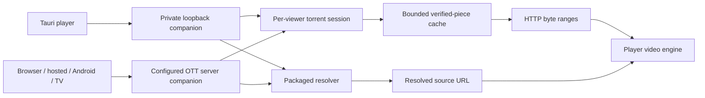

# Media companion

The native media service adds ordinary BitTorrent file playback and packaged
source resolvers. It uses the player's video engines and accepts sources from playlists.
Local videos still reads original files without importing them into this cache.

## Availability

- Tauri contains the service. It starts on demand on a private loopback port,
  using the instance's private data directory. Normal startup joins no swarm.
- The **Torrent** provider is available only when the app owns this native
  service, currently in Tauri. A configured external endpoint does not enable
  that provider.
- OTT server includes it but requires explicit operator configuration.
- Browser, hosted, Android and the current webOS/Tizen packages can play
  companion sources through an operator-configured reachable endpoint. Their
  web bundle does not contain a TCP/UDP torrent engine or expose the native
  Torrent provider.



HTTPS, browser local-network permissions and network reachability still apply.
The current webOS (LG) and Tizen packages do not install a local companion
service on the TV; those clients can use the service on a computer or NAS for
playlist sources. Local LG support requires a packaged webOS service and a
bridge that exposes its owned lifecycle to the player. That integration is not
implemented in the current package.

The local bundled-service design follows
[NuvioTVSmart at commit `3977b0c`](https://github.com/NuvioMedia/NuvioTVSmart/tree/3977b0cabfb4ca338dce5f3fcd9001b2f0e10e30/services/webos):
the app owns a packaged service and uses its local playback endpoint. OTTPlay
uses its own maintained Rust companion core rather than Nuvio's bundled media
runtime. This architecture is the reference for LG integration; packaging,
lifecycle and playback still need validation in OTTPlay's LG build.

The [standalone companion](../src-rs/companion/README.md) also builds as an ARM
executable for the webOS SDK. This executable is a separate building block;
the current LG application does not yet start it or provide its source picker.

The optional companion client requires the browser's Fetch API. The shared
player's ES5 runtime does not add it. Older TV browsers may therefore run the
ordinary player but cannot use companion source playback. Use a newer
browser or WebView where available. Browser API availability does not establish
codec support or compatibility with every TV model and firmware.

## Playback

Select the **Torrent** provider in the Tauri app. Its source and file
selection uses the app's own service. It never adopts the external companion
endpoint, even when one is configured. There is no companion endpoint editor in
the player settings UI.

Open **Torrent: Manage lists** in provider settings, choose **Add new list**, and enter
a magnet URI or public HTTP(S) torrent metadata URL and a source name. The player
reads and saves the playable file list. Each source appears as a category;
choose a file from its channel list to play it. References use stable zero-based
file indices. Metadata loading has a deadline and can be cancelled.

Source preparation shows **Connecting...** while the companion resolves the
source, with a 60-second limit per resolution attempt. Loading the optional
client beforehand has its own 15-second limit. The normal decoder startup
deadline begins only after a playback URL is ready. Pause/resume does not
extend source resolution or start the previous source while preparation is
pending. Cancelling or switching sources discards late results.

M3U entries can contain these source URIs too. This existing source-playback path
uses an explicitly configured external endpoint, or Tauri's built-in service
when the endpoint is empty. Other clients require the complete private endpoint
configured by the operator. Favorites for those catalogue entries retain the
playlist identity and original source, never temporary lease URLs. The Torrent
provider stores its catalogue sources and selected file references without
saving private endpoints or temporary lease URLs. Each playback
gets a fresh viewer lease. Seeking reads byte ranges from the selected file.
Raw and cloud settings backups include the `torrentcfg` catalogue. Importing
Favorites alone transfers references, so the receiving player also needs the
matching catalogue. Named presets and structured settings JSON do not provision
a Torrent catalogue; use the typed catalog API below or a full raw/cloud backup
for that transfer. Private companion endpoints remain installation settings throughout.
Codec support still depends on the video engine; receiving a file does not make
an unsupported codec playable. External AceStream engines remain separate.

Torrent file responses and resolver URLs with a recognized video-file extension
use file playback without changing the saved streaming-engine preference.
Other resolver URLs follow that preference. If a resolver returns a file URL
without an extension, choose Auto or HTML5; the client does not probe arbitrary
endpoints to guess their format.

For a catalogue entry, add the original source to your own M3U:

```m3u
#EXTM3U
#EXTINF:-1 group-title="My media",My video
magnet:?xt=urn:btih:REPLACE_WITH_THE_40_CHARACTER_INFO_HASH
```

Do not copy a running session's `/sessions/.../stream` address into a playlist.
That URL expires with its viewer. The original reference obtains a new session
on the next playback. A file choice is carried as a zero-based `so` index in a
magnet reference, or `index` in an `ottplay-torrent:` reference.

## Movie discovery and language

Movie categories, search and metadata details belong to the native **Torrent**
provider. As in the Nuvio/Stremio flow, metadata and playable sources come from
separate services: a metadata result alone is not a playable torrent. Selecting
sources for a film queries the operator's configured stream addons; choosing a
supported result then starts playback. No addon or film is guaranteed to have
available, compatible sources. The manually maintained source catalog and its
file playback remain separate and available when discovery services fail or
are offline.

On a supported native installation, choose **Torrent** in the provider settings.
An empty source catalog opens the movie list. With the default TMDB catalog,
**Category selection** offers **Popular**, **New releases** and **Genre**.
A generic Stremio addon instead supplies its catalog names from its manifest.
**My sources** and **Favorites** remain available; **My sources** returns to your
existing playable sources. Use the normal Search action when the catalog
supports search. Press **Enter/OK** on a film to open its source chooser, or
**INFO/EPG** to read its full information. The first page is displayed immediately;
subsequent pages load sequentially in the background while the movie list is
open. Existing rows and the current selection stay in place as results arrive.
The previous 500-movie display limit no longer applies. The adapter retains its
bounded request and pagination limits (up to offset 50,000 for generic Stremio
catalogs); the actual catalog may end sooner. Closing the list, choosing a movie,
changing categories or entering standby cancels pending loading. Temporary
overlays pause it until the list is visible again. An error pauses automatic
loading without removing existing results; **Next page** retries that page.
Empty, fully duplicated or non-advancing pages end loading. Merely opening a list,
highlighting a film or reading its description does not start a torrent
download. Choose **Catalog language** in the Torrent provider settings to
override the interface language for movie metadata.

`torrentCatalogLanguage` is a portable preference for the current provider. Its
default empty value follows the effective interface language. An explicit value
uses one of the existing language identifiers, such as `_rus` or `_fra`, and
applies to subsequent categories, searches and details. It does not change the
interface, audio tracks or subtitles. Metadata services may still return their
own fallback text when a translation is unavailable.

By default discovery uses the existing TMDB transport. The installation-only
`torrentCatalogEndpoint` can select a compatible Stremio metadata addon. The
player reads its manifest for movie catalogs, search support and metadata
resources; the supported Stremio TMDB catalog layout also remains available.
A public addon can be used for local validation without provisioning a private
TMDB key. Its production default is empty; no public service is selected
automatically. Operators can configure it through the existing authenticated
settings API, or install a validated manifest with **Add Stremio addon…** below:

```sh
ott TARGET setting torrentCatalogEndpoint --value-file /absolute/private/catalog-base-url.txt
```

The file must contain an addon **base URL**, not a `/manifest.json` URL.
Percent-encoded configuration segments are preserved. External addons require HTTPS. HTTP is accepted only
for the exact loopback hosts `localhost`, `127.0.0.1` and `[::1]`, with an optional
port. Other `127.*` addresses, alternative numeric forms, `*.localhost` and names
that merely resolve to loopback are not accepted. User information, query
strings and fragments are rejected. Paths can contain private configuration,
so reads are masked and both
`torrentCatalogEndpoint` and `sTorrentCatalogEndpoint` are excluded from JSON,
raw and cloud backups. Restoring a backup preserves this installation's current
endpoint. A configured public service receives metadata requests and search
terms; setting it does not enable Torrent on unsupported web-only clients.
Operating a private TMDB-backed service with an operator's own API key remains
a future deployment option; this setting neither stores nor provisions a TMDB
API key.

Stream discovery requires the separate installation-only `torrentStreamAddons`
setting. Its default is the JSON string `[]`, so no stream addon is contacted
until an operator configures one through the authenticated CLI:

```sh
ott TARGET setting torrentStreamAddons --value-file /absolute/private/stream-addons.json
```

The file contains a JSON array of up to eight **manifest URLs**, for
example `["https://addon.example/private-config/manifest.json"]`. The limit is
4,096 UTF-8 bytes for the complete compact JSON string, including quotes and
commas. Whitespace around URLs, final slashes and exact duplicate URLs are
normalized while preserving order and configuration paths, including
percent-encoded JSON configuration.
The `/manifest.json` suffix is required; credentials in the URL authority,
query strings and fragments are rejected. External URLs require HTTPS; HTTP
uses the same exact loopback exception as the catalog endpoint. There is no
default public stream service.

In **Torrent → Manage lists**, choose **Add Stremio addon…** and enter the addon
manifest URL in the standard editor. Copied `stremio://` installation links are
converted to HTTPS before validation; encoded configuration paths are retained.
The player requests only the JSON manifest. A movie stream resource adds the
manifest to this installation's stream addons, while a usable movie catalog
activates that addon's catalog base. An addon with both capabilities saves both
settings atomically; a stream-only addon keeps the current movie catalog.
The manually maintained magnet/torrent catalog is unchanged. **Add new list**
continues to accept magnet links and torrent file URLs separately.

The settings screen reports completion or a bounded error without displaying
the private URL. Back cancels a pending request; late replies and conflicting
settings changes cannot complete an abandoned installation. Adding an addon
does not start a torrent engine or playback.

Manifest paths can contain private credentials, so remote reads are masked.
Both `torrentStreamAddons` and its storage alias `sTorrentStreamAddons` are
excluded from JSON, raw and cloud backup exports and imports; restoring a
backup preserves this installation's current addon configuration. Saving a
change cancels stale source discovery and updates an already visible source
chooser without opening a hidden screen or starting playback. Addons receive
the selected film identifier when sources are requested. This setting does
not enable Torrent on unsupported web-only clients or supply a TMDB API key.

### Reproducible open-movie qualification

[`examples/stremio-open-movie.cjs`](examples/stremio-open-movie.cjs) is a separate
Node.js example serving one real film: **Big Buck Bunny** (Blender Foundation,
2008). It implements Stremio manifest, catalog/search, metadata and stream JSON
routes. The film is licensed under [CC BY 3.0](https://peach.blender.org/about/).
Video and artwork remain on Blender's servers; the example never downloads,
caches or proxies them. It is not started or configured by the player build.

Run the addon locally; its default HTTP loopback endpoint is accepted by the
player without a certificate:

```sh
node docs/examples/stremio-open-movie.cjs
curl --fail http://127.0.0.1:8794/manifest.json
curl --fail 'http://127.0.0.1:8794/catalog/movie/open-movies/search=Big%20Buck%20Bunny.json'
```

To use HTTPS instead, supply an existing certificate and matching key whose
hostname/IP is valid and whose issuer the player already trusts:

```sh
node docs/examples/stremio-open-movie.cjs --host 127.0.0.1 --port 8794 \
  --cert /absolute/private/localhost.crt --key /absolute/private/localhost.key
```

The equivalent environment variables are `OTT_OPEN_MOVIE_HOST`,
`OTT_OPEN_MOVIE_PORT`, `OTT_OPEN_MOVIE_TLS_CERT` and `OTT_OPEN_MOVIE_TLS_KEY`.
The default bind is `127.0.0.1:8794`; using another address requires an explicit
operator choice. TLS validation remains enabled. `--media-url HTTPS_URL` or
`OTT_OPEN_MOVIE_MEDIA_URL` can select another authorized Big Buck Bunny mirror.

For the default local server, put `http://127.0.0.1:8794` in a private catalog
value file and the compact JSON `["http://127.0.0.1:8794/manifest.json"]` in a
private addon value file. Use `https://` for both if running the TLS variant.
Apply them with the two `ott TARGET setting ... --value-file ...` commands above.
Open Torrent, find Big Buck Bunny, choose its source and start playback. The
example exercises real metadata/source selection and direct HTTPS playback;
it does not exercise torrent transfer. Press Ctrl+C to stop the example and
restore the installation's previous settings when qualification is complete.

The default media URL is returned by Blender's
[official video API](https://video.blender.org/api/v1/videos/bf1f3fb5-b119-4f9f-9930-8e20e892b898).
On 2026-10-31 UTC, HEAD returned `200`, `video/mp4`, 110,916,740 bytes;
`Range: bytes=0-1023` returned `206` and exactly 1,024 bytes with an MP4 header.
This validates the remote origin at that time, not playback on every device.

The default TMDB catalog's metadata and images are supplied by
[TMDB](https://www.themoviedb.org).
The built-in credits include its official logo and attribution notice.
The logo is retained unchanged from the [official asset](https://www.themoviedb.org/assets/v4/logos/v2/blue_short-8e7b30f73a4020692ccca9c88bafe5dcb6f8a62a4c6bc55cd9ba82bb2cd95f6c.svg).

## Remote catalog control

Authenticated remote control exposes `torrent_catalog: {version: 1}` only when
the player supports its own native service. An external companion endpoint does
not grant this capability. Requests use action `torrent_catalog`, the current
`runtime`, and one of `read`, `read_chunk`, `metadata`, `status`, `cancel`,
`write_begin`, `write_chunk`, `write_commit`, or `play`. Each operation has its own
controller permission, `torrent_catalog.OP`; existing player restrictions still
apply. The API does not enable remote access or change its authorization.

Reads return immutable catalog snapshots without selecting a provider or starting
network activity. `metadata` prepares a playable file list without saving or
playing it. File indices are the native zero-based indices, not positions in a
displayed list. Catalogs preserve stable catalog and entry IDs and original
source references; they contain no private endpoints or temporary stream URLs.

Writes upload strict UTF-8 JSON in canonical base64 chunks of at most 6,144 decoded
bytes, with an 8 MiB document limit and SHA-256 verification. `write_commit` checks
the original catalog revision again and confirms the persisted result. `replace`
adopts the incoming catalog; `merge` requires matching catalog IDs, preserves
existing order and name, and rejects conflicting entries as a whole. Importing
never selects a provider or starts playback. The updated list appears on the next
explicit provider load or play.

Use a UUID for each mutation and retain it if a response is lost. Identical
requests reuse their retained receipt; `status` recovers the result and `cancel`
cancels pending work. Records and snapshots expire after 600 seconds of inactivity;
valid status or chunk access extends the corresponding lifetime. Metadata has a
75-second total deadline. After expiry or reload, an unknown result must not be
automatically retried as a new mutation. `play` uses the normal guarded playback
path; acceptance confirms dispatch, not decoder startup. Cancelling an accepted
play does not stop it.

Catalog and optional portable Favorites imports are separate commits. A client
must validate both before writing and report partial success if Favorites fails.
Unresolved Favorites keep their original references rather than being remapped.

## Server configuration

Create a private directory and configure `OTT_COMPANION_DIR` with its absolute
path. Set `OTT_COMPANION_TOKEN` to a freshly generated random token of at least
32 URL-safe characters. Both are required; the service is otherwise disabled.

The companion has a separate listener; it does not share the control/web server
port. Its default address is `127.0.0.1:8793`, giving the endpoint
`http://127.0.0.1:8793/companion/<your-token>/v1`.
Set `OTT_COMPANION_HOST` and `OTT_COMPANION_PORT` to change that listener.

When upgrading from the shared-listener implementation, change each configured
client endpoint to this separate address. The old companion URL on the player
port returns 404. A previous `OTT_COMPANION_ALLOW_REMOTE=1` does not move the
new listener out of loopback; intentional LAN deployments must also set their
explicit companion host.

The installation-scoped `companionEndpoint` setting accepts this complete
address through the existing authenticated remote settings API. Use a private
UTF-8 file containing the endpoint with the existing CLI:

```sh
ott TARGET setting companionEndpoint --value-file /absolute/private/companion-endpoint.txt
```

Existing remote-control authorization, kiosk and PIN restrictions apply. Reads
only report whether the setting is configured; they do not reveal the address
or token. Changes apply to subsequent source playback. An empty value restores
Tauri's built-in service for playlist sources; the Torrent provider always uses
its own native service. Keep the token out of public playlists, screenshots and
issues. Native discovery does not publish it to other machines.

This endpoint belongs to the installation, not to a provider profile. JSON,
local/raw and cloud backups omit both `companionEndpoint` and its storage key
`sCompanionEndpoint`. Restoring old backups that contain either key leaves the
current installation setting unchanged. Existing locally saved endpoint values
are preserved; importing a profile or backup cannot configure an external service.

Remote clients additionally require `OTT_COMPANION_ALLOW_REMOTE=1`, an explicit
non-loopback `OTT_COMPANION_HOST`, a reachable endpoint and TLS when needed by
the browser. `OTT_COMPANION_ALLOW_REMOTE` does not change the default bind address.
Keep it within the intended trusted network or an authenticated access boundary.
The service does not modify firewall/router rules. Dedicated relay modes cannot
also host it.

## Ownership and storage

Each viewer owns a lease. Stopping one never invokes another viewer's global
stop. Source changes, standby and page exit cancel pending work and playback.
Tauri closes its native service on standby or reload, then obtains a fresh
endpoint when needed. Inactive leases expire if a client disappears.

Only selected-file verified pieces enter the private cache. A boundary piece
may contain neighbouring-file bytes needed for hash verification. The service
does not create the torrent's directory tree in the media library. Cache space,
viewers, peers, metadata and idle lifetime are bounded. `GET /capabilities`
reports the installed limits. A successful handshake proves service availability,
not the presence of peers or successful video decoding.

The cache has exclusive process ownership. After a crash, a new owner validates
the private marker and directory before reclaiming recognized lease files. It
refuses unknown entries instead of deleting user files. This is a temporary
playback cache, not an offline download library: stopped sessions remove their
piece files. The initial implementation allows two viewers and 2 GiB of reserved
piece windows in total. A selected file whose window exceeds the remaining
limit returns `cache_limit`; it does not silently exceed the disk budget.
Ordinary BitTorrent
peer and tracker traffic is distinct from the restricted HTTP metadata and
plugin fetch paths; enabling torrent playback permits that P2P traffic.

## Packaged resolvers

The service ships a direct-URL resolver and loads operator-installed JavaScript
packages at startup. Each execution has an isolated QuickJS context and memory,
stack, time, input and output limits. Scripts cannot import native modules or
read player settings, tokens or filesystem paths. A strict manifest binds each
script to its SHA-256 digest. HTTP callers cannot upload executable code.

See [resolver packages](../plugins/examples/README.md) for the schema, examples
and exact network permissions. Tauri uses `media-companion/plugins` in its
instance data directory. The server accepts an absolute `OTT_COMPANION_PLUGIN_DIR`.
Invalid configured packages reject startup. Restart after changing packages.

## Protocol

All routes are relative to the private endpoint:

- `GET /capabilities`: protocol and actual capabilities.
- `POST /sessions`: admit a source and return a viewer lease.
- `GET /sessions/{id}`: metadata progress, file list and state.
- `POST /sessions/{id}/select`: select a file by index.
- `GET` or `HEAD /sessions/{id}/stream`: selected file with byte ranges.
- `DELETE /sessions/{id}`: release that viewer's resources.
- `GET /plugins`: installed resolvers and capabilities.
- `POST /plugins/{id}/resolve`: bounded JSON request and stream results.

Errors return categories, not source URLs, tokens or local paths. Clients check
the protocol instead of inferring support from the operating system.

The torrent implementation uses [librqbit](https://github.com/ikatson/rqbit)
(Apache-2.0); resolvers use the existing QuickJS integration. Their licenses and
notices remain with the distribution. The adapter and ownership policy are
maintained in this repository.
