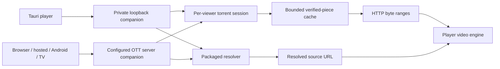

# Media companion

The native media service adds ordinary BitTorrent file playback and packaged
source resolvers. It uses the player's video engines and accepts sources from playlists.
Local videos still reads original files without importing them into this cache.

## Availability

- Tauri contains the service. It starts on demand on a private loopback port,
  using the instance's private data directory. Normal startup joins no swarm.
- OTT server includes it but requires explicit operator configuration.
- Browser, hosted, Android and television web clients use a configured reachable
  endpoint. Their web bundle does not contain a TCP/UDP torrent engine.



HTTPS, browser local-network permissions and network reachability still apply.
The webOS and Tizen packages do not install a native torrent service on the TV;
those clients can use the service on a computer or NAS.

The optional companion client requires the browser's Fetch API. The shared
player's ES5 runtime does not add it. Older TV browsers may therefore run the
ordinary player but cannot use this feature; the companion screen explains
that limitation without starting a service or sending a request. Use a newer
browser or WebView where available. Browser API availability does not establish
codec support or compatibility with every TV model and firmware.

## Playback

Open **Settings → Media companion**. Tauri uses the built-in service when the
endpoint is empty. An explicit endpoint overrides this choice. Other clients
require the complete private endpoint supplied by the operator.

Enter a magnet URI or public HTTP(S) torrent metadata URL. The player obtains
the file list and starts a supported video file. Use the companion file list to
choose another. References use stable zero-based file indices. Metadata loading
has a deadline and can be cancelled.

Source preparation shows **Connecting...** while the companion resolves the
source, with a 60-second limit per resolution attempt. Loading the optional
client beforehand has its own 15-second limit. The normal decoder startup
deadline begins only after a playback URL is ready. Pause/resume does not
extend source resolution or start the previous source while preparation is
pending. Cancelling or switching sources discards late results.

M3U entries can contain these source URIs too. Favorites for those catalogue
entries retain the playlist identity and original source, never temporary lease
URLs. The manual source editor opens a temporary item; it does not create a new
provider catalogue or a Favorites entry. Each playback
gets a fresh viewer lease. Seeking reads byte ranges from the selected file.
Codec support still depends on the video engine; receiving a file does not make
an unsupported codec playable. External AceStream engines remain separate.

Torrent file responses and resolver URLs with a recognized video-file extension
use file playback without changing the saved streaming-engine preference.
Other resolver URLs follow that preference. If a resolver returns a file URL
without an extension, choose Auto or HTML5; the client does not probe arbitrary
endpoints to guess their format.

For a catalogue entry, add the original source to your own M3U:

```m3u
#EXTM3U
#EXTINF:-1 group-title="My media",My video
magnet:?xt=urn:btih:REPLACE_WITH_THE_40_CHARACTER_INFO_HASH
```

Do not copy a running session's `/sessions/.../stream` address into a playlist.
That URL expires with its viewer. The original reference obtains a new session
on the next playback. A file choice is carried as a zero-based `so` index in a
magnet reference, or `index` in an `ottplay-torrent:` reference.

## Server configuration

Create a private directory and configure `OTT_COMPANION_DIR` with its absolute
path. Set `OTT_COMPANION_TOKEN` to a freshly generated random token of at least
32 URL-safe characters. Both are required; the service is otherwise disabled.

For a server listening on loopback port 8443, the endpoint is
`http://127.0.0.1:8443/companion/<your-token>/v1`.

The app-scoped `companionEndpoint` setting accepts this complete address and is
treated as sensitive. Keep the token out of public playlists, screenshots and
issues. Native discovery does not publish it to other machines.

Remote clients additionally require `OTT_COMPANION_ALLOW_REMOTE=1`, an explicit
listening address, a reachable endpoint and TLS when needed by the browser.
Keep it within the intended trusted network or an authenticated access boundary.
The service does not modify firewall/router rules. Dedicated relay modes cannot
also host it.

## Ownership and storage

Each viewer owns a lease. Stopping one never invokes another viewer's global
stop. Source changes, standby and page exit cancel pending work and playback.
Tauri closes its native service on standby or reload, then obtains a fresh
endpoint when needed. Inactive leases expire if a client disappears.

Only selected-file verified pieces enter the private cache. A boundary piece
may contain neighbouring-file bytes needed for hash verification. The service
does not create the torrent's directory tree in the media library. Cache space,
viewers, peers, metadata and idle lifetime are bounded. `GET /capabilities`
reports the installed limits. A successful handshake proves service availability,
not the presence of peers or successful video decoding.

The cache has exclusive process ownership. After a crash, a new owner validates
the private marker and directory before reclaiming recognized lease files. It
refuses unknown entries instead of deleting user files. This is a temporary
playback cache, not an offline download library: stopped sessions remove their
piece files. The initial implementation allows two viewers and 2 GiB of reserved
piece windows in total. A selected file whose window exceeds the remaining
limit returns `cache_limit`; it does not silently exceed the disk budget.
Ordinary BitTorrent
peer and tracker traffic is distinct from the restricted HTTP metadata and
plugin fetch paths; enabling torrent playback permits that P2P traffic.

## Packaged resolvers

The service ships a direct-URL resolver and loads operator-installed JavaScript
packages at startup. Each execution has an isolated QuickJS context and memory,
stack, time, input and output limits. Scripts cannot import native modules or
read player settings, tokens or filesystem paths. A strict manifest binds each
script to its SHA-256 digest. HTTP callers cannot upload executable code.

See [resolver packages](../plugins/examples/README.md) for the schema, examples
and exact network permissions. Tauri uses `media-companion/plugins` in its
instance data directory. The server accepts an absolute `OTT_COMPANION_PLUGIN_DIR`.
Invalid configured packages reject startup. Restart after changing packages.

## Protocol

All routes are relative to the private endpoint:

- `GET /capabilities`: protocol and actual capabilities.
- `POST /sessions`: admit a source and return a viewer lease.
- `GET /sessions/{id}`: metadata progress, file list and state.
- `POST /sessions/{id}/select`: select a file by index.
- `GET` or `HEAD /sessions/{id}/stream`: selected file with byte ranges.
- `DELETE /sessions/{id}`: release that viewer's resources.
- `GET /plugins`: installed resolvers and capabilities.
- `POST /plugins/{id}/resolve`: bounded JSON request and stream results.

Errors return categories, not source URLs, tokens or local paths. Clients check
the protocol instead of inferring support from the operating system.

The torrent implementation uses [librqbit](https://github.com/ikatson/rqbit)
(Apache-2.0); resolvers use the existing QuickJS integration. Their licenses and
notices remain with the distribution. The adapter and ownership policy are
maintained in this repository.
