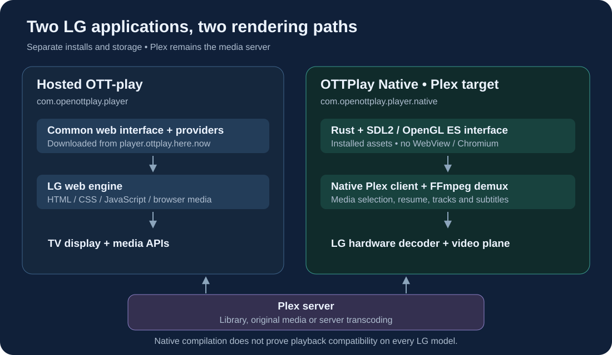

# Native Plex application for LG webOS

**OTTPlay Native** is an experimental, separately installed Plex application
for LG televisions. It renders through SDL2/OpenGL ES and uses the TV's native
decoder, without loading the LG browser or a WebView. The ordinary OTT-play
webOS package continues to provide the full multi-provider web interface.



The [Plex source comparison](plex-native-comparison.md) describes what was
adopted and which capabilities remain separate from the shared player.

The native target uses the pinned PlxNative runtime, preserving its GPU UI,
Plex library and media pipeline. It is packaged as
`com.openottplay.player.native`; the hosted player remains
`com.openottplay.player`. They can be installed independently. Their settings
and update streams are separate.

The current native scope is Plex. It does not claim parity with the main
player's M3U, VPortal, Local media, Favorites or remote-control protocols.
Do not expect an `ott` CLI command addressed to the hosted player to control
this separate application. Codec support and hardware decoding must be
checked on the intended TV model and firmware.

The first ARM candidate was checked against pinned symbol inventories from
14 LG firmware images. Its main executable resolves on the 11 sampled
versions from webOS 3.4.0 through 11.2.0; the sampled webOS 1.x and 2.x images
lack required functions and are unsupported. The six bundled helper/library
ELFs resolve on all 14 inventories. This is a loader-symbol check, not a
decoder, permissions or playback test on every TV in that version range.

The native SDL/OpenGL desktop build also rendered sign-in, library and
settings screens against a synthetic Plex server. Physical LG playback has
not yet been verified for this candidate.

Builds use the webOS ARM SDK directly on macOS or ARM Linux. The build creates
a native ARM ELF executable, its storage service, a complete IPK and a matching
source set. It performs no TV installation, global cache cleanup or
platform privilege changes. A separate CI workflow builds the actual ARM IPK
and matching source set for pull requests that change this native target;
it can also be started manually. A newer run cancels the previous run for the
same pull request. These candidate artifacts do not replace ordinary
web-player releases.

See the [build, installation, source and Homebrew instructions](../native/webos/README.md)
for exact commands. Both Developer Mode installation and an existing Homebrew
Channel use the same package. Developer Mode's session lifetime still applies.

The native runtime and adaptation are **GPL-3.0-or-later**. Each published
binary must retain the license and dependency notices and be accompanied by
its matching source set. This does not change the MIT license of the
separate main web player. See [third-party notices](../THIRD-PARTY-NOTICES.md).

## The matching source set

Native distributions contain two source archives. The primary archive carries
the application, Cargo/Rust sources and bundled native dependencies. A second
runtime archive adds the exact GCC and glibc sources, GPL Buildroot recipes
and patches, license texts, and linker evidence for every shipped ELF. The
`*-source-set.json` file binds both archives to the IPK. Distribute all three
together; the primary archive alone does not close the compiler/runtime
source inventory.

After the primary `all` build, run the separate collector with the same SDK:

```sh
python3 scripts/webos-runtime-sources.py \
  --metadata build/native-webos/dist/ottplay-native-webos-0.1.0.json \
  --source build/native-webos/source \
  --sdk build/native-webos/toolchain/arm-webos-linux-gnueabi_sdk-buildroot
```

The collector checks ELF, link-map and trace hashes before classifying runtime
inputs; an unknown SDK archive or dynamic dependency fails the check. Each
linked GCC/glibc archive and startup object must also match the original
pinned SDK download; keep the bootstrap download or pass `--sdk-archive`.
Source downloads are verified against pinned digests. The supplementary manifest
records the firmware System Library classification separately from bundled
code. It does not copy LG firmware or reinterpret missing firmware licensing
as permission to distribute it.

The pinned macOS SDK port has no identified repository license; its archive
is referenced rather than redistributed. Independently documented build facts
and the underlying licensed Buildroot recipes are provided instead. Existing
upstream collector reports are retained with their original narrow scope;
the supplement supplies the runtime evidence those reports explicitly lacked.
No report claims that an independent bit-identical rebuild has been performed.
