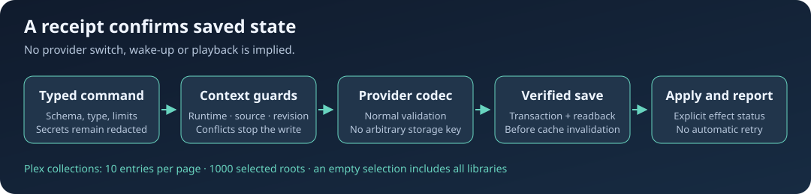

# Individual provider settings and Plex folders

Provider settings appear in `ott TARGET settings` when that provider is active. They use `player_settings` version 1 and its runtime, context and saved-value revision guards. A command never silently switches provider. Application preferences remain accessible when the provider catalogue is unavailable.

```sh
ott t1 provider m3u
ott t1 setting providerName "Home"
ott t1 setting m3uHistoryHours 48
ott t1 setting providerPlaylist --value-file /absolute/private/playlist-url.txt
ott t1 setting m3uMediaUrl --value-file /absolute/private/media-url.txt
ott t1 provider plex
ott t1 setting plexPlayback original
ott t1 setting plexPlayback compatible
ott t1 setting plexPlayback auto
```

Addresses, credentials and private playlist links are redacted in reads and acknowledgements. A value file contains only the UTF-8 value, optionally followed by one newline.



## Available fields

| Provider | Setting IDs | Values |
| --- | --- | --- |
| M3U | `providerName`, `providerPlaylist`, `m3uHistoryHours`, `m3uMediaUrl` | Name, URLs, archive hours 0–8760 |
| Plex | `providerServer`, `providerPassword`, `plexPlayback` | Server URL, Plex token, `auto` / `original` / `compatible` |
| Stalker | `providerName`, `providerServer`, `stalkerMac` | Current slot name, portal URL, colon-separated MAC |
| VPortal | `providerName`, `vportalLink` | Current slot name and link |
| Edem / iLook | `edemKey`, `edemCdn`, `edemPortal`, `edemList` | Access key, full CDN host, VPortal link, list template 0–3 |
| Xtream | `providerServer`, `providerUsername`, `providerPassword` | Connection credentials |
| Generic operator providers | `providerServer`, `providerUsername`, `providerPassword`, `providerPlaylist` | API credentials and fallback playlist |
| 1OTT / shara-tv | `providerUsername`, `providerPassword` | ID/PIN or username/password |
| Only4 | `providerUsername`, `providerMode` | IPTV token and stream mode 0–2 |
| tv.team | `providerPlaylist` | Playlist URL |
| 1Cent / Shura | `providerUsername`, `providerMode`; Shura also `providerServer` | Access key, stream mode, Shura server |
| OTTCLUB | `providerUsername`, `providerServer` | Access key and host, optionally with a port |
| Antifriz | `providerUsername`, `providerMode` | Eight-character key; mode 0–1 |
| KBC | `providerPlaylist` | Saved slot string `0`, `1` or `2` |

The target's schema is authoritative. Demo and local-file providers do not have account credentials. Derived identifiers and device-generated MAC values are not account settings. Provider changes usually require a catalogue reload; stream modes apply to a subsequent stream. Saving does not start playback, leave standby or prove that the server accepted credentials. Initial Plex setup requires a valid server/token pair through the existing provider-configuration flow.

The normal driver codec performs each save, verifies storage, then invalidates affected caches. Remote saves invalidate already-open local settings drafts after successful persistence. A rejected write does not cancel an existing catalogue request.

## Plex folder collection

`plexFolderPaths` is a collection, not a scalar string array. The separate `plex_folders` capability supports all 1000 saved selections without enlarging general settings payloads. Reads use pages of at most ten entries under one revision.

```sh
ott t1 setting plexFolderPaths
ott t1 setting plexFolderPaths list
ott t1 setting plexFolderPaths add /library/sections/16/all "Children's films"
ott t1 setting plexFolderPaths add /library/metadata/78777/children "A series"
ott t1 setting plexFolderPaths remove /library/sections/16/all
ott t1 setting plexFolderPaths clear
```

Paths must be canonical Plex library/folder roots, not arbitrary URLs. Titles are limited to 1024 UTF-16 code units and 4096 UTF-8 bytes. Adding an existing path preserves its title and reports unchanged. Removing a missing path is also unchanged. At 1000 items, a new addition fails before writing; removal and clear remain available.

**An empty selection means all libraries.** `clear` removes the selection filter; it does not produce an empty catalogue or stop playback. The saved roots apply to the next catalogue build, reported as `deferred / next_catalogue`. Editing the collection performs no network request, wake or playback.

Snapshots expire after two minutes. The CLI rejects incomplete, repeated or changed pagination rather than displaying a partial selection as complete. It does not automatically replay a lost write; reread the selection first.

## Troubleshooting

- Missing field: verify the active provider and update player, controller and CLI together.
- Revision conflict: reread the field or reopen the local editor. Do not reuse a receipt after another save.
- Storage failure: inspect the saved value before retrying. A source change is rejected, and newer source state is not overwritten to manufacture success.
- Saved with `effect_failed`: the bytes persisted, but invalidation failed. Diagnose the player and reload it if needed rather than repeatedly rewriting credentials.
- Folder capacity: remove an unneeded selection or select a broader canonical library root.
- Missing optional asset: deploy matching `remote-settings.js`, `remote-provider-fields.js` and provider bundles. Native/offline packages require the same assets.

See [typed player settings](remote-player-settings.md) for authorization and the VPortal off-active-slot configuration flow.
