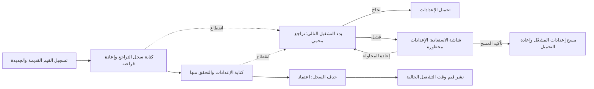

# إعدادات متعددة المفاتيح قابلة للاستعادة

<!-- language-navigation:start -->

<a href="settings-recovery.md" lang="en" dir="ltr">English</a> · <a href="settings-recovery.ar.md" lang="ar" dir="rtl">العربية</a> · <a href="settings-recovery.bn.md" lang="bn" dir="ltr">বাংলা</a> · <a href="settings-recovery.cs.md" lang="cs" dir="ltr">Čeština</a> · <a href="settings-recovery.de.md" lang="de" dir="ltr">Deutsch</a> · <a href="settings-recovery.es.md" lang="es" dir="ltr">Español</a> · <a href="settings-recovery.fa.md" lang="fa" dir="rtl">فارسی</a> · <a href="settings-recovery.fr.md" lang="fr" dir="ltr">Français</a>
 
<a href="settings-recovery.he.md" lang="he" dir="rtl">עברית</a> · <a href="settings-recovery.hi.md" lang="hi" dir="ltr">हिन्दी</a> · <a href="settings-recovery.id.md" lang="id" dir="ltr">Bahasa Indonesia</a> · <a href="settings-recovery.it.md" lang="it" dir="ltr">Italiano</a> · <a href="settings-recovery.ja.md" lang="ja" dir="ltr">日本語</a> · <a href="settings-recovery.ko.md" lang="ko" dir="ltr">한국어</a> · <a href="settings-recovery.nl.md" lang="nl" dir="ltr">Nederlands</a> · <a href="settings-recovery.pl.md" lang="pl" dir="ltr">Polski</a>
 
<a href="settings-recovery.pt.md" lang="pt" dir="ltr">Português</a> · <a href="settings-recovery.ru.md" lang="ru" dir="ltr">Русский</a> · <a href="settings-recovery.th.md" lang="th" dir="ltr">ไทย</a> · <a href="settings-recovery.tr.md" lang="tr" dir="ltr">Türkçe</a> · <a href="settings-recovery.uk.md" lang="uk" dir="ltr">Українська</a> · <a href="settings-recovery.vi.md" lang="vi" dir="ltr">Tiếng Việt</a> · <a href="settings-recovery.zh-Hans.md" lang="zh-Hans" dir="ltr">简体中文</a> · <a href="settings-recovery.zh-Hant.md" lang="zh-Hant" dir="ltr">繁體中文</a>

<!-- language-navigation:end -->

[التحسينات](roadmap-delivery.ar.md)

تستخدم دفعات localStorage المدعومة `ottplaySettingsJournalV1`، وهو سجل تراجع داخلي لا يدخل في التصدير أو البيانات المرسلة إلى السحابة أو التعداد المعتاد للإعدادات. قبل تعديل الإعدادات، تسجّل جهة الكتابة السلسلة القديمة/الجديدة لكل مفتاح (أو null)، ثم تعيد قراءة السجل وتكتب الدفعة وتتحقق منها، وبعد ذلك تحذف السجل باعتبار الحذف نقطة اعتماد العملية. لا تُنشر تغييرات وقت التشغيل إلا ما دام مالك الإعدادات المسجّل هو المالك الحالي. الاستيراد لا يمسح المفاتيح غير المرتبطة بالعملية.

يحتفظ ترحيل PIN الرقابة الأبوية بالقيمة الأصلية الدقيقة في الذاكرة لفحص التعارضات، لكنه لا يكتب كقيمة للتراجع إلا بديلها المحمي. يجب ألا يعيد استيراد فاشل أو استرداد متقطع رمز PIN قديمًا قابلًا للقراءة. يبقى تنسيق السجل بالإصدار 1. راجع [ترحيل PIN والقيود](parental-pin-storage.md) قبل تحديث إعدادات أقدم أو استعادتها.

تُجري عملية بدء التشغيل الاستعادة قبل تحميل الإعدادات. ولا تعيد قيمة قديمة إلا ما دامت القيمة المخزّنة تساوي القيمة الجديدة لهذه الدفعة، وبذلك تحافظ على أي تعديل لاحق من جهة أخرى. تتحقق من السجل والملكية طوال الاستعادة. يفتح السجل الفاشل أو التالف شاشة استعادة قبل بدء المشغّل. لا تُحمَّل إعدادات حساب جزئية أو قيم احتياطية قديمة من ملفات الارتباط، وتظل الكتابة المعتادة للإعدادات محظورة. يعيد **Retry** الاستعادة المحمية ولا يعيد التحميل إلا بعد نجاحها. يتطلب **Clear settings** تأكيدًا صريحًا ثانيًا؛ أما Cancel/Back فيترك البيانات دون تغيير. يُمسح localStorage للأصل وملفات ارتباط المشغّل المسجّلة عند مساراتها الجذرية. ولا تُمس ملفات الارتباط الأخرى. تمنع علامة إعادة تعيين دائمة وقائمة سماح احتياطية فارغة ملفات الارتباط القديمة غير المسجّلة من إحياء الإعدادات، حتى عند تعذر localStorage؛ وتُضاف الكتابات الاحتياطية الجديدة إلى قائمة السماح. لا يُرفع حاجز السجل إلا بعد التحقق من سياسة إعادة التعيين والحذف. عند الفشل تبقى شاشة الاستعادة والحاجز. تعمل مفاتيح Tab/الأسهم/Enter ومفاتيح جهاز التحكم عن بُعد قبل التهيئة المعتادة للواجهة. لا تُعاد تهيئة أي شيء تلقائيًا، ولا تعرض الشاشة محتويات السجل أبدًا. عند الحاجة، احتفظ بنسخة خاصة من التخزين الأصلي للتشخيص قبل اختيار Clear settings. حدود السجل: 16 000 مدخل و2 MiB من النص المتسلسل.

**نطاق الضمان:** جهة كتابة واحدة ومخزن localStorage أصلي مدعوم واحد. لا توفر المتصفحات عملية compare-and-swap ذرية بين علامات التبويب. لا تشغّل عمليات استيراد متزامنة في نوافذ متعددة؛ فهذه ليست معاملة متعددة التبويبات أو قاعدة بيانات. متانة البيانات عند انقطاع الطاقة محدودة بتخزين المتصفح/نظام التشغيل نفسه. تحتفظ مهايئات ملفات الارتباط/الجلسة/الأجهزة المخصصة بالتراجع المحمي بأفضل جهد؛ ولا تحصل على سجل دائم. لا توجد معاملة موزّعة مع وحدة التحكم البعيدة أو مشغّل آخر.

يحتوي السجل مؤقتًا على قيم الإعدادات القديمة/الجديدة، وربما بيانات اعتماد المزوّد، في تخزين الأصل نفسه الذي يحتفظ بها أصلًا. ليس هذا قياسًا عن بُعد، ويجب ألا يُنسخ إلى تقارير أخطاء عامة. يؤدي تجاوز الحصة أثناء إعداد السجل إلى التوقف قبل الكتابة. لا تحذف سجلًا معلّقًا لمجرد إخفاء استيراد فاشل؛ فهذا يتلف معلومات الاستعادة الخاصة به.

شغّل `node tests/test_settings_journal.cjs` و`node tests/test_settings_store.cjs` و`node tests/test_local_settings_backup.cjs` و`node tests/test_cloud_settings_session.cjs`. تعيد الاختبارات التشغيل من لقطات لكتابات متقطعة، وتقطع الاستعادة نفسها، وتحافظ على قيم الجهات الأخرى، وتختبر إخفاقات الحصة/التلف/إعادة الدخول. وتشمل أيضًا قراءات وكتابات معزولة، وحماية بدء التشغيل المبكر الفعلية، وإعادة المحاولة بعد فشل مؤقت في التخزين، والتأكيد الصريح لإعادة التعيين، وإدخال لوحة المفاتيح/جهاز التحكم، وعمليات إعادة تعيين متقطعة، ورفض حذف ملفات الارتباط، وملفات ارتباط جهات أخرى المقيّدة بمسار، والبدائل الأصلية/القائمة على ملفات الارتباط بعد إعادة التعيين. يتبع محمّل لغة HTML المبكر قائمة السماح نفسها لإعادة التعيين.

