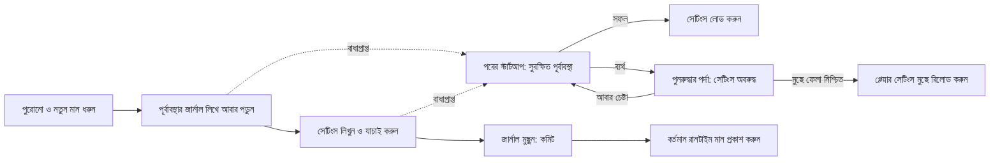

# একাধিক কী-এর পুনরুদ্ধারযোগ্য সেটিংস

<!-- language-navigation:start -->

<a href="settings-recovery.md" lang="en" dir="ltr">English</a> · <a href="settings-recovery.ar.md" lang="ar" dir="rtl">العربية</a> · <a href="settings-recovery.bn.md" lang="bn" dir="ltr">বাংলা</a> · <a href="settings-recovery.cs.md" lang="cs" dir="ltr">Čeština</a> · <a href="settings-recovery.de.md" lang="de" dir="ltr">Deutsch</a> · <a href="settings-recovery.es.md" lang="es" dir="ltr">Español</a> · <a href="settings-recovery.fa.md" lang="fa" dir="rtl">فارسی</a> · <a href="settings-recovery.fr.md" lang="fr" dir="ltr">Français</a>
 
<a href="settings-recovery.he.md" lang="he" dir="rtl">עברית</a> · <a href="settings-recovery.hi.md" lang="hi" dir="ltr">हिन्दी</a> · <a href="settings-recovery.id.md" lang="id" dir="ltr">Bahasa Indonesia</a> · <a href="settings-recovery.it.md" lang="it" dir="ltr">Italiano</a> · <a href="settings-recovery.ja.md" lang="ja" dir="ltr">日本語</a> · <a href="settings-recovery.ko.md" lang="ko" dir="ltr">한국어</a> · <a href="settings-recovery.nl.md" lang="nl" dir="ltr">Nederlands</a> · <a href="settings-recovery.pl.md" lang="pl" dir="ltr">Polski</a>
 
<a href="settings-recovery.pt.md" lang="pt" dir="ltr">Português</a> · <a href="settings-recovery.ru.md" lang="ru" dir="ltr">Русский</a> · <a href="settings-recovery.th.md" lang="th" dir="ltr">ไทย</a> · <a href="settings-recovery.tr.md" lang="tr" dir="ltr">Türkçe</a> · <a href="settings-recovery.uk.md" lang="uk" dir="ltr">Українська</a> · <a href="settings-recovery.vi.md" lang="vi" dir="ltr">Tiếng Việt</a> · <a href="settings-recovery.zh-Hans.md" lang="zh-Hans" dir="ltr">简体中文</a> · <a href="settings-recovery.zh-Hant.md" lang="zh-Hant" dir="ltr">繁體中文</a>

<!-- language-navigation:end -->

[উন্নতি](roadmap-delivery.bn.md)

সমর্থিত localStorage ব্যাচ `ottplaySettingsJournalV1` ব্যবহার করে। এটি অভ্যন্তরীণ পূর্বাবস্থায় ফেরানোর জার্নাল, যা এক্সপোর্ট, ক্লাউড পেলোড ও সাধারণ সেটিংস তালিকার বাইরে থাকে। সেটিংস বদলানোর আগে লেখক প্রতিটি কী-এর পুরোনো/নতুন স্ট্রিং (বা null) লেখে, জার্নাল আবার পড়ে, ব্যাচ লিখে যাচাই করে, তারপর জার্নাল মুছে দেয়—এটাই কমিটের বিন্দু। রানটাইমের পরিবর্তন শুধু তখনই প্রকাশিত হয় যখন ধরে রাখা সেটিংসের মালিক এখনও বর্তমান। ইম্পোর্ট সম্পর্কহীন কী মুছে দেয় না।

অভিভাবকীয় PIN মাইগ্রেশন দ্বন্দ্ব পরীক্ষার জন্য হুবহু মূল মান মেমোরিতে রাখে, কিন্তু রোলব্যাকের মান হিসেবে শুধু তার সুরক্ষিত বিকল্প লেখে। ব্যর্থ ইম্পোর্ট বা বাধাপ্রাপ্ত পুনরুদ্ধার পড়া যায় এমন পুরোনো PIN ফেরত আনতে পারবে না। জার্নালের বিন্যাস সংস্করণ 1-ই থাকে। পুরোনো সেটিংস আপডেট বা পুনঃস্থাপনের আগে [PIN মাইগ্রেশন ও সীমাবদ্ধতা](parental-pin-storage.md) পড়ুন।

স্টার্টআপ সেটিংস লোড করার আগে পুনরুদ্ধার করে। সংরক্ষিত মান এই ব্যাচের নতুন মানের সমান থাকলেই পুরোনো মান ফেরায়; ফলে পরে অন্য কারও করা পরিবর্তন টিকে থাকে। পুরো পুনরুদ্ধারে জার্নাল ও মালিকানা যাচাই হয়। ব্যর্থ বা নষ্ট জার্নাল প্লেয়ার শুরুর আগে পুনরুদ্ধার পর্দা খোলে। আংশিক অ্যাকাউন্ট সেটিংস বা কুকির পুরোনো ফলব্যাক মান লোড হয় না, আর সাধারণ সেটিংস লেখা বন্ধ থাকে। **Retry** সুরক্ষিত পুনরুদ্ধার আবার চালায় এবং সফল হওয়ার পরেই রিলোড করে। **Clear settings** দ্বিতীয়বার স্পষ্ট নিশ্চিতকরণ চায়; Cancel/Back ডেটা অক্ষত রাখে। এটি origin-এর localStorage ও নথিভুক্ত প্লেয়ার কুকি তাদের মূল পাথে মুছে দেয়। অন্য কুকি অপরিবর্তিত থাকে। স্থায়ী রিসেট চিহ্ন ও খালি ফলব্যাক অনুমোদন-তালিকা অনথিভুক্ত পুরোনো কুকিকে সেটিংস ফিরিয়ে আনতে দেয় না, এমনকি localStorage অনুপলব্ধ হলেও; নতুন ফলব্যাক লেখা অনুমোদন-তালিকায় ঢোকে। রিসেট নীতি ও মুছে ফেলা যাচাই করার পরেই জার্নালের বাধা সরানো হয়। ব্যর্থ হলে পুনরুদ্ধার পর্দা ও বাধা থাকে। কীবোর্ডের Tab/তীর/Enter এবং ডিভাইস রিমোটের বোতাম স্বাভাবিক UI চালুর আগেই কাজ করে। কিছুই স্বয়ংক্রিয়ভাবে রিসেট হয় না এবং পর্দা কখনো জার্নালের বিষয়বস্তু দেখায় না। প্রয়োজন হলে Clear settings বেছে নেওয়ার আগে সমস্যা নির্ণয়ের জন্য মূল স্টোরেজ ব্যক্তিগতভাবে রাখুন। জার্নালের সীমা: 16 000 এন্ট্রি ও 2 MiB সিরিয়ালাইজড লেখা।

**নিশ্চয়তার সীমানা:** একজন লেখক, একটি সমর্থিত নেটিভ localStorage সংরক্ষণাগার। ব্রাউজার ট্যাবের মধ্যে অ্যাটমিক compare-and-swap দেয় না। একাধিক উইন্ডোয় একসঙ্গে ইম্পোর্ট চালাবেন না; এটি বহু-ট্যাব লেনদেন বা ডেটাবেস নয়। বিদ্যুৎ চলে গেলে স্থায়িত্ব ব্রাউজার/OS-এর স্টোরেজের সীমার মধ্যে থাকে। কুকি/সেশন/কাস্টম ডিভাইস অ্যাডাপ্টার সুরক্ষিত সর্বোচ্চ-চেষ্টার রোলব্যাক রাখে; স্থায়ী জার্নাল পায় না। দূরের কন্ট্রোলার বা অন্য প্লেয়ারের সঙ্গে বিতরণকৃত লেনদেন নেই।

জার্নালে সাময়িকভাবে পুরোনো/নতুন সেটিংস মান থাকে, যার মধ্যে প্রদানকারীর শংসাপত্রও থাকতে পারে; সেগুলো আগে থেকে থাকা একই origin স্টোরেজেই থাকে। এটি টেলিমেট্রি নয় এবং প্রকাশ্য বাগ রিপোর্টে কপি করা যাবে না। জার্নাল তৈরির সময় কোটার ব্যর্থতা লেখা শুরুর আগেই থামায়। শুধু ব্যর্থ ইম্পোর্ট লুকাতে অপেক্ষমাণ জার্নাল মুছবেন না; এতে পুনরুদ্ধারের তথ্য হারিয়ে যায়।

`node tests/test_settings_journal.cjs`, `node tests/test_settings_store.cjs`, `node tests/test_local_settings_backup.cjs` ও `node tests/test_cloud_settings_session.cjs` চালান। পরীক্ষাগুলো বাধাপ্রাপ্ত লেখার স্ন্যাপশট থেকে পুনরায় শুরু হয়, পুনরুদ্ধার নিজেকেও থামায়, অন্যের মান ধরে রাখে এবং কোটা/ক্ষতি/পুনঃপ্রবেশ ব্যর্থতা যাচাই করে। পুনরুদ্ধারের পরীক্ষায় পৃথক রাখা পড়া/লেখা, প্রকৃত প্রাথমিক স্টার্টআপ সুরক্ষা, সাময়িক স্টোরেজ ব্যর্থতার পর আবার চেষ্টা, স্পষ্ট রিসেট নিশ্চিতকরণ, কীবোর্ড/রিমোট ইনপুট, বাধাপ্রাপ্ত রিসেট, প্রত্যাখ্যাত কুকি মুছে ফেলা, অন্যের পাথ-সীমিত কুকি এবং রিসেটের পর নেটিভ/কুকি ফলব্যাকও অন্তর্ভুক্ত। প্রাথমিক HTML ভাষা লোডার একই রিসেট অনুমোদন-তালিকা মেনে চলে।
