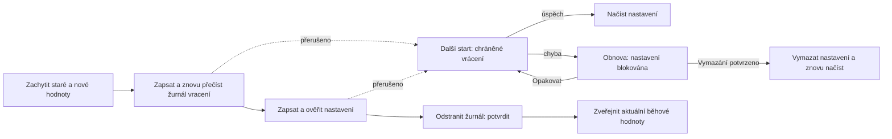

# Obnovitelná nastavení s více klíči

<!-- language-navigation:start -->

<a href="settings-recovery.md" lang="en" dir="ltr">English</a> · <a href="settings-recovery.ar.md" lang="ar" dir="rtl">العربية</a> · <a href="settings-recovery.bn.md" lang="bn" dir="ltr">বাংলা</a> · <a href="settings-recovery.cs.md" lang="cs" dir="ltr">Čeština</a> · <a href="settings-recovery.de.md" lang="de" dir="ltr">Deutsch</a> · <a href="settings-recovery.es.md" lang="es" dir="ltr">Español</a> · <a href="settings-recovery.fa.md" lang="fa" dir="rtl">فارسی</a> · <a href="settings-recovery.fr.md" lang="fr" dir="ltr">Français</a>
 
<a href="settings-recovery.he.md" lang="he" dir="rtl">עברית</a> · <a href="settings-recovery.hi.md" lang="hi" dir="ltr">हिन्दी</a> · <a href="settings-recovery.id.md" lang="id" dir="ltr">Bahasa Indonesia</a> · <a href="settings-recovery.it.md" lang="it" dir="ltr">Italiano</a> · <a href="settings-recovery.ja.md" lang="ja" dir="ltr">日本語</a> · <a href="settings-recovery.ko.md" lang="ko" dir="ltr">한국어</a> · <a href="settings-recovery.nl.md" lang="nl" dir="ltr">Nederlands</a> · <a href="settings-recovery.pl.md" lang="pl" dir="ltr">Polski</a>
 
<a href="settings-recovery.pt.md" lang="pt" dir="ltr">Português</a> · <a href="settings-recovery.ru.md" lang="ru" dir="ltr">Русский</a> · <a href="settings-recovery.th.md" lang="th" dir="ltr">ไทย</a> · <a href="settings-recovery.tr.md" lang="tr" dir="ltr">Türkçe</a> · <a href="settings-recovery.uk.md" lang="uk" dir="ltr">Українська</a> · <a href="settings-recovery.vi.md" lang="vi" dir="ltr">Tiếng Việt</a> · <a href="settings-recovery.zh-Hans.md" lang="zh-Hans" dir="ltr">简体中文</a> · <a href="settings-recovery.zh-Hant.md" lang="zh-Hant" dir="ltr">繁體中文</a>

<!-- language-navigation:end -->

[Vylepšení](roadmap-delivery.cs.md)

Podporované dávky localStorage používají `ottplaySettingsJournalV1`, interní žurnál vracení změn, který se nezahrnuje do exportu, cloudových dat ani běžného výčtu nastavení. Před změnou nastavení zapisující komponenta uloží původní/nový řetězec každého klíče (nebo null), přečte žurnál zpět, zapíše a ověří dávku a poté odstraní žurnál jako bod potvrzení. Běhové změny se zveřejní pouze tehdy, pokud zachycený vlastník nastavení zůstává aktuální. Import nemaže nesouvisející klíče.

Migrace rodičovského PINu uchová přesnou původní hodnotu v paměti pro kontrolu konfliktů, ale jako návratovou hodnotu zapíše pouze její chráněnou náhradu. Neúspěšný import nebo přerušená obnova nesmí obnovit čitelný starý PIN. Formát žurnálu zůstává ve verzi 1. Před aktualizací či obnovou starších nastavení si přečtěte [migraci PINu a omezení](parental-pin-storage.md).

Spouštění provede obnovu ještě před načtením nastavení. Starou hodnotu obnoví pouze tehdy, když uložená hodnota stále odpovídá nové hodnotě této dávky; zachová tak pozdější cizí změnu. Během celé obnovy ověřuje žurnál a vlastnictví. Neúspěšný nebo poškozený žurnál otevře před spuštěním přehrávače obrazovku obnovy. Nenačítají se částečná nastavení účtu ani zastaralé záložní hodnoty cookies a běžné zápisy zůstávají zablokované. **Retry** zopakuje chráněnou obnovu a znovu načte aplikaci až po úspěchu. **Clear settings** vyžaduje druhé výslovné potvrzení; Cancel/Back ponechá data beze změny. Vymaže localStorage daného originu a zaznamenané cookies přehrávače v jejich kořenové cestě. Cizí cookies zůstanou nedotčené. Trvalá značka resetu a prázdný seznam povolených záložních hodnot brání nezaznamenaným starým cookies oživit nastavení, i když localStorage přestane být dostupné; nové záložní zápisy se přidávají do seznamu povolených. Bariéra žurnálu se odstraní až po ověření pravidel resetu a smazání. Při chybě obrazovka i bariéra zůstávají. Tab, šipky, Enter a tlačítka dálkového ovladače fungují před běžnou inicializací rozhraní. Nic se neresetuje automaticky a obrazovka nikdy nevypisuje obsah žurnálu. Je-li to potřeba, před volbou Clear settings si původní úložiště soukromě uchovejte pro diagnostiku. Limity žurnálu: 16 000 záznamů a 2 MiB serializovaného textu.

**Hranice záruky:** jeden zapisující a jedno podporované nativní úložiště localStorage. Prohlížeče neposkytují atomické compare-and-swap mezi kartami. Nespouštějte souběžné importy ve více oknech; nejde o transakci mezi kartami ani databázi. Odolnost proti výpadku napájení omezuje samotné úložiště prohlížeče/OS. Adaptéry cookies/relace/vlastního zařízení zachovávají chráněné vrácení změn podle možností; nezískávají trvalý žurnál. Neexistuje distribuovaná transakce se vzdáleným řadičem ani jiným přehrávačem.

Žurnál dočasně obsahuje staré/nové hodnoty nastavení, případně i přihlašovací údaje poskytovatele, ve stejném úložišti originu, kde již jsou. Nejde o telemetrii a nesmí se kopírovat do veřejných hlášení chyb. Chyba kvóty při přípravě žurnálu zastaví operaci před zápisy. Neodstraňujte čekající žurnál jen kvůli zakrytí neúspěšného importu; ztratili byste informace pro obnovu.

Spusťte `node tests/test_settings_journal.cjs`, `node tests/test_settings_store.cjs`, `node tests/test_local_settings_backup.cjs` a `node tests/test_cloud_settings_session.cjs`. Testy restartují ze snímků přerušených zápisů, přerušují samotnou obnovu, zachovávají cizí hodnoty a prověřují chyby kvóty/poškození/opětovného vstupu. Pokrývají také izolovaná čtení a zápisy, skutečnou časnou ochranu při spuštění, nový pokus po dočasné chybě úložiště, výslovné potvrzení resetu, vstup klávesnice/ovladače, přerušené resety, odmítnuté mazání cookies, cizí cookies omezené cestou a nativní/cookie záložní mechanismy po resetu. Časný HTML načítač jazyka dodržuje tentýž seznam povolených hodnot po resetu.
