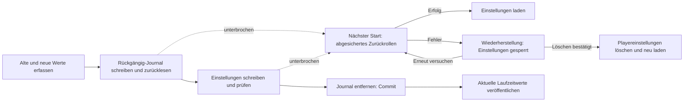

# Wiederherstellbare Einstellungen über mehrere Schlüssel

<!-- language-navigation:start -->

<a href="settings-recovery.md" lang="en" dir="ltr">English</a> · <a href="settings-recovery.ar.md" lang="ar" dir="rtl">العربية</a> · <a href="settings-recovery.bn.md" lang="bn" dir="ltr">বাংলা</a> · <a href="settings-recovery.cs.md" lang="cs" dir="ltr">Čeština</a> · <a href="settings-recovery.de.md" lang="de" dir="ltr">Deutsch</a> · <a href="settings-recovery.es.md" lang="es" dir="ltr">Español</a> · <a href="settings-recovery.fa.md" lang="fa" dir="rtl">فارسی</a> · <a href="settings-recovery.fr.md" lang="fr" dir="ltr">Français</a>
 
<a href="settings-recovery.he.md" lang="he" dir="rtl">עברית</a> · <a href="settings-recovery.hi.md" lang="hi" dir="ltr">हिन्दी</a> · <a href="settings-recovery.id.md" lang="id" dir="ltr">Bahasa Indonesia</a> · <a href="settings-recovery.it.md" lang="it" dir="ltr">Italiano</a> · <a href="settings-recovery.ja.md" lang="ja" dir="ltr">日本語</a> · <a href="settings-recovery.ko.md" lang="ko" dir="ltr">한국어</a> · <a href="settings-recovery.nl.md" lang="nl" dir="ltr">Nederlands</a> · <a href="settings-recovery.pl.md" lang="pl" dir="ltr">Polski</a>
 
<a href="settings-recovery.pt.md" lang="pt" dir="ltr">Português</a> · <a href="settings-recovery.ru.md" lang="ru" dir="ltr">Русский</a> · <a href="settings-recovery.th.md" lang="th" dir="ltr">ไทย</a> · <a href="settings-recovery.tr.md" lang="tr" dir="ltr">Türkçe</a> · <a href="settings-recovery.uk.md" lang="uk" dir="ltr">Українська</a> · <a href="settings-recovery.vi.md" lang="vi" dir="ltr">Tiếng Việt</a> · <a href="settings-recovery.zh-Hans.md" lang="zh-Hans" dir="ltr">简体中文</a> · <a href="settings-recovery.zh-Hant.md" lang="zh-Hant" dir="ltr">繁體中文</a>

<!-- language-navigation:end -->

[Verbesserungen](roadmap-delivery.de.md)

Unterstützte localStorage-Stapel verwenden `ottplaySettingsJournalV1`, ein internes Rückgängig-Journal, das von Exporten, Cloud-Nutzdaten und der normalen Aufzählung von Einstellungen ausgeschlossen ist. Vor einer Änderung zeichnet der Schreiber für jeden Schlüssel die alte und neue Zeichenfolge (oder null) auf, liest das Journal zurück, schreibt und prüft den Stapel und entfernt dann das Journal als Commit-Punkt. Laufzeitänderungen werden nur veröffentlicht, solange der erfasste Eigentümer der Einstellungen noch aktuell ist. Nicht betroffene Schlüssel werden durch einen Import nicht gelöscht.

Die Migration der Jugendschutz-PIN hält den exakten Originalwert für Konfliktprüfungen im Speicher, schreibt aber nur dessen geschützten Ersatz als Rückrollwert. Ein fehlgeschlagener Import oder eine unterbrochene Wiederherstellung darf keine lesbare alte PIN wiederherstellen. Das Journalformat bleibt Version 1. Lesen Sie vor dem Aktualisieren oder Wiederherstellen älterer Einstellungen [PIN-Migration und Grenzen](parental-pin-storage.md).

Der Start stellt Einstellungen wieder her, bevor er sie lädt. Ein alter Wert wird nur zurückgeschrieben, solange der gespeicherte Wert noch dem neuen Wert dieses Stapels entspricht; eine spätere fremde Änderung bleibt erhalten. Journal und Eigentümerschaft werden während der gesamten Wiederherstellung geprüft. Ein fehlgeschlagenes oder beschädigtes Journal öffnet vor dem Playerstart einen Wiederherstellungsbildschirm. Weder unvollständige Kontoeinstellungen noch veraltete Cookie-Ersatzwerte werden geladen; normale Schreibzugriffe auf Einstellungen bleiben gesperrt. **Retry** wiederholt die abgesicherte Wiederherstellung und lädt nur bei Erfolg neu. **Clear settings** verlangt eine zweite ausdrückliche Bestätigung; Cancel/Back lässt die Daten unverändert. Es löscht den localStorage der Origin und die aufgezeichneten Player-Cookies an deren Wurzelpfad. Fremde Cookies bleiben erhalten. Eine dauerhafte Rücksetzmarkierung und eine leere Ersatzwert-Freigabeliste verhindern, dass nicht aufgezeichnete alte Cookies Einstellungen wiederbeleben, auch wenn localStorage nicht mehr verfügbar ist; neue Ersatzwert-Schreibzugriffe werden in die Freigabeliste aufgenommen. Die Journalsperre wird erst entfernt, wenn Rücksetzrichtlinie und Löschung geprüft wurden. Bei einem Fehler bleiben Wiederherstellungsbildschirm und Sperre bestehen. Tab, Pfeiltasten, Enter und Gerätetasten der Fernbedienung funktionieren bereits vor der normalen UI-Initialisierung. Nichts wird automatisch zurückgesetzt; der Bildschirm zeigt niemals Journalinhalte an. Bewahren Sie bei Bedarf vor Clear settings den ursprünglichen Speicher privat zur Diagnose auf. Journalgrenzen: 16 000 Einträge und 2 MiB serialisierter Text.

**Garantiegrenze:** ein Schreiber und ein unterstützter nativer localStorage-Datenspeicher. Browser bieten kein atomares Compare-and-Swap zwischen Tabs. Führen Sie keine gleichzeitigen Importe in mehreren Fenstern aus; dies ist weder eine tabübergreifende Transaktion noch eine Datenbank. Die Beständigkeit bei Stromausfall ist durch den Browser-/Betriebssystemspeicher selbst begrenzt. Cookie-/Sitzungs-/benutzerdefinierte Geräteadapter behalten ihr abgesichertes Zurückrollen nach bestem Bemühen; sie erhalten kein dauerhaftes Journal. Es gibt keine verteilte Transaktion mit dem entfernten Controller oder einem anderen Player.

Das Journal enthält vorübergehend alte/neue Einstellungswerte, möglicherweise einschließlich Anbieterzugangsdaten, im selben Origin-Speicher, in dem diese bereits liegen. Es ist keine Telemetrie und darf nicht in öffentliche Fehlerberichte kopiert werden. Ein Quotenfehler beim Vorbereiten des Journals stoppt den Vorgang vor Schreibzugriffen. Entfernen Sie ein ausstehendes Journal nicht bloß, um einen fehlgeschlagenen Import zu verbergen; dadurch gehen dessen Wiederherstellungsinformationen verloren.

Führen Sie `node tests/test_settings_journal.cjs`, `node tests/test_settings_store.cjs`, `node tests/test_local_settings_backup.cjs` und `node tests/test_cloud_settings_session.cjs` aus. Die Tests starten aus Momentaufnahmen unterbrochener Schreibvorgänge neu, unterbrechen die Wiederherstellung selbst, erhalten fremde Werte und prüfen Quoten-, Beschädigungs- und Wiedereintrittsfehler. Die Wiederherstellungstests umfassen außerdem isolierte Lese-/Schreibzugriffe, die tatsächliche frühe Startsperre, erneute Versuche nach vorübergehendem Speicherausfall, ausdrückliche Rücksetzbestätigung, Tastatur-/Fernbedienungseingaben, unterbrochene Rücksetzungen, abgelehnte Cookie-Löschung, fremde pfadgebundene Cookies sowie native/Cookie-Ersatzwerte nach einer Rücksetzung. Der frühe HTML-Sprachlader beachtet dieselbe Rücksetz-Freigabeliste.
