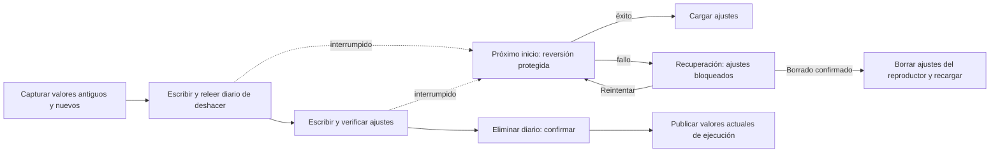

# Ajustes recuperables de varias claves

<!-- language-navigation:start -->

<a href="settings-recovery.md" lang="en" dir="ltr">English</a> · <a href="settings-recovery.ar.md" lang="ar" dir="rtl">العربية</a> · <a href="settings-recovery.bn.md" lang="bn" dir="ltr">বাংলা</a> · <a href="settings-recovery.cs.md" lang="cs" dir="ltr">Čeština</a> · <a href="settings-recovery.de.md" lang="de" dir="ltr">Deutsch</a> · <a href="settings-recovery.es.md" lang="es" dir="ltr">Español</a> · <a href="settings-recovery.fa.md" lang="fa" dir="rtl">فارسی</a> · <a href="settings-recovery.fr.md" lang="fr" dir="ltr">Français</a>
 
<a href="settings-recovery.he.md" lang="he" dir="rtl">עברית</a> · <a href="settings-recovery.hi.md" lang="hi" dir="ltr">हिन्दी</a> · <a href="settings-recovery.id.md" lang="id" dir="ltr">Bahasa Indonesia</a> · <a href="settings-recovery.it.md" lang="it" dir="ltr">Italiano</a> · <a href="settings-recovery.ja.md" lang="ja" dir="ltr">日本語</a> · <a href="settings-recovery.ko.md" lang="ko" dir="ltr">한국어</a> · <a href="settings-recovery.nl.md" lang="nl" dir="ltr">Nederlands</a> · <a href="settings-recovery.pl.md" lang="pl" dir="ltr">Polski</a>
 
<a href="settings-recovery.pt.md" lang="pt" dir="ltr">Português</a> · <a href="settings-recovery.ru.md" lang="ru" dir="ltr">Русский</a> · <a href="settings-recovery.th.md" lang="th" dir="ltr">ไทย</a> · <a href="settings-recovery.tr.md" lang="tr" dir="ltr">Türkçe</a> · <a href="settings-recovery.uk.md" lang="uk" dir="ltr">Українська</a> · <a href="settings-recovery.vi.md" lang="vi" dir="ltr">Tiếng Việt</a> · <a href="settings-recovery.zh-Hans.md" lang="zh-Hans" dir="ltr">简体中文</a> · <a href="settings-recovery.zh-Hant.md" lang="zh-Hant" dir="ltr">繁體中文</a>

<!-- language-navigation:end -->

[Mejoras](roadmap-delivery.es.md)

Los lotes localStorage compatibles usan `ottplaySettingsJournalV1`, un diario interno de deshacer excluido de exportaciones, cargas útiles de la nube y enumeraciones normales de ajustes. Antes de modificar los ajustes, el escritor registra la cadena anterior/nueva de cada clave (o null), vuelve a leer el diario, escribe y verifica el lote y después elimina el diario como punto de confirmación. Los cambios en ejecución solo se publican mientras siga vigente el propietario de ajustes capturado. Una importación no borra claves ajenas al lote.

La migración del PIN parental conserva en memoria el valor original exacto para comprobar conflictos, pero solo escribe su sustituto protegido como valor de reversión. Una importación fallida o una recuperación interrumpida no debe restaurar un PIN antiguo legible. El formato del diario sigue siendo la versión 1. Consulte [migración del PIN y limitaciones](parental-pin-storage.md) antes de actualizar o restaurar ajustes antiguos.

El arranque recupera los ajustes antes de cargarlos. Solo restaura un valor anterior si el valor almacenado aún coincide con el nuevo valor de ese lote, conservando así una modificación externa posterior. Valida el diario y la titularidad durante toda la recuperación. Un diario fallido o corrupto abre una pantalla de recuperación antes de iniciar el reproductor. No se cargan ajustes parciales de la cuenta ni valores de respaldo obsoletos de cookies; las escrituras normales de ajustes siguen bloqueadas. **Retry** repite la recuperación protegida y solo recarga tras completarla correctamente. **Clear settings** exige una segunda confirmación explícita; Cancel/Back mantiene los datos intactos. Borra localStorage del origen y las cookies registradas del reproductor en su ruta raíz. No modifica cookies ajenas. Un marcador de restablecimiento persistente y una lista de respaldo permitida vacía evitan que cookies antiguas no registradas recuperen ajustes, incluso si localStorage deja de estar disponible; las nuevas escrituras de respaldo se añaden a esa lista. La barrera del diario solo se retira después de verificar la política de restablecimiento y el borrado. Un fallo mantiene la pantalla y la barrera. Tab, flechas y Enter del teclado y las teclas del mando funcionan antes de la inicialización normal de la interfaz. Nada se restablece automáticamente y la pantalla nunca muestra el contenido del diario. Si es necesario, guarde privadamente el almacenamiento original para diagnosticarlo antes de elegir Clear settings. Límites del diario: 16 000 entradas y 2 MiB de texto serializado.

**Límite de la garantía:** un escritor y un almacenamiento localStorage nativo compatible. Los navegadores no ofrecen comparación e intercambio atómicos entre pestañas. No ejecute importaciones simultáneas en varias ventanas; esto no es una transacción entre pestañas ni una base de datos. La durabilidad frente a cortes de energía depende del almacenamiento del navegador/SO. Los adaptadores de cookies/sesión/dispositivos personalizados mantienen una reversión protegida de mejor esfuerzo; no obtienen un diario persistente. No hay una transacción distribuida con el controlador remoto u otro reproductor.

El diario contiene temporalmente valores de ajustes antiguos/nuevos, posiblemente incluidas credenciales del proveedor, en el mismo almacenamiento de origen que ya los guarda. No es telemetría y no debe copiarse en informes públicos de errores. Un fallo de cuota al preparar el diario detiene el proceso antes de escribir. No elimine un diario pendiente solo para ocultar una importación fallida: descartaría su información de recuperación.

Ejecute `node tests/test_settings_journal.cjs`, `node tests/test_settings_store.cjs`, `node tests/test_local_settings_backup.cjs` y `node tests/test_cloud_settings_session.cjs`. Las pruebas reinician desde instantáneas de escrituras interrumpidas, interrumpen la propia recuperación, conservan valores ajenos y ejercitan fallos de cuota/corrupción/reentrada. También cubren lecturas/escrituras aisladas, la protección real al comienzo del arranque, reintentos tras un fallo temporal de almacenamiento, confirmación explícita de restablecimiento, entrada por teclado/mando, restablecimientos interrumpidos, borrado de cookies rechazado, cookies ajenas limitadas a una ruta y respaldos nativos/de cookies tras restablecer. El cargador temprano del idioma HTML respeta la misma lista permitida de restablecimiento.
