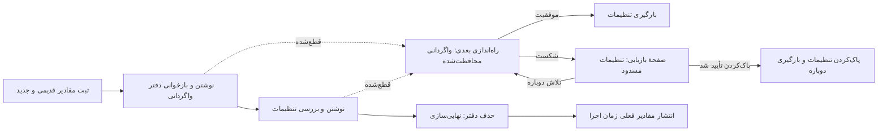

# تنظیمات چندکلیدی قابل بازیابی

<!-- language-navigation:start -->

<a href="settings-recovery.md" lang="en" dir="ltr">English</a> · <a href="settings-recovery.ar.md" lang="ar" dir="rtl">العربية</a> · <a href="settings-recovery.bn.md" lang="bn" dir="ltr">বাংলা</a> · <a href="settings-recovery.cs.md" lang="cs" dir="ltr">Čeština</a> · <a href="settings-recovery.de.md" lang="de" dir="ltr">Deutsch</a> · <a href="settings-recovery.es.md" lang="es" dir="ltr">Español</a> · <a href="settings-recovery.fa.md" lang="fa" dir="rtl">فارسی</a> · <a href="settings-recovery.fr.md" lang="fr" dir="ltr">Français</a>
 
<a href="settings-recovery.he.md" lang="he" dir="rtl">עברית</a> · <a href="settings-recovery.hi.md" lang="hi" dir="ltr">हिन्दी</a> · <a href="settings-recovery.id.md" lang="id" dir="ltr">Bahasa Indonesia</a> · <a href="settings-recovery.it.md" lang="it" dir="ltr">Italiano</a> · <a href="settings-recovery.ja.md" lang="ja" dir="ltr">日本語</a> · <a href="settings-recovery.ko.md" lang="ko" dir="ltr">한국어</a> · <a href="settings-recovery.nl.md" lang="nl" dir="ltr">Nederlands</a> · <a href="settings-recovery.pl.md" lang="pl" dir="ltr">Polski</a>
 
<a href="settings-recovery.pt.md" lang="pt" dir="ltr">Português</a> · <a href="settings-recovery.ru.md" lang="ru" dir="ltr">Русский</a> · <a href="settings-recovery.th.md" lang="th" dir="ltr">ไทย</a> · <a href="settings-recovery.tr.md" lang="tr" dir="ltr">Türkçe</a> · <a href="settings-recovery.uk.md" lang="uk" dir="ltr">Українська</a> · <a href="settings-recovery.vi.md" lang="vi" dir="ltr">Tiếng Việt</a> · <a href="settings-recovery.zh-Hans.md" lang="zh-Hans" dir="ltr">简体中文</a> · <a href="settings-recovery.zh-Hant.md" lang="zh-Hant" dir="ltr">繁體中文</a>

<!-- language-navigation:end -->

[بهبودها](roadmap-delivery.fa.md)

دسته‌های پشتیبانی‌شدهٔ localStorage از `ottplaySettingsJournalV1` استفاده می‌کنند؛ این دفتر ثبت داخلی برای واگردانی، از خروجی‌گیری، داده‌های ارسالی به ابر و فهرست‌کردن معمول تنظیمات کنار گذاشته می‌شود. پیش از تغییر تنظیمات، نویسنده رشتهٔ قدیمی/جدید هر کلید (یا null) را ثبت می‌کند، دفتر را دوباره می‌خواند، دسته را می‌نویسد و بررسی می‌کند و سپس با حذف دفتر، عملیات را نهایی می‌کند. تغییرات زمان اجرا تنها تا وقتی منتشر می‌شوند که مالکِ ثبت‌شدهٔ تنظیمات همچنان مالک فعلی باشد. واردکردن، کلیدهای نامرتبط را پاک نمی‌کند.

مهاجرت PIN والدین مقدار اصلی دقیق را برای بررسی تعارض در حافظه نگه می‌دارد، اما فقط جایگزین محافظت‌شدهٔ آن را به‌عنوان مقدار بازگردانی می‌نویسد. واردکردن ناموفق یا بازیابی قطع‌شده نباید PIN قدیمی خواندنی را برگرداند. قالب دفتر ثبت همچنان نسخهٔ 1 است. پیش از به‌روزرسانی یا بازیابی تنظیمات قدیمی، [مهاجرت PIN و محدودیت‌ها](parental-pin-storage.md) را بخوانید.

راه‌اندازی پیش از بارگیری تنظیمات، بازیابی را انجام می‌دهد. تنها هنگامی مقدار قدیمی را برمی‌گرداند که مقدار ذخیره‌شده هنوز برابر مقدار جدید این دسته باشد؛ به این ترتیب ویرایش بعدیِ بخش دیگری حفظ می‌شود. دفتر و مالکیت در سراسر بازیابی اعتبارسنجی می‌شوند. دفتر ناموفق یا خراب پیش از شروع پخش‌کننده صفحهٔ بازیابی را باز می‌کند. تنظیمات ناقص حساب یا مقادیر پشتیبان کهنهٔ کوکی بارگیری نمی‌شوند و نوشتن عادی تنظیمات مسدود می‌ماند. **Retry** بازیابی محافظت‌شده را تکرار می‌کند و فقط پس از موفقیت دوباره بارگیری می‌کند. **Clear settings** به تأیید صریح دوم نیاز دارد؛ Cancel/Back داده‌ها را دست‌نخورده می‌گذارد. این عملیات localStorage مبدأ و کوکی‌های ثبت‌شدهٔ پخش‌کننده را در مسیر ریشهٔ آن‌ها پاک می‌کند. کوکی‌های دیگر دست‌نخورده می‌مانند. نشانگر پایدار بازنشانی و فهرست مجاز خالیِ مقادیر پشتیبان، جلوی زنده‌شدن تنظیمات از کوکی‌های قدیمی ثبت‌نشده را می‌گیرند، حتی اگر localStorage از دسترس خارج شود؛ نوشتن‌های پشتیبان جدید وارد فهرست مجاز می‌شوند. مانع دفتر تنها پس از بررسی سیاست بازنشانی و حذف برداشته می‌شود. شکست، صفحهٔ بازیابی و مانع را نگه می‌دارد. کلیدهای Tab/جهت‌ها/Enter و کنترل از راه دور دستگاه پیش از راه‌اندازی عادی رابط کار می‌کنند. هیچ‌چیز خودکار بازنشانی نمی‌شود و صفحه هرگز محتوای دفتر را نمایش نمی‌دهد. در صورت نیاز، پیش از انتخاب Clear settings نسخهٔ اصلی فضای ذخیره‌سازی را خصوصی برای عیب‌یابی حفظ کنید. محدودیت‌های دفتر: 16 000 مدخل و 2 MiB متن سریال‌شده.

**مرز تضمین:** یک نویسنده و یک فضای ذخیره‌سازی بومیِ پشتیبانی‌شدهٔ localStorage. مرورگرها compare-and-swap اتمی میان زبانه‌ها ارائه نمی‌کنند. واردکردن هم‌زمان را در چند پنجره اجرا نکنید؛ این قابلیت تراکنش چندزبانه‌ای یا پایگاه داده نیست. دوام در قطع برق به فضای ذخیره‌سازی خود مرورگر/سیستم‌عامل محدود است. آداپتورهای کوکی/نشست/دستگاه سفارشی بازگردانی محافظت‌شده در حد توان را حفظ می‌کنند؛ دفتر پایدار به آن‌ها اضافه نمی‌شود. تراکنش توزیع‌شده‌ای با کنترل‌کنندهٔ دوردست یا پخش‌کنندهٔ دیگر وجود ندارد.

دفتر موقتاً مقادیر قدیمی/جدید تنظیمات، و احتمالاً اطلاعات ورود ارائه‌دهنده، را در همان فضای ذخیره‌سازی مبدأ که از قبل آن‌ها را دارد نگه می‌دارد. این تله‌متری نیست و نباید در گزارش عمومی خطا کپی شود. خطای سهمیه هنگام آماده‌سازی دفتر پیش از نوشتن‌ها عملیات را متوقف می‌کند. دفتر معلق را فقط برای پنهان‌کردن واردکردن ناموفق حذف نکنید؛ این کار اطلاعات بازیابی را دور می‌ریزد.

`node tests/test_settings_journal.cjs`، `node tests/test_settings_store.cjs`، `node tests/test_local_settings_backup.cjs` و `node tests/test_cloud_settings_session.cjs` را اجرا کنید. آزمون‌ها از تصویر لحظه‌ای نوشتن‌های قطع‌شده دوباره آغاز می‌شوند، خود بازیابی را قطع می‌کنند، مقادیر دیگران را حفظ می‌کنند و شکست سهمیه/خرابی/ورود مجدد را می‌آزمایند. همچنین خواندن/نوشتن قرنطینه‌شده، محافظ واقعی شروع زودهنگام، تلاش مجدد پس از خرابی موقت ذخیره‌سازی، تأیید صریح بازنشانی، ورودی صفحه‌کلید/کنترل، بازنشانی‌های قطع‌شده، رد حذف کوکی، کوکی‌های دیگران با دامنهٔ مسیر مشخص و مسیرهای جایگزین بومی/کوکی پس از بازنشانی را پوشش می‌دهند. بارگذار زودهنگام زبان HTML همان فهرست مجاز بازنشانی را دنبال می‌کند.

