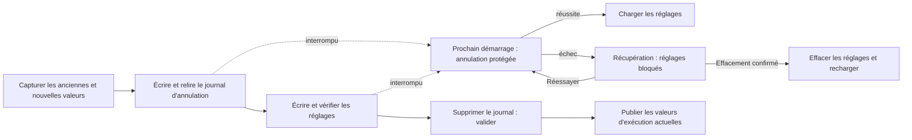

# Réglages récupérables sur plusieurs clés

<!-- language-navigation:start -->

<a href="settings-recovery.md" lang="en" dir="ltr">English</a> · <a href="settings-recovery.ar.md" lang="ar" dir="rtl">العربية</a> · <a href="settings-recovery.bn.md" lang="bn" dir="ltr">বাংলা</a> · <a href="settings-recovery.cs.md" lang="cs" dir="ltr">Čeština</a> · <a href="settings-recovery.de.md" lang="de" dir="ltr">Deutsch</a> · <a href="settings-recovery.es.md" lang="es" dir="ltr">Español</a> · <a href="settings-recovery.fa.md" lang="fa" dir="rtl">فارسی</a> · <a href="settings-recovery.fr.md" lang="fr" dir="ltr">Français</a>
 
<a href="settings-recovery.he.md" lang="he" dir="rtl">עברית</a> · <a href="settings-recovery.hi.md" lang="hi" dir="ltr">हिन्दी</a> · <a href="settings-recovery.id.md" lang="id" dir="ltr">Bahasa Indonesia</a> · <a href="settings-recovery.it.md" lang="it" dir="ltr">Italiano</a> · <a href="settings-recovery.ja.md" lang="ja" dir="ltr">日本語</a> · <a href="settings-recovery.ko.md" lang="ko" dir="ltr">한국어</a> · <a href="settings-recovery.nl.md" lang="nl" dir="ltr">Nederlands</a> · <a href="settings-recovery.pl.md" lang="pl" dir="ltr">Polski</a>
 
<a href="settings-recovery.pt.md" lang="pt" dir="ltr">Português</a> · <a href="settings-recovery.ru.md" lang="ru" dir="ltr">Русский</a> · <a href="settings-recovery.th.md" lang="th" dir="ltr">ไทย</a> · <a href="settings-recovery.tr.md" lang="tr" dir="ltr">Türkçe</a> · <a href="settings-recovery.uk.md" lang="uk" dir="ltr">Українська</a> · <a href="settings-recovery.vi.md" lang="vi" dir="ltr">Tiếng Việt</a> · <a href="settings-recovery.zh-Hans.md" lang="zh-Hans" dir="ltr">简体中文</a> · <a href="settings-recovery.zh-Hant.md" lang="zh-Hant" dir="ltr">繁體中文</a>

<!-- language-navigation:end -->

[Améliorations](roadmap-delivery.fr.md)

Les lots localStorage pris en charge utilisent `ottplaySettingsJournalV1`, un journal interne d'annulation exclu des exports, des charges utiles cloud et de l'énumération normale des réglages. Avant de modifier les réglages, l'écrivain consigne l'ancienne et la nouvelle chaîne de chaque clé (ou null), relit le journal, écrit et vérifie le lot, puis supprime le journal comme point de validation. Les changements d'exécution ne sont publiés que tant que le propriétaire des réglages capturé reste actuel. Un import n'efface pas les clés sans rapport.

La migration du PIN parental conserve la valeur d'origine exacte en mémoire pour détecter les conflits, mais n'écrit que son remplacement protégé comme valeur de retour arrière. Un import échoué ou une récupération interrompue ne doit pas restaurer un ancien PIN lisible. Le format du journal reste en version 1. Consultez [la migration du PIN et ses limites](parental-pin-storage.md) avant de mettre à jour ou de restaurer d'anciens réglages.

Le démarrage effectue la récupération avant de charger les réglages. Il ne restaure une ancienne valeur que si la valeur stockée correspond encore à la nouvelle valeur de ce lot, préservant une modification externe ultérieure. Il valide le journal et la propriété tout au long de la récupération. Un journal en échec ou corrompu ouvre un écran de récupération avant le démarrage du lecteur. Aucun réglage partiel de compte ni ancienne valeur de repli issue des cookies n'est chargé, et les écritures ordinaires restent bloquées. **Retry** recommence la récupération protégée et ne recharge qu'après réussite. **Clear settings** exige une deuxième confirmation explicite ; Cancel/Back laisse les données intactes. Il efface le localStorage de l'origine et les cookies enregistrés du lecteur à leur chemin racine. Les cookies étrangers restent intacts. Un marqueur de remise à zéro persistant et une liste d'autorisation de repli vide empêchent les anciens cookies non enregistrés de ressusciter les réglages, même lorsque localStorage devient indisponible ; les nouvelles écritures de repli entrent dans cette liste. La barrière du journal n'est retirée qu'après vérification de la politique de remise à zéro et de l'effacement. Un échec maintient l'écran et la barrière. Tab, les flèches, Entrée et les touches de télécommande fonctionnent avant l'initialisation normale de l'interface. Rien n'est réinitialisé automatiquement et l'écran n'affiche jamais le contenu du journal. Si nécessaire, conservez le stockage d'origine de manière privée pour le diagnostic avant de choisir Clear settings. Limites du journal : 16 000 entrées et 2 MiB de texte sérialisé.

**Périmètre de garantie :** un seul écrivain et un stockage localStorage natif pris en charge. Les navigateurs ne fournissent pas de comparaison-échange atomique entre onglets. Ne lancez pas d'imports simultanés dans plusieurs fenêtres ; ce n'est ni une transaction multi-onglets ni une base de données. La durabilité lors d'une coupure de courant dépend du stockage du navigateur/OS. Les adaptateurs cookies/session/appareil personnalisé gardent leur retour arrière protégé au mieux ; ils n'acquièrent pas de journal persistant. Il n'y a pas de transaction distribuée avec le contrôleur distant ou un autre lecteur.

Le journal contient temporairement les anciennes/nouvelles valeurs de réglage, éventuellement des identifiants du fournisseur, dans le stockage de même origine qui les détient déjà. Ce n'est pas de la télémétrie et il ne doit pas être copié dans des rapports de bogues publics. Un dépassement de quota lors de la préparation du journal arrête l'opération avant les écritures. Ne supprimez pas un journal en attente uniquement pour masquer un import échoué : cela détruit ses informations de récupération.

Exécutez `node tests/test_settings_journal.cjs`, `node tests/test_settings_store.cjs`, `node tests/test_local_settings_backup.cjs` et `node tests/test_cloud_settings_session.cjs`. Les tests redémarrent à partir d'instantanés d'écritures interrompues, interrompent la récupération elle-même, préservent les valeurs étrangères et couvrent les échecs de quota/corruption/réentrance. Ils couvrent aussi les lectures/écritures en quarantaine, la véritable protection précoce du démarrage, la relance après une panne de stockage temporaire, la confirmation explicite de remise à zéro, les entrées clavier/télécommande, les remises à zéro interrompues, le refus d'effacer des cookies, les cookies étrangers limités à un chemin et les replis natifs/cookies après réinitialisation. Le chargeur précoce de langue HTML respecte la même liste d'autorisation de remise à zéro.
