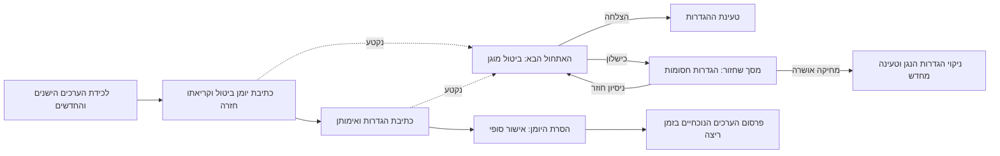

# הגדרות מרובות מפתחות הניתנות לשחזור

<!-- language-navigation:start -->

<a href="settings-recovery.md" lang="en" dir="ltr">English</a> · <a href="settings-recovery.ar.md" lang="ar" dir="rtl">العربية</a> · <a href="settings-recovery.bn.md" lang="bn" dir="ltr">বাংলা</a> · <a href="settings-recovery.cs.md" lang="cs" dir="ltr">Čeština</a> · <a href="settings-recovery.de.md" lang="de" dir="ltr">Deutsch</a> · <a href="settings-recovery.es.md" lang="es" dir="ltr">Español</a> · <a href="settings-recovery.fa.md" lang="fa" dir="rtl">فارسی</a> · <a href="settings-recovery.fr.md" lang="fr" dir="ltr">Français</a>
 
<a href="settings-recovery.he.md" lang="he" dir="rtl">עברית</a> · <a href="settings-recovery.hi.md" lang="hi" dir="ltr">हिन्दी</a> · <a href="settings-recovery.id.md" lang="id" dir="ltr">Bahasa Indonesia</a> · <a href="settings-recovery.it.md" lang="it" dir="ltr">Italiano</a> · <a href="settings-recovery.ja.md" lang="ja" dir="ltr">日本語</a> · <a href="settings-recovery.ko.md" lang="ko" dir="ltr">한국어</a> · <a href="settings-recovery.nl.md" lang="nl" dir="ltr">Nederlands</a> · <a href="settings-recovery.pl.md" lang="pl" dir="ltr">Polski</a>
 
<a href="settings-recovery.pt.md" lang="pt" dir="ltr">Português</a> · <a href="settings-recovery.ru.md" lang="ru" dir="ltr">Русский</a> · <a href="settings-recovery.th.md" lang="th" dir="ltr">ไทย</a> · <a href="settings-recovery.tr.md" lang="tr" dir="ltr">Türkçe</a> · <a href="settings-recovery.uk.md" lang="uk" dir="ltr">Українська</a> · <a href="settings-recovery.vi.md" lang="vi" dir="ltr">Tiếng Việt</a> · <a href="settings-recovery.zh-Hans.md" lang="zh-Hans" dir="ltr">简体中文</a> · <a href="settings-recovery.zh-Hant.md" lang="zh-Hant" dir="ltr">繁體中文</a>

<!-- language-navigation:end -->

[שיפורים](roadmap-delivery.he.md)

אצוות localStorage הנתמכות משתמשות ב־`ottplaySettingsJournalV1`, יומן ביטול פנימי שאינו נכלל בייצוא, במטעני נתונים לענן או במנייה הרגילה של ההגדרות. לפני שינוי ההגדרות, הכותב רושם את המחרוזת הישנה/החדשה של כל מפתח (או null), קורא את היומן בחזרה, כותב ומאמת את האצווה, ואז מסיר את היומן כנקודת האישור הסופי. שינויים בזמן ריצה מתפרסמים רק כל עוד בעלי ההגדרות שנלכדו הם עדיין הבעלים הנוכחיים. ייבוא אינו מוחק מפתחות לא קשורים.

העברת PIN של בקרת הורים שומרת את הערך המקורי המדויק בזיכרון לבדיקת התנגשויות, אך כותבת כערך להחזרה רק את התחליף המוגן שלו. ייבוא שנכשל או שחזור שנקטע אינם רשאים לשחזר PIN ישן קריא. פורמט היומן נשאר גרסה 1. קראו על [העברת PIN והמגבלות](parental-pin-storage.md) לפני עדכון או שחזור של הגדרות ישנות.

האתחול משחזר לפני טעינת ההגדרות. הוא מחזיר ערך ישן רק כל עוד הערך השמור עדיין שווה לערך החדש של האצווה הזאת, וכך שומר שינוי מאוחר יותר של גורם אחר. היומן והבעלות נבדקים לאורך כל השחזור. יומן שנכשל או נפגם פותח מסך שחזור לפני שהנגן מתחיל. הגדרות חשבון חלקיות או ערכי גיבוי מיושנים מעוגיות אינם נטענים, וכתיבת הגדרות רגילה נשארת חסומה. **Retry** חוזר על השחזור המוגן וטוען מחדש רק לאחר הצלחה. **Clear settings** דורש אישור מפורש שני; Cancel/Back משאיר את הנתונים ללא שינוי. הפעולה מוחקת את localStorage של המקור ואת עוגיות הנגן המתועדות בנתיבי השורש שלהן. עוגיות אחרות נשארות ללא שינוי. סמן איפוס מתמשך ורשימת היתר ריקה לערכי גיבוי מונעים מעוגיות ישנות שלא תועדו להחיות הגדרות, גם כאשר localStorage אינו זמין; כתיבות גיבוי חדשות נכנסות לרשימת ההיתר. מחסום היומן מוסר רק לאחר אימות מדיניות האיפוס והמחיקה. כישלון משאיר את מסך השחזור והמחסום. מקשי Tab/חצים/Enter ומקשי השלט פועלים לפני אתחול ממשק המשתמש הרגיל. דבר אינו מתאפס אוטומטית, והמסך לעולם אינו מציג את תוכן היומן. בעת הצורך שמרו את האחסון המקורי באופן פרטי לצורך אבחון לפני בחירה ב־Clear settings. מגבלות היומן: 16 000 רשומות ו־2 MiB של טקסט מסוריאל.

**גבול האחריות:** כותב יחיד ומאגר localStorage ילידי נתמך יחיד. דפדפנים אינם מספקים compare-and-swap אטומי בין לשוניות. אל תריצו ייבואים במקביל בחלונות מרובים; זו אינה עסקה בין לשוניות או מסד נתונים. העמידות באובדן מתח מוגבלת על ידי האחסון של הדפדפן/מערכת ההפעלה עצמם. מתאמי עוגיות/הפעלה/מכשיר מותאם שומרים על החזרה מוגנת כמיטב היכולת; הם אינם מקבלים יומן מתמשך. אין עסקה מבוזרת עם הבקר המרוחק או נגן אחר.

היומן מכיל זמנית ערכי הגדרות ישנים/חדשים, ואולי גם פרטי הזדהות של ספק, באותו אחסון מקור שכבר מכיל אותם. הוא אינו טלמטריה ואין להעתיקו לדיווחי באגים ציבוריים. כישלון מכסה בעת הכנת היומן עוצר לפני הכתיבות. אל תסירו יומן ממתין רק כדי להסתיר ייבוא שנכשל; הדבר משליך את מידע השחזור שלו.

הריצו `node tests/test_settings_journal.cjs`, `node tests/test_settings_store.cjs`, `node tests/test_local_settings_backup.cjs` ו־`node tests/test_cloud_settings_session.cjs`. הבדיקות מתחילות מחדש מתמונות מצב של כתיבות שנקטעו, קוטעות את השחזור עצמו, שומרות ערכים של אחרים ובודקות כשלי מכסה/השחתה/כניסה חוזרת. הן מכסות גם קריאות וכתיבות מבודדות, את הגנת האתחול המוקדמת בפועל, ניסיון חוזר לאחר תקלה זמנית באחסון, אישור איפוס מפורש, קלט ממקלדת/שלט, איפוסים שנקטעו, סירוב למחיקת עוגיות, עוגיות של אחרים המוגבלות לנתיב, ומנגנוני גיבוי ילידיים/עוגיות לאחר איפוס. טוען שפת ה־HTML המוקדם פועל לפי אותה רשימת היתר לאיפוס.

