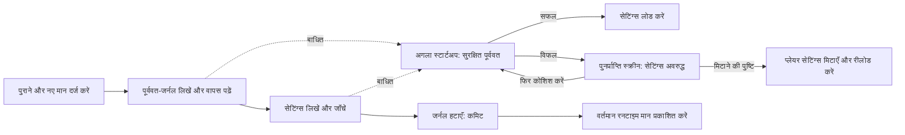

# कई कुंजियों वाली पुनर्प्राप्त करने योग्य सेटिंग्स

<!-- language-navigation:start -->

<a href="settings-recovery.md" lang="en" dir="ltr">English</a> · <a href="settings-recovery.ar.md" lang="ar" dir="rtl">العربية</a> · <a href="settings-recovery.bn.md" lang="bn" dir="ltr">বাংলা</a> · <a href="settings-recovery.cs.md" lang="cs" dir="ltr">Čeština</a> · <a href="settings-recovery.de.md" lang="de" dir="ltr">Deutsch</a> · <a href="settings-recovery.es.md" lang="es" dir="ltr">Español</a> · <a href="settings-recovery.fa.md" lang="fa" dir="rtl">فارسی</a> · <a href="settings-recovery.fr.md" lang="fr" dir="ltr">Français</a>
 
<a href="settings-recovery.he.md" lang="he" dir="rtl">עברית</a> · <a href="settings-recovery.hi.md" lang="hi" dir="ltr">हिन्दी</a> · <a href="settings-recovery.id.md" lang="id" dir="ltr">Bahasa Indonesia</a> · <a href="settings-recovery.it.md" lang="it" dir="ltr">Italiano</a> · <a href="settings-recovery.ja.md" lang="ja" dir="ltr">日本語</a> · <a href="settings-recovery.ko.md" lang="ko" dir="ltr">한국어</a> · <a href="settings-recovery.nl.md" lang="nl" dir="ltr">Nederlands</a> · <a href="settings-recovery.pl.md" lang="pl" dir="ltr">Polski</a>
 
<a href="settings-recovery.pt.md" lang="pt" dir="ltr">Português</a> · <a href="settings-recovery.ru.md" lang="ru" dir="ltr">Русский</a> · <a href="settings-recovery.th.md" lang="th" dir="ltr">ไทย</a> · <a href="settings-recovery.tr.md" lang="tr" dir="ltr">Türkçe</a> · <a href="settings-recovery.uk.md" lang="uk" dir="ltr">Українська</a> · <a href="settings-recovery.vi.md" lang="vi" dir="ltr">Tiếng Việt</a> · <a href="settings-recovery.zh-Hans.md" lang="zh-Hans" dir="ltr">简体中文</a> · <a href="settings-recovery.zh-Hant.md" lang="zh-Hant" dir="ltr">繁體中文</a>

<!-- language-navigation:end -->

[सुधार](roadmap-delivery.hi.md)

समर्थित localStorage बैच `ottplaySettingsJournalV1` का उपयोग करते हैं। यह आंतरिक पूर्ववत-जर्नल एक्सपोर्ट, क्लाउड पेलोड और सामान्य सेटिंग सूची में शामिल नहीं होता। सेटिंग्स बदलने से पहले लेखक हर कुंजी की पुरानी/नई स्ट्रिंग (या null) दर्ज करता है, जर्नल वापस पढ़ता है, बैच लिखकर जाँचता है, फिर जर्नल हटाता है—यही कमिट बिंदु है। रनटाइम बदलाव तभी प्रकाशित होते हैं जब दर्ज किया गया सेटिंग-स्वामी अभी भी वर्तमान हो। इंपोर्ट असंबंधित कुंजियाँ नहीं मिटाता।

अभिभावकीय PIN माइग्रेशन टकराव जाँचने के लिए सटीक मूल मान मेमोरी में रखता है, लेकिन रोलबैक मान के रूप में केवल उसका सुरक्षित प्रतिस्थापन लिखता है। विफल इंपोर्ट या बीच में रुकी पुनर्प्राप्ति से पढ़ने योग्य पुराना PIN वापस नहीं आना चाहिए। जर्नल का प्रारूप संस्करण 1 ही रहता है। पुरानी सेटिंग्स अपडेट या पुनर्स्थापित करने से पहले [PIN माइग्रेशन और सीमाएँ](parental-pin-storage.md) पढ़ें।

स्टार्टअप सेटिंग्स लोड करने से पहले पुनर्प्राप्ति करता है। पुराना मान तभी लौटाता है जब संग्रहित मान अभी भी इस बैच के नए मान के बराबर हो, जिससे बाद में किए गए किसी अन्य बदलाव को सुरक्षित रखा जाता है। पूरी पुनर्प्राप्ति में जर्नल और स्वामित्व जाँचे जाते हैं। विफल या खराब जर्नल प्लेयर शुरू होने से पहले पुनर्प्राप्ति स्क्रीन खोलता है। आंशिक खाता सेटिंग्स या कुकी के पुराने फ़ॉलबैक मान लोड नहीं होते और सामान्य सेटिंग लेखन अवरुद्ध रहता है। **Retry** सुरक्षित पुनर्प्राप्ति दोहराता है और केवल सफलता के बाद दोबारा लोड करता है। **Clear settings** के लिए दूसरी स्पष्ट पुष्टि चाहिए; Cancel/Back डेटा जस का तस रखता है। यह उस origin का localStorage और दर्ज प्लेयर कुकी उनके रूट पथ पर मिटाता है। अन्य कुकी नहीं छेड़ी जातीं। स्थायी रीसेट चिह्न और खाली फ़ॉलबैक अनुमति-सूची बिना दर्ज पुरानी कुकी को सेटिंग्स वापस लाने से रोकते हैं, तब भी जब localStorage अनुपलब्ध हो जाए; नए फ़ॉलबैक लेखन अनुमति-सूची में जोड़े जाते हैं। रीसेट नीति और मिटाने की पुष्टि के बाद ही जर्नल अवरोध हटता है। विफलता पर स्क्रीन और अवरोध बने रहते हैं। कीबोर्ड Tab/तीर/Enter और डिवाइस रिमोट की कुंजियाँ सामान्य UI आरंभ होने से पहले काम करती हैं। कुछ भी स्वतः रीसेट नहीं होता और स्क्रीन कभी जर्नल की सामग्री नहीं दिखाती। आवश्यकता हो तो Clear settings चुनने से पहले मूल संग्रहण को निदान के लिए निजी रूप से सुरक्षित रखें। जर्नल की सीमा: 16 000 प्रविष्टियाँ और 2 MiB सीरियलाइज़ किया गया पाठ।

**गारंटी की सीमा:** एक लेखक, एक समर्थित नेटिव localStorage संग्रह। ब्राउज़र टैब के बीच एटॉमिक compare-and-swap नहीं देते। कई विंडो में समवर्ती इंपोर्ट न चलाएँ; यह कई टैब का ट्रांज़ैक्शन या डेटाबेस नहीं है। बिजली जाने पर टिकाऊपन ब्राउज़र/OS के संग्रहण से ही सीमित है। कुकी/सेशन/कस्टम डिवाइस अडैप्टर सुरक्षित सर्वोत्तम-प्रयास रोलबैक रखते हैं; उन्हें स्थायी जर्नल नहीं मिलता। रिमोट नियंत्रक या किसी दूसरे प्लेयर के साथ वितरित ट्रांज़ैक्शन नहीं होता।

जर्नल में अस्थायी रूप से पुराने/नए सेटिंग मान होते हैं, जिनमें प्रदाता के क्रेडेंशियल भी हो सकते हैं। वे उसी origin संग्रहण में रहते हैं जहाँ पहले से थे। यह टेलीमेट्री नहीं है और इसे सार्वजनिक बग रिपोर्ट में कॉपी नहीं करना चाहिए। जर्नल तैयार करते समय कोटा विफलता लेखन से पहले रोक देती है। केवल विफल इंपोर्ट छिपाने के लिए लंबित जर्नल न हटाएँ; इससे उसकी पुनर्प्राप्ति जानकारी नष्ट हो जाती है।

`node tests/test_settings_journal.cjs`, `node tests/test_settings_store.cjs`, `node tests/test_local_settings_backup.cjs` और `node tests/test_cloud_settings_session.cjs` चलाएँ। परीक्षण बीच में रुके लेखन के स्नैपशॉट से फिर शुरू होते हैं, पुनर्प्राप्ति को भी बाधित करते हैं, अन्य लेखक के मान सुरक्षित रखते हैं और कोटा/खराब डेटा/पुनःप्रवेश विफलताएँ जाँचते हैं। वे अलग रखे गए पढ़ने/लिखने, असली शुरुआती स्टार्टअप सुरक्षा, अस्थायी संग्रहण विफलता के बाद दोबारा कोशिश, स्पष्ट रीसेट पुष्टि, कीबोर्ड/रिमोट इनपुट, बाधित रीसेट, अस्वीकृत कुकी हटाना, अन्य लेखक की पथ-सीमित कुकी और रीसेट के बाद नेटिव/कुकी फ़ॉलबैक भी जाँचते हैं। शुरुआती HTML भाषा लोडर उसी रीसेट अनुमति-सूची का पालन करता है।
