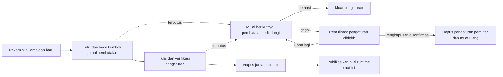

# Pengaturan multi-kunci yang dapat dipulihkan

<!-- language-navigation:start -->

<a href="settings-recovery.md" lang="en" dir="ltr">English</a> · <a href="settings-recovery.ar.md" lang="ar" dir="rtl">العربية</a> · <a href="settings-recovery.bn.md" lang="bn" dir="ltr">বাংলা</a> · <a href="settings-recovery.cs.md" lang="cs" dir="ltr">Čeština</a> · <a href="settings-recovery.de.md" lang="de" dir="ltr">Deutsch</a> · <a href="settings-recovery.es.md" lang="es" dir="ltr">Español</a> · <a href="settings-recovery.fa.md" lang="fa" dir="rtl">فارسی</a> · <a href="settings-recovery.fr.md" lang="fr" dir="ltr">Français</a>
 
<a href="settings-recovery.he.md" lang="he" dir="rtl">עברית</a> · <a href="settings-recovery.hi.md" lang="hi" dir="ltr">हिन्दी</a> · <a href="settings-recovery.id.md" lang="id" dir="ltr">Bahasa Indonesia</a> · <a href="settings-recovery.it.md" lang="it" dir="ltr">Italiano</a> · <a href="settings-recovery.ja.md" lang="ja" dir="ltr">日本語</a> · <a href="settings-recovery.ko.md" lang="ko" dir="ltr">한국어</a> · <a href="settings-recovery.nl.md" lang="nl" dir="ltr">Nederlands</a> · <a href="settings-recovery.pl.md" lang="pl" dir="ltr">Polski</a>
 
<a href="settings-recovery.pt.md" lang="pt" dir="ltr">Português</a> · <a href="settings-recovery.ru.md" lang="ru" dir="ltr">Русский</a> · <a href="settings-recovery.th.md" lang="th" dir="ltr">ไทย</a> · <a href="settings-recovery.tr.md" lang="tr" dir="ltr">Türkçe</a> · <a href="settings-recovery.uk.md" lang="uk" dir="ltr">Українська</a> · <a href="settings-recovery.vi.md" lang="vi" dir="ltr">Tiếng Việt</a> · <a href="settings-recovery.zh-Hans.md" lang="zh-Hans" dir="ltr">简体中文</a> · <a href="settings-recovery.zh-Hant.md" lang="zh-Hant" dir="ltr">繁體中文</a>

<!-- language-navigation:end -->

[Peningkatan](roadmap-delivery.id.md)

Batch localStorage yang didukung menggunakan `ottplaySettingsJournalV1`, jurnal pembatalan internal yang dikecualikan dari ekspor, payload cloud, dan enumerasi pengaturan biasa. Sebelum mengubah pengaturan, penulis mencatat string lama/baru setiap kunci (atau null), membaca kembali jurnal, menulis dan memverifikasi batch, lalu menghapus jurnal sebagai titik commit. Perubahan saat berjalan hanya dipublikasikan selama pemilik pengaturan yang direkam masih aktif. Impor tidak menghapus kunci yang tidak terkait.

Migrasi PIN orang tua menyimpan nilai asli yang persis sama di memori untuk memeriksa konflik, tetapi hanya menulis penggantinya yang terlindungi sebagai nilai pemulihan. Impor gagal atau pemulihan terputus tidak boleh mengembalikan PIN lama yang dapat dibaca. Format jurnal tetap versi 1. Lihat [migrasi PIN dan batasannya](parental-pin-storage.md) sebelum memperbarui atau memulihkan pengaturan lama.

Proses awal memulihkan sebelum memuat pengaturan. Nilai lama dipulihkan hanya selama nilai tersimpan masih sama dengan nilai baru batch ini, sehingga perubahan berikutnya dari pihak lain tetap terjaga. Jurnal dan kepemilikan divalidasi sepanjang pemulihan. Jurnal yang gagal atau rusak membuka layar pemulihan sebelum pemutar dimulai. Pengaturan akun parsial atau nilai fallback cookie yang usang tidak dimuat, dan penulisan pengaturan biasa tetap diblokir. **Retry** mengulangi pemulihan terlindungi dan memuat ulang hanya setelah berhasil. **Clear settings** memerlukan konfirmasi eksplisit kedua; Cancel/Back membiarkan data utuh. Tindakan ini menghapus localStorage origin dan cookie pemutar yang tercatat pada jalur akarnya. Cookie lain dibiarkan. Penanda reset persisten dan daftar izin fallback kosong mencegah cookie lama yang tidak tercatat menghidupkan kembali pengaturan, termasuk saat localStorage tidak tersedia; penulisan fallback baru masuk ke daftar izin. Penghalang jurnal baru dihapus setelah kebijakan reset dan penghapusan diverifikasi. Kegagalan mempertahankan layar pemulihan dan penghalang. Tab/panah/Enter pada keyboard dan tombol remote perangkat bekerja sebelum inisialisasi UI biasa. Tidak ada reset otomatis, dan layar tidak pernah menampilkan isi jurnal. Bila perlu, simpan penyimpanan asli secara privat untuk diagnosis sebelum memilih Clear settings. Batas jurnal: 16 000 entri dan 2 MiB teks terserialisasi.

**Batas jaminan:** satu penulis, satu penyimpanan localStorage native yang didukung. Browser tidak menyediakan compare-and-swap atomik antar-tab. Jangan menjalankan impor serentak di beberapa jendela; ini bukan transaksi multi-tab atau basis data. Ketahanan saat listrik padam dibatasi oleh penyimpanan browser/OS itu sendiri. Adaptor cookie/sesi/perangkat khusus mempertahankan rollback terlindungi dengan upaya terbaik; adaptor tersebut tidak memperoleh jurnal persisten. Tidak ada transaksi terdistribusi dengan pengontrol jarak jauh atau pemutar lain.

Jurnal sementara memuat nilai pengaturan lama/baru, mungkin termasuk kredensial penyedia, di penyimpanan origin yang sama yang sudah menampungnya. Ini bukan telemetri dan tidak boleh disalin ke laporan bug publik. Kegagalan kuota saat menyiapkan jurnal menghentikan proses sebelum penulisan. Jangan menghapus jurnal tertunda hanya untuk menyembunyikan impor gagal; tindakan itu membuang informasi pemulihannya.

Jalankan `node tests/test_settings_journal.cjs`, `node tests/test_settings_store.cjs`, `node tests/test_local_settings_backup.cjs`, dan `node tests/test_cloud_settings_session.cjs`. Pengujian memulai ulang dari snapshot penulisan yang terputus, menginterupsi pemulihan itu sendiri, mempertahankan nilai pihak lain, dan menguji kegagalan kuota/kerusakan/reentransi. Pengujian pemulihan juga mencakup baca/tulis yang dikarantina, pelindung awal yang sebenarnya, percobaan ulang setelah kegagalan penyimpanan sementara, konfirmasi reset eksplisit, input keyboard/remote, reset terputus, penghapusan cookie yang ditolak, cookie lain yang dibatasi jalur, serta fallback native/cookie setelah reset. Pemuat bahasa HTML awal mengikuti daftar izin reset yang sama.
