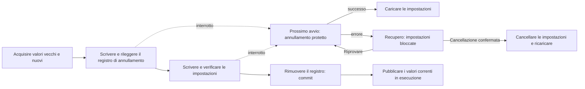

# Impostazioni recuperabili su più chiavi

<!-- language-navigation:start -->

<a href="settings-recovery.md" lang="en" dir="ltr">English</a> · <a href="settings-recovery.ar.md" lang="ar" dir="rtl">العربية</a> · <a href="settings-recovery.bn.md" lang="bn" dir="ltr">বাংলা</a> · <a href="settings-recovery.cs.md" lang="cs" dir="ltr">Čeština</a> · <a href="settings-recovery.de.md" lang="de" dir="ltr">Deutsch</a> · <a href="settings-recovery.es.md" lang="es" dir="ltr">Español</a> · <a href="settings-recovery.fa.md" lang="fa" dir="rtl">فارسی</a> · <a href="settings-recovery.fr.md" lang="fr" dir="ltr">Français</a>
 
<a href="settings-recovery.he.md" lang="he" dir="rtl">עברית</a> · <a href="settings-recovery.hi.md" lang="hi" dir="ltr">हिन्दी</a> · <a href="settings-recovery.id.md" lang="id" dir="ltr">Bahasa Indonesia</a> · <a href="settings-recovery.it.md" lang="it" dir="ltr">Italiano</a> · <a href="settings-recovery.ja.md" lang="ja" dir="ltr">日本語</a> · <a href="settings-recovery.ko.md" lang="ko" dir="ltr">한국어</a> · <a href="settings-recovery.nl.md" lang="nl" dir="ltr">Nederlands</a> · <a href="settings-recovery.pl.md" lang="pl" dir="ltr">Polski</a>
 
<a href="settings-recovery.pt.md" lang="pt" dir="ltr">Português</a> · <a href="settings-recovery.ru.md" lang="ru" dir="ltr">Русский</a> · <a href="settings-recovery.th.md" lang="th" dir="ltr">ไทย</a> · <a href="settings-recovery.tr.md" lang="tr" dir="ltr">Türkçe</a> · <a href="settings-recovery.uk.md" lang="uk" dir="ltr">Українська</a> · <a href="settings-recovery.vi.md" lang="vi" dir="ltr">Tiếng Việt</a> · <a href="settings-recovery.zh-Hans.md" lang="zh-Hans" dir="ltr">简体中文</a> · <a href="settings-recovery.zh-Hant.md" lang="zh-Hant" dir="ltr">繁體中文</a>

<!-- language-navigation:end -->

[Miglioramenti](roadmap-delivery.it.md)

I batch localStorage supportati usano `ottplaySettingsJournalV1`, un registro interno di annullamento escluso da esportazioni, payload cloud e normale enumerazione delle impostazioni. Prima di modificare le impostazioni, il processo che scrive registra la stringa precedente/nuova di ogni chiave (o null), rilegge il registro, scrive e verifica il batch, quindi rimuove il registro come punto di commit. Le modifiche in esecuzione vengono pubblicate solo finché il proprietario delle impostazioni acquisito resta quello corrente. Un'importazione non cancella chiavi estranee.

La migrazione del PIN parentale mantiene in memoria l'esatto valore originale per verificare i conflitti, ma scrive solo il suo sostituto protetto come valore di ripristino. Un'importazione fallita o un recupero interrotto non devono ripristinare un vecchio PIN leggibile. Il formato del registro resta alla versione 1. Vedere [migrazione del PIN e limiti](parental-pin-storage.md) prima di aggiornare o ripristinare vecchie impostazioni.

L'avvio esegue il recupero prima di caricare le impostazioni. Ripristina un vecchio valore solo se quello memorizzato corrisponde ancora al nuovo valore del batch, preservando modifiche esterne successive. Verifica registro e proprietà durante tutto il recupero. Un registro fallito o danneggiato apre una schermata di recupero prima dell'avvio del lettore. Non vengono caricati impostazioni parziali dell'account o vecchi valori di ripiego dai cookie, e le normali scritture restano bloccate. **Retry** ripete il recupero protetto e ricarica solo dopo il successo. **Clear settings** richiede una seconda conferma esplicita; Cancel/Back lascia intatti i dati. Cancella il localStorage dell'origine e i cookie registrati del lettore al loro percorso radice. I cookie estranei restano invariati. Un marcatore persistente di azzeramento e una lista vuota dei ripieghi consentiti impediscono ai vecchi cookie non registrati di riportare in vita impostazioni, anche quando localStorage diventa indisponibile; le nuove scritture di ripiego entrano nella lista. La barriera del registro viene rimossa solo dopo aver verificato politica di azzeramento e cancellazione. In caso di errore restano schermata e barriera. Tab, frecce, Invio e tasti del telecomando funzionano prima della normale inizializzazione dell'interfaccia. Nulla viene azzerato automaticamente e la schermata non mostra mai il contenuto del registro. Se necessario, conservare privatamente l'archivio originale per la diagnosi prima di scegliere Clear settings. Limiti del registro: 16 000 voci e 2 MiB di testo serializzato.

**Limite della garanzia:** un solo scrittore e un archivio localStorage nativo supportato. I browser non forniscono compare-and-swap atomico tra schede. Non eseguire importazioni concorrenti in più finestre: non è una transazione tra schede né un database. La durabilità in caso di interruzione di corrente dipende dall'archiviazione del browser/SO. Gli adattatori cookie/sessione/dispositivo personalizzato mantengono un rollback protetto al meglio delle possibilità; non acquisiscono un registro persistente. Non esiste una transazione distribuita con il controller remoto o un altro lettore.

Il registro contiene temporaneamente valori vecchi/nuovi delle impostazioni, eventualmente incluse credenziali del fornitore, nello stesso archivio dell'origine che già li conserva. Non è telemetria e non deve essere copiato in segnalazioni pubbliche. Un errore di quota durante la preparazione del registro interrompe l'operazione prima delle scritture. Non rimuovere un registro in sospeso solo per nascondere un'importazione fallita: si perderebbero le informazioni di recupero.

Eseguire `node tests/test_settings_journal.cjs`, `node tests/test_settings_store.cjs`, `node tests/test_local_settings_backup.cjs` e `node tests/test_cloud_settings_session.cjs`. I test ripartono da istantanee di scritture interrotte, interrompono il recupero stesso, preservano valori estranei e verificano errori di quota/corruzione/rientranza. Coprono anche letture/scritture in quarantena, l'effettiva protezione iniziale dell'avvio, nuovi tentativi dopo guasti temporanei dell'archivio, conferma esplicita di azzeramento, input da tastiera/telecomando, azzeramenti interrotti, rifiuti di cancellazione dei cookie, cookie estranei con percorso specifico e ripieghi nativi/cookie dopo un azzeramento. Il caricatore iniziale della lingua HTML segue la stessa lista dei ripieghi consentiti dopo l'azzeramento.
