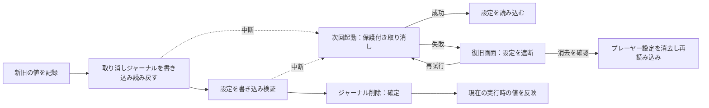

# 複数キー設定の復旧

<!-- language-navigation:start -->

<a href="settings-recovery.md" lang="en" dir="ltr">English</a> · <a href="settings-recovery.ar.md" lang="ar" dir="rtl">العربية</a> · <a href="settings-recovery.bn.md" lang="bn" dir="ltr">বাংলা</a> · <a href="settings-recovery.cs.md" lang="cs" dir="ltr">Čeština</a> · <a href="settings-recovery.de.md" lang="de" dir="ltr">Deutsch</a> · <a href="settings-recovery.es.md" lang="es" dir="ltr">Español</a> · <a href="settings-recovery.fa.md" lang="fa" dir="rtl">فارسی</a> · <a href="settings-recovery.fr.md" lang="fr" dir="ltr">Français</a>
 
<a href="settings-recovery.he.md" lang="he" dir="rtl">עברית</a> · <a href="settings-recovery.hi.md" lang="hi" dir="ltr">हिन्दी</a> · <a href="settings-recovery.id.md" lang="id" dir="ltr">Bahasa Indonesia</a> · <a href="settings-recovery.it.md" lang="it" dir="ltr">Italiano</a> · <a href="settings-recovery.ja.md" lang="ja" dir="ltr">日本語</a> · <a href="settings-recovery.ko.md" lang="ko" dir="ltr">한국어</a> · <a href="settings-recovery.nl.md" lang="nl" dir="ltr">Nederlands</a> · <a href="settings-recovery.pl.md" lang="pl" dir="ltr">Polski</a>
 
<a href="settings-recovery.pt.md" lang="pt" dir="ltr">Português</a> · <a href="settings-recovery.ru.md" lang="ru" dir="ltr">Русский</a> · <a href="settings-recovery.th.md" lang="th" dir="ltr">ไทย</a> · <a href="settings-recovery.tr.md" lang="tr" dir="ltr">Türkçe</a> · <a href="settings-recovery.uk.md" lang="uk" dir="ltr">Українська</a> · <a href="settings-recovery.vi.md" lang="vi" dir="ltr">Tiếng Việt</a> · <a href="settings-recovery.zh-Hans.md" lang="zh-Hans" dir="ltr">简体中文</a> · <a href="settings-recovery.zh-Hant.md" lang="zh-Hant" dir="ltr">繁體中文</a>

<!-- language-navigation:end -->

[改善点](roadmap-delivery.ja.md)

対応するlocalStorageのバッチ処理は `ottplaySettingsJournalV1` を使用します。これは内部の取り消しジャーナルで、エクスポート、クラウド送信データ、通常の設定列挙から除外されます。設定を変更する前に、書き込み側は各キーの復元用／新しい文字列（またはnull）を記録し、ジャーナルを読み戻し、バッチを書き込んで検証します。その後、ジャーナルを削除した時点で確定します。実行時の変更を反映するのは、記録した設定所有者が引き続き現在の所有者である場合だけです。インポートは無関係なキーを削除しません。

保護者PINの移行では、競合確認のため正確な元の値をメモリに保持しますが、復元用の値として書き込むのは保護済みの代替値だけです。インポートの失敗や復旧の中断によって、読み取り可能な旧PINを復元してはいけません。ジャーナル形式はバージョン1のままです。古い設定を更新または復元する前に、[PINの移行と制限](parental-pin-storage.md)を参照してください。

起動処理は設定を読み込む前に復旧を行います。保存値がこのバッチの新しい値とまだ一致している場合だけ旧値を復元するため、その後に別の処理が行った編集を保持します。復旧中は常にジャーナルと所有権を検証します。処理に失敗した、または破損したジャーナルがあると、プレーヤーの起動前に復旧画面を開きます。不完全なアカウント設定や古いcookieフォールバック値は読み込まず、通常の設定書き込みも遮断したままです。**Retry** は保護付き復旧を繰り返し、成功した場合だけ再読み込みします。**Clear settings** は2回目の明示的な確認を要求し、Cancel/Backではデータを変更しません。そのオリジンのlocalStorageと、記録済みのプレーヤーcookieを各ルートパスで削除します。他のcookieには触れません。永続的なリセットマーカーと空のフォールバック許可リストにより、localStorageが利用不能になった場合を含め、未記録の古いcookieが設定を復活させることを防ぎます。新しいフォールバック書き込みは許可リストに登録されます。ジャーナルの遮断は、リセット方針と削除を検証した後でのみ解除します。失敗時は復旧画面と遮断を維持します。キーボードのTab／矢印／Enterと機器リモコンのキーは、通常のUI初期化前から動作します。自動リセットは行わず、画面にジャーナルの内容を表示することもありません。必要ならClear settingsを選ぶ前に、診断用として元のストレージを非公開で保存してください。ジャーナルの上限は16 000件、シリアライズしたテキストで2 MiBです。

**保証の範囲：** 書き込み側は1つ、対応するネイティブlocalStorageの保存先も1つです。ブラウザーはタブ間でアトミックなcompare-and-swapを提供しません。複数ウィンドウで同時にインポートしないでください。これは複数タブのトランザクションやデータベースではありません。停電時の永続性は、ブラウザー／OSのストレージ自体によって制限されます。cookie／セッション／独自の機器アダプターは、保護付きのベストエフォートなロールバックを維持しますが、永続ジャーナルは追加されません。遠隔コントローラーや他のプレーヤーとの分散トランザクションはありません。

ジャーナルは新旧の設定値を一時的に保持し、プロバイダーの認証情報を含む可能性があります。保存場所は、それらをもともと保持している同じオリジンのストレージです。これはテレメトリーではなく、公開バグ報告にコピーしてはいけません。ジャーナル準備中に容量制限エラーが発生すると、書き込み前に停止します。失敗したインポートを隠すためだけに未処理のジャーナルを削除しないでください。復旧情報が失われます。

`node tests/test_settings_journal.cjs`、`node tests/test_settings_store.cjs`、`node tests/test_local_settings_backup.cjs`、`node tests/test_cloud_settings_session.cjs` を実行します。テストは中断された書き込みのスナップショットから再起動し、復旧自体も中断させ、他の処理の値を保持し、容量制限／破損／再入の失敗を確認します。また、隔離された読み書き、実際の早期起動ガード、一時的なストレージ障害後の再試行、明示的リセット確認、キーボード／リモコン入力、中断されたリセット、拒否されたcookie削除、別の処理のパス限定cookie、リセット後のネイティブ／cookieフォールバックも確認します。早期HTML言語ローダーも同じリセット許可リストに従います。
