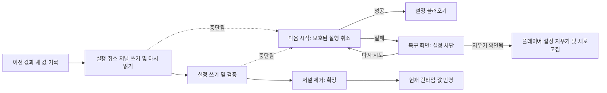

# 복구 가능한 다중 키 설정

<!-- language-navigation:start -->

<a href="settings-recovery.md" lang="en" dir="ltr">English</a> · <a href="settings-recovery.ar.md" lang="ar" dir="rtl">العربية</a> · <a href="settings-recovery.bn.md" lang="bn" dir="ltr">বাংলা</a> · <a href="settings-recovery.cs.md" lang="cs" dir="ltr">Čeština</a> · <a href="settings-recovery.de.md" lang="de" dir="ltr">Deutsch</a> · <a href="settings-recovery.es.md" lang="es" dir="ltr">Español</a> · <a href="settings-recovery.fa.md" lang="fa" dir="rtl">فارسی</a> · <a href="settings-recovery.fr.md" lang="fr" dir="ltr">Français</a>
 
<a href="settings-recovery.he.md" lang="he" dir="rtl">עברית</a> · <a href="settings-recovery.hi.md" lang="hi" dir="ltr">हिन्दी</a> · <a href="settings-recovery.id.md" lang="id" dir="ltr">Bahasa Indonesia</a> · <a href="settings-recovery.it.md" lang="it" dir="ltr">Italiano</a> · <a href="settings-recovery.ja.md" lang="ja" dir="ltr">日本語</a> · <a href="settings-recovery.ko.md" lang="ko" dir="ltr">한국어</a> · <a href="settings-recovery.nl.md" lang="nl" dir="ltr">Nederlands</a> · <a href="settings-recovery.pl.md" lang="pl" dir="ltr">Polski</a>
 
<a href="settings-recovery.pt.md" lang="pt" dir="ltr">Português</a> · <a href="settings-recovery.ru.md" lang="ru" dir="ltr">Русский</a> · <a href="settings-recovery.th.md" lang="th" dir="ltr">ไทย</a> · <a href="settings-recovery.tr.md" lang="tr" dir="ltr">Türkçe</a> · <a href="settings-recovery.uk.md" lang="uk" dir="ltr">Українська</a> · <a href="settings-recovery.vi.md" lang="vi" dir="ltr">Tiếng Việt</a> · <a href="settings-recovery.zh-Hans.md" lang="zh-Hans" dir="ltr">简体中文</a> · <a href="settings-recovery.zh-Hant.md" lang="zh-Hant" dir="ltr">繁體中文</a>

<!-- language-navigation:end -->

[개선 사항](roadmap-delivery.ko.md)

지원되는 localStorage 일괄 처리는 `ottplaySettingsJournalV1` 을 사용합니다. 이는 내보내기, 클라우드 페이로드 및 일반 설정 열거에서 제외되는 내부 실행 취소 저널입니다. 설정을 바꾸기 전에 작성자는 각 키의 복구용/새 문자열(또는 null)을 기록하고 저널을 다시 읽은 뒤 일괄 처리를 기록하고 검증합니다. 이후 저널을 제거하는 시점에 확정합니다. 런타임 변경은 기록해 둔 설정 소유자가 여전히 현재 소유자인 동안에만 반영합니다. 가져오기는 무관한 키를 지우지 않습니다.

자녀 보호 PIN 마이그레이션은 충돌 검사를 위해 정확한 원래 값을 메모리에 유지하지만, 롤백 값으로는 보호된 대체 값만 기록합니다. 가져오기 실패나 복구 중단으로 읽을 수 있는 기존 PIN을 복원해서는 안 됩니다. 저널 형식은 버전 1을 유지합니다. 오래된 설정을 업데이트하거나 복원하기 전에 [PIN 마이그레이션과 제한](parental-pin-storage.md)을 읽으세요.

시작 과정은 설정을 불러오기 전에 복구를 수행합니다. 저장된 값이 여전히 이 일괄 처리의 새 값과 같을 때만 이전 값을 복원하므로, 이후 다른 곳에서 한 수정은 보존합니다. 복구 전 과정에서 저널과 소유권을 검증합니다. 실패하거나 손상된 저널이 있으면 플레이어 시작 전에 복구 화면을 엽니다. 일부만 있는 계정 설정이나 오래된 쿠키 대체 값은 불러오지 않으며, 일반적인 설정 쓰기는 계속 차단합니다. **Retry** 는 보호된 복구를 반복하고 성공 후에만 새로고침합니다. **Clear settings** 는 두 번째 명시적 확인을 요구합니다. Cancel/Back은 데이터를 그대로 둡니다. 해당 오리진의 localStorage와 기록된 플레이어 쿠키를 각 루트 경로에서 지웁니다. 다른 쿠키는 그대로 둡니다. 영구적인 초기화 표시와 빈 대체 값 허용 목록은 localStorage가 사용할 수 없게 된 경우에도 기록되지 않은 기존 쿠키가 설정을 되살리지 못하게 합니다. 새로운 대체 값 쓰기는 허용 목록에 등록됩니다. 저널 차단은 초기화 정책과 삭제를 검증한 뒤에만 해제합니다. 실패하면 복구 화면과 차단을 유지합니다. 키보드의 Tab/방향키/Enter와 기기 리모컨 키는 일반 UI 초기화 전부터 동작합니다. 자동 초기화는 없으며 화면에는 저널 내용이 절대로 표시되지 않습니다. 필요하면 Clear settings를 선택하기 전에 진단을 위해 원래 저장소를 비공개로 보관하세요. 저널 한도는 16 000개 항목과 직렬화된 텍스트 2 MiB입니다.

**보장 범위:** 하나의 작성자와 하나의 지원되는 네이티브 localStorage 저장소입니다. 브라우저는 탭 사이의 원자적 compare-and-swap을 제공하지 않습니다. 여러 창에서 동시에 가져오기를 실행하지 마세요. 이는 다중 탭 트랜잭션이나 데이터베이스가 아닙니다. 전원 손실 시 내구성은 브라우저/운영체제 저장소 자체에 의해 제한됩니다. 쿠키/세션/사용자 정의 기기 어댑터는 보호된 최선 노력 롤백을 유지하며, 영구 저널을 얻게 되지는 않습니다. 원격 컨트롤러나 다른 플레이어와의 분산 트랜잭션은 없습니다.

저널에는 이전/새 설정 값이 잠시 들어 있으며 공급자 자격 증명이 포함될 수 있습니다. 위치는 해당 값을 이미 저장하는 동일 오리진 저장소입니다. 이는 원격 측정 데이터가 아니며 공개 버그 보고서에 복사해서는 안 됩니다. 저널 준비 중 할당량 오류가 발생하면 쓰기 전에 중단합니다. 가져오기 실패를 숨기려고 대기 중인 저널을 제거하지 마세요. 복구 정보가 사라집니다.

`node tests/test_settings_journal.cjs`, `node tests/test_settings_store.cjs`, `node tests/test_local_settings_backup.cjs` 및 `node tests/test_cloud_settings_session.cjs` 를 실행하세요. 테스트는 중단된 쓰기의 스냅샷에서 다시 시작하고, 복구 자체를 중단하며, 다른 곳에서 기록한 값을 보존하고 할당량/손상/재진입 실패를 검증합니다. 복구 테스트는 격리된 읽기/쓰기, 실제 초기 시작 보호 장치, 일시적 저장소 오류 후 재시도, 명시적 초기화 확인, 키보드/리모컨 입력, 중단된 초기화, 거부된 쿠키 삭제, 다른 경로 범위의 외부 쿠키, 초기화 후 네이티브/쿠키 대체 처리도 다룹니다. 초기 HTML 언어 로더는 동일한 초기화 허용 목록을 따릅니다.
