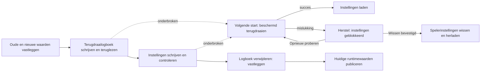

# Herstelbare instellingen over meerdere sleutels

<!-- language-navigation:start -->

<a href="settings-recovery.md" lang="en" dir="ltr">English</a> · <a href="settings-recovery.ar.md" lang="ar" dir="rtl">العربية</a> · <a href="settings-recovery.bn.md" lang="bn" dir="ltr">বাংলা</a> · <a href="settings-recovery.cs.md" lang="cs" dir="ltr">Čeština</a> · <a href="settings-recovery.de.md" lang="de" dir="ltr">Deutsch</a> · <a href="settings-recovery.es.md" lang="es" dir="ltr">Español</a> · <a href="settings-recovery.fa.md" lang="fa" dir="rtl">فارسی</a> · <a href="settings-recovery.fr.md" lang="fr" dir="ltr">Français</a>
 
<a href="settings-recovery.he.md" lang="he" dir="rtl">עברית</a> · <a href="settings-recovery.hi.md" lang="hi" dir="ltr">हिन्दी</a> · <a href="settings-recovery.id.md" lang="id" dir="ltr">Bahasa Indonesia</a> · <a href="settings-recovery.it.md" lang="it" dir="ltr">Italiano</a> · <a href="settings-recovery.ja.md" lang="ja" dir="ltr">日本語</a> · <a href="settings-recovery.ko.md" lang="ko" dir="ltr">한국어</a> · <a href="settings-recovery.nl.md" lang="nl" dir="ltr">Nederlands</a> · <a href="settings-recovery.pl.md" lang="pl" dir="ltr">Polski</a>
 
<a href="settings-recovery.pt.md" lang="pt" dir="ltr">Português</a> · <a href="settings-recovery.ru.md" lang="ru" dir="ltr">Русский</a> · <a href="settings-recovery.th.md" lang="th" dir="ltr">ไทย</a> · <a href="settings-recovery.tr.md" lang="tr" dir="ltr">Türkçe</a> · <a href="settings-recovery.uk.md" lang="uk" dir="ltr">Українська</a> · <a href="settings-recovery.vi.md" lang="vi" dir="ltr">Tiếng Việt</a> · <a href="settings-recovery.zh-Hans.md" lang="zh-Hans" dir="ltr">简体中文</a> · <a href="settings-recovery.zh-Hant.md" lang="zh-Hant" dir="ltr">繁體中文</a>

<!-- language-navigation:end -->

[Verbeteringen](roadmap-delivery.nl.md)

Ondersteunde localStorage-batches gebruiken `ottplaySettingsJournalV1`, een intern terugdraailogboek dat is uitgesloten van exports, cloudinhoud en normale overzichten van instellingen. Voor een wijziging legt de schrijver de oude/nieuwe tekenreeks van elke sleutel (of null) vast, leest het logboek terug, schrijft en controleert de batch en verwijdert vervolgens het logboek als vastleggingspunt. Runtimewijzigingen worden alleen gepubliceerd zolang de vastgelegde eigenaar van de instellingen nog actueel is. Een import wist geen niet-betrokken sleutels.

Bij migratie van de pincode voor ouderlijk toezicht blijft de exacte oorspronkelijke waarde in het geheugen voor conflictcontroles, maar wordt alleen de beschermde vervanging als terugrolwaarde geschreven. Een mislukte import of onderbroken herstelactie mag geen leesbare oude pincode herstellen. Het logboekformaat blijft versie 1. Lees [pincodemigratie en beperkingen](parental-pin-storage.md) voordat u oudere instellingen bijwerkt of herstelt.

Bij het opstarten vindt herstel plaats voordat instellingen worden ingeladen. Een oude waarde wordt alleen hersteld zolang de opgeslagen waarde nog gelijk is aan de nieuwe waarde van deze batch; latere externe wijzigingen blijven behouden. Tijdens het hele herstel worden logboek en eigenaarschap gecontroleerd. Een mislukt of beschadigd logboek opent vóór de spelerstart een herstelscherm. Gedeeltelijke accountinstellingen en verouderde cookieterugvalwaarden worden niet geladen, en gewone schrijfopdrachten blijven geblokkeerd. **Retry** herhaalt het beschermde herstel en herlaadt alleen na succes. **Clear settings** vereist een tweede expliciete bevestiging; Cancel/Back laat de gegevens intact. Het wist de localStorage van de origin en de geregistreerde spelercookies op hun hoofdpad. Andere cookies blijven ongemoeid. Een blijvende resetmarkering en een lege terugvaltoelatingslijst voorkomen dat niet-geregistreerde oude cookies instellingen terugbrengen, ook als localStorage niet meer beschikbaar is; nieuwe terugvalschrijfopdrachten komen op de toelatingslijst. De logboekbarrière verdwijnt pas nadat resetbeleid en verwijdering zijn gecontroleerd. Bij mislukking blijven herstelscherm en barrière bestaan. Tab, pijlen, Enter en afstandsbedieningstoetsen werken vóór de normale initialisatie van de interface. Niets wordt automatisch gereset en het scherm toont nooit logboekinhoud. Bewaar indien nodig de oorspronkelijke opslag privé voor diagnose voordat u Clear settings kiest. Logboeklimieten: 16 000 vermeldingen en 2 MiB geserialiseerde tekst.

**Garantiegrens:** één schrijver en één ondersteunde native localStorage-opslag. Browsers bieden geen atomische compare-and-swap tussen tabbladen. Voer geen gelijktijdige imports in meerdere vensters uit; dit is geen transactie over tabbladen of database. Duurzaamheid bij stroomuitval wordt beperkt door de browser-/OS-opslag zelf. Cookie-/sessie-/aangepaste apparaatadapters behouden hun beschermde terugrol naar beste vermogen; zij krijgen geen blijvend logboek. Er is geen gedistribueerde transactie met de externe controller of een andere speler.

Het logboek bevat tijdelijk oude/nieuwe instellingswaarden, mogelijk met inloggegevens van providers, in dezelfde originopslag waar die al staan. Het is geen telemetrie en mag niet naar openbare foutrapporten worden gekopieerd. Een quotafout bij het voorbereiden van het logboek stopt vóór het schrijven. Verwijder geen openstaand logboek alleen om een mislukte import te verbergen; daarmee gooit u de herstelinformatie weg.

Voer `node tests/test_settings_journal.cjs`, `node tests/test_settings_store.cjs`, `node tests/test_local_settings_backup.cjs` en `node tests/test_cloud_settings_session.cjs` uit. Tests starten opnieuw vanuit momentopnamen van onderbroken schrijfacties, onderbreken het herstel zelf, behouden externe waarden en testen quota-/corruptie-/herintredingsfouten. Hersteltests omvatten ook afgeschermde lees-/schrijfacties, de werkelijke vroege opstartbeveiliging, opnieuw proberen na tijdelijke opslaguitval, expliciete resetbevestiging, toetsenbord-/afstandsbedieningsinvoer, onderbroken resets, geweigerde cookieverwijdering, externe padgebonden cookies en native/cookieterugval na een reset. De vroege HTML-taallader volgt dezelfde resettoelatingslijst.
