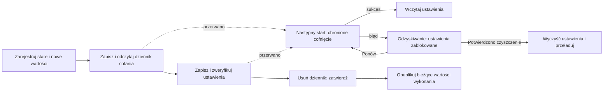

# Odzyskiwalne ustawienia wielu kluczy

<!-- language-navigation:start -->

<a href="settings-recovery.md" lang="en" dir="ltr">English</a> · <a href="settings-recovery.ar.md" lang="ar" dir="rtl">العربية</a> · <a href="settings-recovery.bn.md" lang="bn" dir="ltr">বাংলা</a> · <a href="settings-recovery.cs.md" lang="cs" dir="ltr">Čeština</a> · <a href="settings-recovery.de.md" lang="de" dir="ltr">Deutsch</a> · <a href="settings-recovery.es.md" lang="es" dir="ltr">Español</a> · <a href="settings-recovery.fa.md" lang="fa" dir="rtl">فارسی</a> · <a href="settings-recovery.fr.md" lang="fr" dir="ltr">Français</a>
 
<a href="settings-recovery.he.md" lang="he" dir="rtl">עברית</a> · <a href="settings-recovery.hi.md" lang="hi" dir="ltr">हिन्दी</a> · <a href="settings-recovery.id.md" lang="id" dir="ltr">Bahasa Indonesia</a> · <a href="settings-recovery.it.md" lang="it" dir="ltr">Italiano</a> · <a href="settings-recovery.ja.md" lang="ja" dir="ltr">日本語</a> · <a href="settings-recovery.ko.md" lang="ko" dir="ltr">한국어</a> · <a href="settings-recovery.nl.md" lang="nl" dir="ltr">Nederlands</a> · <a href="settings-recovery.pl.md" lang="pl" dir="ltr">Polski</a>
 
<a href="settings-recovery.pt.md" lang="pt" dir="ltr">Português</a> · <a href="settings-recovery.ru.md" lang="ru" dir="ltr">Русский</a> · <a href="settings-recovery.th.md" lang="th" dir="ltr">ไทย</a> · <a href="settings-recovery.tr.md" lang="tr" dir="ltr">Türkçe</a> · <a href="settings-recovery.uk.md" lang="uk" dir="ltr">Українська</a> · <a href="settings-recovery.vi.md" lang="vi" dir="ltr">Tiếng Việt</a> · <a href="settings-recovery.zh-Hans.md" lang="zh-Hans" dir="ltr">简体中文</a> · <a href="settings-recovery.zh-Hant.md" lang="zh-Hant" dir="ltr">繁體中文</a>

<!-- language-navigation:end -->

[Ulepszenia](roadmap-delivery.pl.md)

Obsługiwane partie localStorage korzystają z `ottplaySettingsJournalV1`, wewnętrznego dziennika cofania wyłączonego z eksportu, danych wysyłanych do chmury i zwykłego wyliczania ustawień. Przed zmianą zapisujący zapisuje poprzedni/nowy ciąg każdego klucza (lub null), odczytuje dziennik, zapisuje i weryfikuje partię, a następnie usuwa dziennik jako punkt zatwierdzenia. Zmiany w czasie działania są publikowane tylko, dopóki uchwycony właściciel ustawień pozostaje bieżący. Import nie usuwa niezwiązanych kluczy.

Migracja PIN-u rodzicielskiego zachowuje dokładną pierwotną wartość w pamięci do wykrywania konfliktów, ale jako wartość cofania zapisuje tylko jej chroniony zamiennik. Nieudany import lub przerwane odzyskiwanie nie może przywrócić czytelnego starego PIN-u. Format dziennika pozostaje w wersji 1. Przed aktualizacją lub odtworzeniem starszych ustawień przeczytaj [migrację PIN-u i ograniczenia](parental-pin-storage.md).

Rozruch wykonuje odzyskiwanie przed wczytaniem ustawień. Przywraca starą wartość tylko wtedy, gdy zapisana wartość nadal odpowiada nowej wartości tej partii, zachowując późniejszą obcą zmianę. Przez cały proces sprawdza dziennik i własność. Błąd lub uszkodzenie dziennika otwiera ekran odzyskiwania przed uruchomieniem odtwarzacza. Nie są wczytywane częściowe ustawienia konta ani nieaktualne wartości zastępcze cookies, a zwykłe zapisy ustawień pozostają zablokowane. **Retry** powtarza chronione odzyskiwanie i przeładowuje dopiero po sukcesie. **Clear settings** wymaga drugiego jawnego potwierdzenia; Cancel/Back pozostawia dane bez zmian. Czyści localStorage originu i zarejestrowane cookies odtwarzacza w ich ścieżce głównej. Obce cookies pozostają nietknięte. Trwały znacznik resetu i pusta lista dozwolonych wartości zastępczych zapobiegają odtwarzaniu ustawień z niezarejestrowanych starych cookies, także gdy localStorage stanie się niedostępne; nowe zapisy zastępcze trafiają na listę. Bariera dziennika znika dopiero po sprawdzeniu zasad resetu i usunięcia danych. Błąd zachowuje ekran i barierę. Tab, strzałki, Enter i przyciski pilota działają przed zwykłą inicjalizacją interfejsu. Nic nie jest resetowane automatycznie, a ekran nigdy nie pokazuje zawartości dziennika. W razie potrzeby przed Clear settings zachowaj prywatnie oryginalny magazyn do diagnostyki. Limity dziennika: 16 000 wpisów i 2 MiB tekstu po serializacji.

**Granica gwarancji:** jeden zapisujący i jeden obsługiwany natywny magazyn localStorage. Przeglądarki nie zapewniają atomowej operacji compare-and-swap między kartami. Nie uruchamiaj jednoczesnych importów w wielu oknach; to nie transakcja wielokartowa ani baza danych. Trwałość przy utracie zasilania ogranicza sam magazyn przeglądarki/systemu. Adaptery cookies/sesji/niestandardowych urządzeń zachowują chronione cofanie według najlepszych możliwości; nie otrzymują trwałego dziennika. Nie ma transakcji rozproszonej ze zdalnym kontrolerem ani innym odtwarzaczem.

Dziennik tymczasowo zawiera stare/nowe wartości ustawień, potencjalnie dane logowania dostawcy, w tym samym magazynie originu, który już je przechowuje. To nie telemetria i nie wolno kopiować go do publicznych zgłoszeń błędów. Błąd limitu miejsca podczas przygotowania dziennika zatrzymuje operację przed zapisami. Nie usuwaj oczekującego dziennika tylko po to, by ukryć nieudany import: odrzucisz informacje potrzebne do odzyskania.

Uruchom `node tests/test_settings_journal.cjs`, `node tests/test_settings_store.cjs`, `node tests/test_local_settings_backup.cjs` i `node tests/test_cloud_settings_session.cjs`. Testy restartują ze zrzutów przerwanych zapisów, przerywają samo odzyskiwanie, zachowują obce wartości i sprawdzają błędy limitu/uszkodzenia/ponownego wejścia. Obejmują też odizolowane odczyty i zapisy, rzeczywistą wczesną ochronę rozruchu, ponowienie po chwilowej awarii magazynu, jawne potwierdzenie resetu, wejście klawiatury/pilota, przerwane resety, odrzucone usuwanie cookies, obce cookies ograniczone ścieżką i natywne/cookie mechanizmy zastępcze po resecie. Wczesny moduł HTML wczytujący język przestrzega tej samej listy dozwolonej po resecie.
