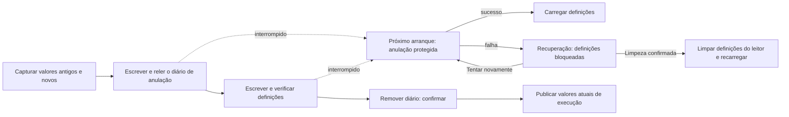

# Definições recuperáveis com várias chaves

<!-- language-navigation:start -->

<a href="settings-recovery.md" lang="en" dir="ltr">English</a> · <a href="settings-recovery.ar.md" lang="ar" dir="rtl">العربية</a> · <a href="settings-recovery.bn.md" lang="bn" dir="ltr">বাংলা</a> · <a href="settings-recovery.cs.md" lang="cs" dir="ltr">Čeština</a> · <a href="settings-recovery.de.md" lang="de" dir="ltr">Deutsch</a> · <a href="settings-recovery.es.md" lang="es" dir="ltr">Español</a> · <a href="settings-recovery.fa.md" lang="fa" dir="rtl">فارسی</a> · <a href="settings-recovery.fr.md" lang="fr" dir="ltr">Français</a>
 
<a href="settings-recovery.he.md" lang="he" dir="rtl">עברית</a> · <a href="settings-recovery.hi.md" lang="hi" dir="ltr">हिन्दी</a> · <a href="settings-recovery.id.md" lang="id" dir="ltr">Bahasa Indonesia</a> · <a href="settings-recovery.it.md" lang="it" dir="ltr">Italiano</a> · <a href="settings-recovery.ja.md" lang="ja" dir="ltr">日本語</a> · <a href="settings-recovery.ko.md" lang="ko" dir="ltr">한국어</a> · <a href="settings-recovery.nl.md" lang="nl" dir="ltr">Nederlands</a> · <a href="settings-recovery.pl.md" lang="pl" dir="ltr">Polski</a>
 
<a href="settings-recovery.pt.md" lang="pt" dir="ltr">Português</a> · <a href="settings-recovery.ru.md" lang="ru" dir="ltr">Русский</a> · <a href="settings-recovery.th.md" lang="th" dir="ltr">ไทย</a> · <a href="settings-recovery.tr.md" lang="tr" dir="ltr">Türkçe</a> · <a href="settings-recovery.uk.md" lang="uk" dir="ltr">Українська</a> · <a href="settings-recovery.vi.md" lang="vi" dir="ltr">Tiếng Việt</a> · <a href="settings-recovery.zh-Hans.md" lang="zh-Hans" dir="ltr">简体中文</a> · <a href="settings-recovery.zh-Hant.md" lang="zh-Hant" dir="ltr">繁體中文</a>

<!-- language-navigation:end -->

[Melhorias](roadmap-delivery.pt.md)

Os lotes localStorage suportados usam `ottplaySettingsJournalV1`, um diário interno de anulação excluído das exportações, dados enviados para a nuvem e enumeração normal de definições. Antes de alterar definições, o escritor regista a cadeia anterior/nova de cada chave (ou null), relê o diário, escreve e verifica o lote, e depois remove o diário como ponto de confirmação. As alterações em execução só são publicadas enquanto o proprietário das definições capturado continuar a ser o atual. Uma importação não apaga chaves alheias ao lote.

A migração do PIN parental mantém em memória o valor original exato para verificar conflitos, mas escreve apenas o seu substituto protegido como valor de reversão. Uma importação falhada ou recuperação interrompida não pode restaurar um PIN antigo legível. O formato do diário continua na versão 1. Consulte [migração do PIN e limitações](parental-pin-storage.md) antes de atualizar ou restaurar definições antigas.

O arranque recupera antes de carregar as definições. Só restaura um valor antigo enquanto o valor guardado ainda corresponde ao novo valor desse lote, preservando alterações externas posteriores. Valida o diário e a titularidade durante toda a recuperação. Um diário falhado ou corrompido abre um ecrã de recuperação antes de iniciar o leitor. Não carrega definições parciais da conta nem valores de recurso antigos de cookies, e as escritas normais continuam bloqueadas. **Retry** repete a recuperação protegida e só recarrega após sucesso. **Clear settings** exige uma segunda confirmação explícita; Cancel/Back mantém os dados intactos. Apaga o localStorage da origem e os cookies registados do leitor no seu caminho raiz. Os cookies alheios não são alterados. Um marcador persistente de reposição e uma lista de recurso permitida vazia impedem cookies antigos não registados de ressuscitar definições, mesmo quando localStorage fica indisponível; novas escritas de recurso entram na lista. A barreira do diário só é retirada depois de verificar a política de reposição e a eliminação. Uma falha mantém o ecrã e a barreira. Tab, setas, Enter e teclas do comando funcionam antes da inicialização normal da interface. Nada é reposto automaticamente e o ecrã nunca mostra o conteúdo do diário. Se necessário, conserve privadamente o armazenamento original para diagnóstico antes de escolher Clear settings. Limites do diário: 16 000 entradas e 2 MiB de texto serializado.

**Limite da garantia:** um escritor e um armazenamento localStorage nativo suportado. Os navegadores não fornecem comparação e troca atómicas entre separadores. Não execute importações concorrentes em várias janelas; isto não é uma transação entre separadores nem uma base de dados. A durabilidade em caso de corte de energia depende do próprio armazenamento do navegador/SO. Os adaptadores de cookies/sessão/dispositivos personalizados mantêm uma reversão protegida de melhor esforço; não passam a ter diário persistente. Não existe transação distribuída com o controlador remoto ou outro leitor.

O diário contém temporariamente valores antigos/novos das definições, eventualmente credenciais do fornecedor, no mesmo armazenamento da origem que já os guarda. Não é telemetria e não deve ser copiado para relatos públicos de erros. Uma falha de quota durante a preparação do diário interrompe a operação antes das escritas. Não remova um diário pendente apenas para ocultar uma importação falhada: isso descarta as suas informações de recuperação.

Execute `node tests/test_settings_journal.cjs`, `node tests/test_settings_store.cjs`, `node tests/test_local_settings_backup.cjs` e `node tests/test_cloud_settings_session.cjs`. Os testes reiniciam a partir de instantâneos de escritas interrompidas, interrompem a própria recuperação, preservam valores alheios e exercitam falhas de quota/corrupção/reentrada. Também cobrem leituras/escritas em quarentena, a proteção real no início do arranque, nova tentativa após falha temporária de armazenamento, confirmação explícita de reposição, entrada por teclado/comando, reposições interrompidas, eliminação de cookies recusada, cookies alheios limitados a caminhos e recursos nativos/de cookies após a reposição. O carregador inicial do idioma HTML segue a mesma lista de reposição permitida.
