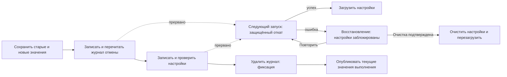

# Восстановимые настройки с несколькими ключами

<!-- language-navigation:start -->

<a href="settings-recovery.md" lang="en" dir="ltr">English</a> · <a href="settings-recovery.ar.md" lang="ar" dir="rtl">العربية</a> · <a href="settings-recovery.bn.md" lang="bn" dir="ltr">বাংলা</a> · <a href="settings-recovery.cs.md" lang="cs" dir="ltr">Čeština</a> · <a href="settings-recovery.de.md" lang="de" dir="ltr">Deutsch</a> · <a href="settings-recovery.es.md" lang="es" dir="ltr">Español</a> · <a href="settings-recovery.fa.md" lang="fa" dir="rtl">فارسی</a> · <a href="settings-recovery.fr.md" lang="fr" dir="ltr">Français</a>
 
<a href="settings-recovery.he.md" lang="he" dir="rtl">עברית</a> · <a href="settings-recovery.hi.md" lang="hi" dir="ltr">हिन्दी</a> · <a href="settings-recovery.id.md" lang="id" dir="ltr">Bahasa Indonesia</a> · <a href="settings-recovery.it.md" lang="it" dir="ltr">Italiano</a> · <a href="settings-recovery.ja.md" lang="ja" dir="ltr">日本語</a> · <a href="settings-recovery.ko.md" lang="ko" dir="ltr">한국어</a> · <a href="settings-recovery.nl.md" lang="nl" dir="ltr">Nederlands</a> · <a href="settings-recovery.pl.md" lang="pl" dir="ltr">Polski</a>
 
<a href="settings-recovery.pt.md" lang="pt" dir="ltr">Português</a> · <a href="settings-recovery.ru.md" lang="ru" dir="ltr">Русский</a> · <a href="settings-recovery.th.md" lang="th" dir="ltr">ไทย</a> · <a href="settings-recovery.tr.md" lang="tr" dir="ltr">Türkçe</a> · <a href="settings-recovery.uk.md" lang="uk" dir="ltr">Українська</a> · <a href="settings-recovery.vi.md" lang="vi" dir="ltr">Tiếng Việt</a> · <a href="settings-recovery.zh-Hans.md" lang="zh-Hans" dir="ltr">简体中文</a> · <a href="settings-recovery.zh-Hant.md" lang="zh-Hant" dir="ltr">繁體中文</a>

<!-- language-navigation:end -->

[Улучшения](roadmap-delivery.ru.md)

Поддерживаемые пакетные записи localStorage используют `ottplaySettingsJournalV1` — внутренний журнал отмены, который не включается в экспорт, облачные данные и обычное перечисление настроек. Перед изменением компонент записи сохраняет старую/новую строку каждого ключа (или null), перечитывает журнал, записывает и проверяет пакет, затем удаляет журнал как точку фиксации. Изменения во время выполнения публикуются только пока зафиксированный владелец настроек остаётся текущим. Импорт не очищает посторонние ключи.

Миграция родительского PIN сохраняет точное исходное значение в памяти для проверки конфликтов, но записывает в качестве значения отката только его защищённую замену. Неудачный импорт или прерванное восстановление не должны возвращать читаемый старый PIN. Формат журнала остаётся версии 1. Перед обновлением или восстановлением старых настроек прочитайте [о миграции PIN и ограничениях](parental-pin-storage.md).

При запуске восстановление выполняется до загрузки настроек. Старое значение возвращается только пока сохранённое значение ещё равно новому значению этого пакета: более поздняя посторонняя правка сохраняется. Журнал и владелец проверяются на протяжении всего восстановления. Неудачный или повреждённый журнал открывает экран восстановления до запуска плеера. Частичные настройки аккаунта и устаревшие резервные значения cookies не загружаются; обычная запись настроек остаётся заблокированной. **Retry** повторяет защищённое восстановление и перезагружает только после успеха. **Clear settings** требует второго явного подтверждения; Cancel/Back оставляет данные нетронутыми. Очищаются localStorage этого origin и зарегистрированные cookies плеера по их корневому пути. Посторонние cookies не затрагиваются. Постоянный маркер сброса и пустой список разрешённых резервных значений не дают незарегистрированным старым cookies возродить настройки, в том числе когда localStorage становится недоступным; новые резервные записи добавляются в список разрешённых. Барьер журнала удаляется только после проверки правил сброса и удаления. При ошибке экран восстановления и барьер сохраняются. Tab/стрелки/Enter и кнопки пульта работают до обычной инициализации интерфейса. Ничего не сбрасывается автоматически, и экран никогда не выводит содержимое журнала. При необходимости до выбора Clear settings приватно сохраните исходное хранилище для диагностики. Ограничения журнала: 16 000 записей и 2 MiB сериализованного текста.

**Граница гарантий:** один компонент записи и одно поддерживаемое нативное хранилище localStorage. Браузеры не предоставляют атомарную операцию compare-and-swap между вкладками. Не запускайте одновременные импорты в нескольких окнах: это не транзакция между вкладками и не база данных. Устойчивость к потере питания ограничена самим хранилищем браузера/ОС. Адаптеры cookies/сессии/специализированных устройств сохраняют защищённый откат в пределах возможного; постоянного журнала они не получают. Распределённой транзакции с удалённым контроллером или другим плеером нет.

Журнал временно содержит старые/новые значения настроек, возможно и учётные данные провайдера, в том же хранилище origin, где они уже находятся. Это не телеметрия; его нельзя копировать в публичные сообщения об ошибках. Ошибка квоты при подготовке журнала останавливает операцию до записей. Не удаляйте незавершённый журнал только ради сокрытия неудачного импорта: это уничтожит информацию для восстановления.

Выполните `node tests/test_settings_journal.cjs`, `node tests/test_settings_store.cjs`, `node tests/test_local_settings_backup.cjs` и `node tests/test_cloud_settings_session.cjs`. Тесты перезапускаются из снимков прерванных записей, прерывают само восстановление, сохраняют посторонние значения и проверяют ошибки квоты/повреждения/повторного входа. Тесты восстановления также охватывают изолированные чтения/записи, настоящий ранний барьер запуска, повтор после временной ошибки хранилища, явное подтверждение сброса, ввод с клавиатуры/пульта, прерванные сбросы, отклонённое удаление cookies, посторонние cookies с ограничением по пути и нативные/cookie резервные механизмы после сброса. Ранний HTML-загрузчик языка соблюдает тот же список разрешённых после сброса.
