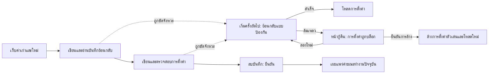

# การตั้งค่าหลายคีย์ที่กู้คืนได้

<!-- language-navigation:start -->

<a href="settings-recovery.md" lang="en" dir="ltr">English</a> · <a href="settings-recovery.ar.md" lang="ar" dir="rtl">العربية</a> · <a href="settings-recovery.bn.md" lang="bn" dir="ltr">বাংলা</a> · <a href="settings-recovery.cs.md" lang="cs" dir="ltr">Čeština</a> · <a href="settings-recovery.de.md" lang="de" dir="ltr">Deutsch</a> · <a href="settings-recovery.es.md" lang="es" dir="ltr">Español</a> · <a href="settings-recovery.fa.md" lang="fa" dir="rtl">فارسی</a> · <a href="settings-recovery.fr.md" lang="fr" dir="ltr">Français</a>
 
<a href="settings-recovery.he.md" lang="he" dir="rtl">עברית</a> · <a href="settings-recovery.hi.md" lang="hi" dir="ltr">हिन्दी</a> · <a href="settings-recovery.id.md" lang="id" dir="ltr">Bahasa Indonesia</a> · <a href="settings-recovery.it.md" lang="it" dir="ltr">Italiano</a> · <a href="settings-recovery.ja.md" lang="ja" dir="ltr">日本語</a> · <a href="settings-recovery.ko.md" lang="ko" dir="ltr">한국어</a> · <a href="settings-recovery.nl.md" lang="nl" dir="ltr">Nederlands</a> · <a href="settings-recovery.pl.md" lang="pl" dir="ltr">Polski</a>
 
<a href="settings-recovery.pt.md" lang="pt" dir="ltr">Português</a> · <a href="settings-recovery.ru.md" lang="ru" dir="ltr">Русский</a> · <a href="settings-recovery.th.md" lang="th" dir="ltr">ไทย</a> · <a href="settings-recovery.tr.md" lang="tr" dir="ltr">Türkçe</a> · <a href="settings-recovery.uk.md" lang="uk" dir="ltr">Українська</a> · <a href="settings-recovery.vi.md" lang="vi" dir="ltr">Tiếng Việt</a> · <a href="settings-recovery.zh-Hans.md" lang="zh-Hans" dir="ltr">简体中文</a> · <a href="settings-recovery.zh-Hant.md" lang="zh-Hant" dir="ltr">繁體中文</a>

<!-- language-navigation:end -->

[การปรับปรุง](roadmap-delivery.th.md)

การเขียน localStorage แบบชุดที่รองรับใช้ `ottplaySettingsJournalV1` ซึ่งเป็นบันทึกย้อนกลับภายในที่ไม่รวมอยู่ในการส่งออก ข้อมูลส่งขึ้นคลาวด์ หรือการไล่รายการตั้งค่าปกติ ก่อนเปลี่ยนการตั้งค่า ผู้เขียนจะบันทึกสตริงค่าเดิม/ค่าใหม่ของแต่ละคีย์ (หรือ null) อ่านบันทึกกลับมา เขียนและตรวจสอบชุดข้อมูล แล้วลบบันทึกเพื่อยืนยันการเปลี่ยนแปลง การเปลี่ยนแปลงขณะทำงานจะถูกเผยแพร่ต่อเมื่อเจ้าของการตั้งค่าที่จับไว้ยังเป็นเจ้าของปัจจุบัน การนำเข้าไม่ลบคีย์ที่ไม่เกี่ยวข้อง

การย้าย PIN ผู้ปกครองเก็บค่าต้นฉบับที่ตรงกันทุกประการไว้ในหน่วยความจำเพื่อตรวจความขัดแย้ง แต่เขียนเฉพาะค่าทดแทนที่ได้รับการป้องกันเป็นค่าสำหรับย้อนกลับ การนำเข้าที่ล้มเหลวหรือการกู้คืนที่ถูกขัดจังหวะต้องไม่คืน PIN เก่าที่อ่านได้ รูปแบบบันทึกยังเป็นเวอร์ชัน 1 ดู [การย้าย PIN และข้อจำกัด](parental-pin-storage.md) ก่อนอัปเดตหรือคืนค่าการตั้งค่าเก่า

ขั้นตอนเริ่มต้นจะกู้คืนก่อนโหลดการตั้งค่า โดยคืนค่าเก่าเฉพาะเมื่อค่าที่เก็บไว้ยังตรงกับค่าใหม่ของชุดนี้ จึงรักษาการแก้ไขภายหลังจากส่วนอื่นไว้ได้ ระบบตรวจสอบบันทึกและความเป็นเจ้าของตลอดการกู้คืน บันทึกที่ล้มเหลวหรือเสียหายจะเปิดหน้ากู้คืนก่อนเริ่มตัวเล่น จะไม่โหลดการตั้งค่าบัญชีที่ไม่ครบหรือค่าสำรองคุกกี้ที่ล้าสมัย และยังคงบล็อกการเขียนการตั้งค่าปกติ **Retry** ทำการกู้คืนแบบมีการป้องกันอีกครั้ง และโหลดใหม่ต่อเมื่อสำเร็จ **Clear settings** ต้องยืนยันอย่างชัดเจนเป็นครั้งที่สอง ส่วน Cancel/Back ปล่อยข้อมูลไว้ตามเดิม การล้างจะลบ localStorage ของ origin และคุกกี้ของตัวเล่นที่บันทึกไว้ที่พาธรากของแต่ละคุกกี้ โดยไม่แตะคุกกี้อื่น เครื่องหมายรีเซ็ตถาวรและรายการอนุญาตค่าสำรองที่ว่างจะป้องกันคุกกี้เก่าที่ไม่ได้บันทึกไว้จากการฟื้นการตั้งค่ากลับมา แม้ localStorage จะใช้งานไม่ได้ การเขียนค่าสำรองใหม่จะเพิ่มในรายการอนุญาต อุปสรรคของบันทึกจะถูกนำออกเมื่อยืนยันนโยบายรีเซ็ตและการลบแล้วเท่านั้น หากล้มเหลว หน้ากู้คืนและอุปสรรคยังคงอยู่ ปุ่ม Tab/ลูกศร/Enter และปุ่มรีโมตอุปกรณ์ใช้ได้ก่อนเริ่ม UI ตามปกติ ไม่มีการรีเซ็ตอัตโนมัติและหน้าจอไม่เคยแสดงเนื้อหาบันทึก หากจำเป็น ให้เก็บพื้นที่จัดเก็บต้นฉบับเป็นส่วนตัวเพื่อวิเคราะห์ปัญหาก่อนเลือก Clear settings ขีดจำกัดบันทึก: 16 000 รายการและข้อความที่ซีเรียลไลซ์ 2 MiB

**ขอบเขตการรับประกัน:** ผู้เขียนหนึ่งรายและพื้นที่ localStorage เนทีฟที่รองรับหนึ่งแห่ง เบราว์เซอร์ไม่มี compare-and-swap แบบอะตอมมิกข้ามแท็บ ห้ามนำเข้าพร้อมกันหลายหน้าต่าง นี่ไม่ใช่ทรานแซกชันข้ามแท็บหรือฐานข้อมูล ความคงทนเมื่อไฟดับถูกจำกัดด้วยพื้นที่จัดเก็บของเบราว์เซอร์/ระบบปฏิบัติการเอง อะแดปเตอร์คุกกี้/เซสชัน/อุปกรณ์กำหนดเองยังคงย้อนกลับแบบป้องกันเท่าที่ทำได้ ไม่ได้เพิ่มบันทึกถาวร ไม่มีทรานแซกชันแบบกระจายร่วมกับตัวควบคุมระยะไกลหรือตัวเล่นอื่น

บันทึกมีค่าการตั้งค่าเก่า/ใหม่ชั่วคราว ซึ่งอาจรวมข้อมูลรับรองของผู้ให้บริการ อยู่ในพื้นที่จัดเก็บ origin เดียวกับที่เก็บข้อมูลเหล่านั้นอยู่แล้ว นี่ไม่ใช่ข้อมูลเทเลเมทรีและห้ามคัดลอกลงรายงานบั๊กสาธารณะ หากโควตาล้มเหลวระหว่างเตรียมบันทึก ระบบจะหยุดก่อนเขียน อย่าลบบันทึกที่ค้างเพียงเพื่อซ่อนการนำเข้าที่ล้มเหลว เพราะจะทิ้งข้อมูลสำหรับกู้คืน

เรียกใช้ `node tests/test_settings_journal.cjs`, `node tests/test_settings_store.cjs`, `node tests/test_local_settings_backup.cjs` และ `node tests/test_cloud_settings_session.cjs` การทดสอบเริ่มใหม่จากสแนปช็อตของการเขียนที่ถูกขัดจังหวะ ขัดจังหวะการกู้คืนเอง รักษาค่าของส่วนอื่น และทดสอบความล้มเหลวด้านโควตา/ความเสียหาย/การเข้าซ้ำ นอกจากนี้ยังครอบคลุมการอ่าน/เขียนที่แยกกักไว้ การป้องกันเริ่มต้นจริง การลองใหม่หลังพื้นที่จัดเก็บล้มเหลวชั่วคราว การยืนยันรีเซ็ตอย่างชัดเจน อินพุตจากคีย์บอร์ด/รีโมต รีเซ็ตที่ถูกขัดจังหวะ การลบคุกกี้ที่ถูกปฏิเสธ คุกกี้ของส่วนอื่นที่จำกัดด้วยพาธ และกลไกสำรองเนทีฟ/คุกกี้หลังรีเซ็ต ตัวโหลดภาษา HTML ระยะแรกใช้รายการอนุญาตรีเซ็ตเดียวกัน
