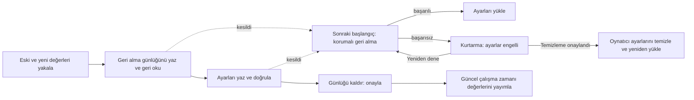

# Birden çok anahtara ait kurtarılabilir ayarlar

<!-- language-navigation:start -->

<a href="settings-recovery.md" lang="en" dir="ltr">English</a> · <a href="settings-recovery.ar.md" lang="ar" dir="rtl">العربية</a> · <a href="settings-recovery.bn.md" lang="bn" dir="ltr">বাংলা</a> · <a href="settings-recovery.cs.md" lang="cs" dir="ltr">Čeština</a> · <a href="settings-recovery.de.md" lang="de" dir="ltr">Deutsch</a> · <a href="settings-recovery.es.md" lang="es" dir="ltr">Español</a> · <a href="settings-recovery.fa.md" lang="fa" dir="rtl">فارسی</a> · <a href="settings-recovery.fr.md" lang="fr" dir="ltr">Français</a>
 
<a href="settings-recovery.he.md" lang="he" dir="rtl">עברית</a> · <a href="settings-recovery.hi.md" lang="hi" dir="ltr">हिन्दी</a> · <a href="settings-recovery.id.md" lang="id" dir="ltr">Bahasa Indonesia</a> · <a href="settings-recovery.it.md" lang="it" dir="ltr">Italiano</a> · <a href="settings-recovery.ja.md" lang="ja" dir="ltr">日本語</a> · <a href="settings-recovery.ko.md" lang="ko" dir="ltr">한국어</a> · <a href="settings-recovery.nl.md" lang="nl" dir="ltr">Nederlands</a> · <a href="settings-recovery.pl.md" lang="pl" dir="ltr">Polski</a>
 
<a href="settings-recovery.pt.md" lang="pt" dir="ltr">Português</a> · <a href="settings-recovery.ru.md" lang="ru" dir="ltr">Русский</a> · <a href="settings-recovery.th.md" lang="th" dir="ltr">ไทย</a> · <a href="settings-recovery.tr.md" lang="tr" dir="ltr">Türkçe</a> · <a href="settings-recovery.uk.md" lang="uk" dir="ltr">Українська</a> · <a href="settings-recovery.vi.md" lang="vi" dir="ltr">Tiếng Việt</a> · <a href="settings-recovery.zh-Hans.md" lang="zh-Hans" dir="ltr">简体中文</a> · <a href="settings-recovery.zh-Hant.md" lang="zh-Hant" dir="ltr">繁體中文</a>

<!-- language-navigation:end -->

[İyileştirmeler](roadmap-delivery.tr.md)

Desteklenen localStorage toplu işlemleri, dışa aktarmaya, bulut yüklerine ve normal ayar listelemesine dahil edilmeyen dahili geri alma günlüğü `ottplaySettingsJournalV1` kullanır. Yazan bileşen, ayarları değiştirmeden önce her anahtarın geri alma/yeni dizesini (veya null) kaydeder, günlüğü geri okur, toplu işlemi yazıp doğrular ve ardından onay noktası olarak günlüğü kaldırır. Çalışma zamanı değişiklikleri yalnızca yakalanan ayar sahibi hâlâ güncelse yayımlanır. İçe aktarma ilgisiz anahtarları temizlemez.

Ebeveyn PIN'i geçişi, çakışma denetimleri için özgün değerin tam halini bellekte tutar ancak geri alma değeri olarak yalnızca korumalı karşılığını yazar. Başarısız içe aktarma veya kesintiye uğrayan kurtarma, okunabilir eski PIN'i geri getirmemelidir. Günlük biçimi sürüm 1 olarak kalır. Eski ayarları güncellemeden veya geri yüklemeden önce [PIN geçişi ve sınırlamalarını](parental-pin-storage.md) okuyun.

Başlangıç, ayarları yüklemeden önce kurtarma yapar. Eski değeri yalnızca depolanan değer hâlâ bu toplu işlemin yeni değerine eşitse geri yükler; böylece daha sonra yapılan başka bir değişikliği korur. Kurtarma boyunca günlüğü ve sahipliği doğrular. Başarısız veya bozuk günlük, oynatıcı başlamadan önce kurtarma ekranını açar. Kısmi hesap ayarları veya eski çerez yedek değerleri yüklenmez; normal ayar yazmaları engellenmeye devam eder. **Retry**, korumalı kurtarmayı tekrarlar ve yalnızca başarıdan sonra yeniden yükler. **Clear settings**, ikinci bir açık onay gerektirir; Cancel/Back verileri değiştirmez. Kaynağın localStorage alanını ve kaydedilmiş oynatıcı çerezlerini kök yollarında temizler. Diğer çerezlere dokunmaz. Kalıcı sıfırlama işareti ve boş yedek izin listesi, localStorage kullanılamaz olduğunda bile kaydedilmemiş eski çerezlerin ayarları geri getirmesini önler; yeni yedek yazmalar izin listesine girer. Günlük bariyeri yalnızca sıfırlama ilkesi ve silme işlemi doğrulandıktan sonra kaldırılır. Başarısızlıkta kurtarma ekranı ve bariyer kalır. Klavyenin Tab/ok/Enter tuşları ve cihaz kumandası tuşları normal arayüz başlatılmadan önce çalışır. Hiçbir şey otomatik sıfırlanmaz ve ekran günlük içeriğini asla göstermez. Gerekirse Clear settings seçmeden önce özgün depolamayı tanı için özel olarak saklayın. Günlük sınırları: 16 000 kayıt ve 2 MiB serileştirilmiş metin.

**Garanti sınırı:** tek yazan ve desteklenen tek yerel localStorage deposu. Tarayıcılar sekmeler arasında atomik compare-and-swap sağlamaz. Birden çok pencerede eşzamanlı içe aktarma çalıştırmayın; bu bir çoklu sekme işlemi veya veritabanı değildir. Elektrik kesintisinde kalıcılık, tarayıcı/işletim sistemi depolamasının kendisiyle sınırlıdır. Çerez/oturum/özel cihaz bağdaştırıcıları korumalı, mümkün olan en iyi geri almayı korur; kalıcı günlük kazanmazlar. Uzak denetleyiciyle veya başka oynatıcıyla dağıtık işlem yoktur.

Günlük, sağlayıcı kimlik bilgilerini de içerebilen eski/yeni ayar değerlerini, bunların zaten tutulduğu aynı kaynak depolamasında geçici olarak bulundurur. Telemetri değildir ve herkese açık hata raporlarına kopyalanmamalıdır. Günlük hazırlanırken kota hatası oluşursa yazmalardan önce durulur. Başarısız içe aktarmayı gizlemek için bekleyen günlüğü kaldırmayın; bu, kurtarma bilgisini atar.

`node tests/test_settings_journal.cjs`, `node tests/test_settings_store.cjs`, `node tests/test_local_settings_backup.cjs` ve `node tests/test_cloud_settings_session.cjs` çalıştırın. Testler kesilen yazmaların anlık görüntülerinden yeniden başlar, kurtarmanın kendisini keser, başka bileşenlere ait değerleri korur ve kota/bozulma/yeniden giriş hatalarını sınar. Ayrıca karantinadaki okuma/yazmalar, gerçek erken başlangıç koruması, geçici depolama hatasından sonra yeniden deneme, açık sıfırlama onayı, klavye/kumanda girişi, kesilen sıfırlamalar, reddedilen çerez silme, başka bileşenlerin yol kapsamlı çerezleri ve sıfırlama sonrası yerel/çerez yedekleri kapsanır. Erken HTML dil yükleyicisi aynı sıfırlama izin listesini izler.
