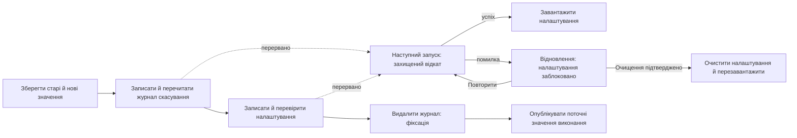

# Відновлювані налаштування з кількома ключами

<!-- language-navigation:start -->

<a href="settings-recovery.md" lang="en" dir="ltr">English</a> · <a href="settings-recovery.ar.md" lang="ar" dir="rtl">العربية</a> · <a href="settings-recovery.bn.md" lang="bn" dir="ltr">বাংলা</a> · <a href="settings-recovery.cs.md" lang="cs" dir="ltr">Čeština</a> · <a href="settings-recovery.de.md" lang="de" dir="ltr">Deutsch</a> · <a href="settings-recovery.es.md" lang="es" dir="ltr">Español</a> · <a href="settings-recovery.fa.md" lang="fa" dir="rtl">فارسی</a> · <a href="settings-recovery.fr.md" lang="fr" dir="ltr">Français</a>
 
<a href="settings-recovery.he.md" lang="he" dir="rtl">עברית</a> · <a href="settings-recovery.hi.md" lang="hi" dir="ltr">हिन्दी</a> · <a href="settings-recovery.id.md" lang="id" dir="ltr">Bahasa Indonesia</a> · <a href="settings-recovery.it.md" lang="it" dir="ltr">Italiano</a> · <a href="settings-recovery.ja.md" lang="ja" dir="ltr">日本語</a> · <a href="settings-recovery.ko.md" lang="ko" dir="ltr">한국어</a> · <a href="settings-recovery.nl.md" lang="nl" dir="ltr">Nederlands</a> · <a href="settings-recovery.pl.md" lang="pl" dir="ltr">Polski</a>
 
<a href="settings-recovery.pt.md" lang="pt" dir="ltr">Português</a> · <a href="settings-recovery.ru.md" lang="ru" dir="ltr">Русский</a> · <a href="settings-recovery.th.md" lang="th" dir="ltr">ไทย</a> · <a href="settings-recovery.tr.md" lang="tr" dir="ltr">Türkçe</a> · <a href="settings-recovery.uk.md" lang="uk" dir="ltr">Українська</a> · <a href="settings-recovery.vi.md" lang="vi" dir="ltr">Tiếng Việt</a> · <a href="settings-recovery.zh-Hans.md" lang="zh-Hans" dir="ltr">简体中文</a> · <a href="settings-recovery.zh-Hant.md" lang="zh-Hant" dir="ltr">繁體中文</a>

<!-- language-navigation:end -->

[Поліпшення](roadmap-delivery.uk.md)

Підтримувані пакети запису localStorage використовують `ottplaySettingsJournalV1` — внутрішній журнал скасування, який не входить до експорту, хмарних даних і звичайного переліку налаштувань. Перед зміною компонент запису зберігає старий/новий рядок кожного ключа (або null), перечитує журнал, записує й перевіряє пакет, а потім видаляє журнал як точку фіксації. Зміни під час виконання публікуються лише доки зафіксований власник налаштувань залишається поточним. Імпорт не очищає сторонні ключі.

Міграція батьківського PIN зберігає точне початкове значення в пам'яті для перевірки конфліктів, але як значення відкату записує лише його захищену заміну. Невдалий імпорт або перерване відновлення не повинні повертати читабельний старий PIN. Формат журналу залишається версії 1. Перед оновленням або відновленням старіших налаштувань прочитайте [про міграцію PIN і обмеження](parental-pin-storage.md).

Запуск виконує відновлення перед завантаженням налаштувань. Старе значення повертається лише доки збережене значення ще дорівнює новому значенню цього пакета: пізніша стороння зміна зберігається. Журнал і власник перевіряються протягом усього відновлення. Невдалий або пошкоджений журнал відкриває екран відновлення ще до запуску плеєра. Часткові налаштування облікового запису та застарілі резервні значення cookies не завантажуються; звичайний запис налаштувань залишається заблокованим. **Retry** повторює захищене відновлення й перезавантажує лише після успіху. **Clear settings** потребує другого явного підтвердження; Cancel/Back залишає дані недоторканими. Очищаються localStorage цього origin і зареєстровані cookies плеєра за їхнім кореневим шляхом. Сторонні cookies не змінюються. Постійний маркер скидання й порожній список дозволених резервних значень не дають незареєстрованим старим cookies відродити налаштування, зокрема коли localStorage стає недоступним; нові резервні записи потрапляють до списку дозволених. Бар'єр журналу видаляється лише після перевірки правил скидання та видалення. Помилка зберігає екран відновлення й бар'єр. Tab/стрілки/Enter і кнопки пульта працюють до звичайної ініціалізації інтерфейсу. Нічого не скидається автоматично, і екран ніколи не показує вміст журналу. За потреби до вибору Clear settings приватно збережіть початкове сховище для діагностики. Обмеження журналу: 16 000 записів і 2 MiB серіалізованого тексту.

**Межа гарантій:** один компонент запису й одне підтримуване нативне сховище localStorage. Браузери не забезпечують атомарної операції compare-and-swap між вкладками. Не запускайте одночасні імпорти в кількох вікнах: це не транзакція між вкладками й не база даних. Стійкість до втрати живлення обмежена самим сховищем браузера/ОС. Адаптери cookies/сесії/спеціалізованих пристроїв зберігають захищений відкат у межах можливого; постійного журналу вони не отримують. Розподіленої транзакції з віддаленим контролером або іншим плеєром немає.

Журнал тимчасово містить старі/нові значення налаштувань, можливо й облікові дані провайдера, у тому самому сховищі origin, де вони вже є. Це не телеметрія; його не можна копіювати до публічних повідомлень про помилки. Помилка квоти під час підготовки журналу зупиняє операцію до записів. Не видаляйте незавершений журнал лише для приховування невдалого імпорту: це знищить інформацію для відновлення.

Виконайте `node tests/test_settings_journal.cjs`, `node tests/test_settings_store.cjs`, `node tests/test_local_settings_backup.cjs` і `node tests/test_cloud_settings_session.cjs`. Тести перезапускаються зі знімків перерваних записів, переривають саме відновлення, зберігають сторонні значення та перевіряють помилки квоти/пошкодження/повторного входу. Тести відновлення також охоплюють ізольоване читання/запис, справжній ранній захист запуску, повтор після тимчасової помилки сховища, явне підтвердження скидання, ввід клавіатури/пульта, перервані скидання, відхилене видалення cookies, сторонні cookies з обмеженням за шляхом і нативні/cookie резервні механізми після скидання. Ранній HTML-завантажувач мови дотримується того самого списку дозволених після скидання.
