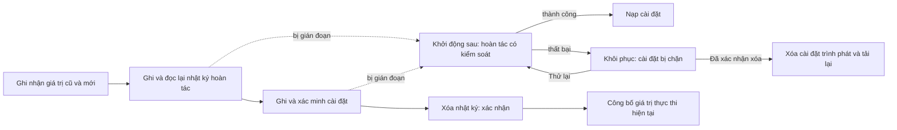

# Cài đặt nhiều khóa có thể khôi phục

<!-- language-navigation:start -->

<a href="settings-recovery.md" lang="en" dir="ltr">English</a> · <a href="settings-recovery.ar.md" lang="ar" dir="rtl">العربية</a> · <a href="settings-recovery.bn.md" lang="bn" dir="ltr">বাংলা</a> · <a href="settings-recovery.cs.md" lang="cs" dir="ltr">Čeština</a> · <a href="settings-recovery.de.md" lang="de" dir="ltr">Deutsch</a> · <a href="settings-recovery.es.md" lang="es" dir="ltr">Español</a> · <a href="settings-recovery.fa.md" lang="fa" dir="rtl">فارسی</a> · <a href="settings-recovery.fr.md" lang="fr" dir="ltr">Français</a>
 
<a href="settings-recovery.he.md" lang="he" dir="rtl">עברית</a> · <a href="settings-recovery.hi.md" lang="hi" dir="ltr">हिन्दी</a> · <a href="settings-recovery.id.md" lang="id" dir="ltr">Bahasa Indonesia</a> · <a href="settings-recovery.it.md" lang="it" dir="ltr">Italiano</a> · <a href="settings-recovery.ja.md" lang="ja" dir="ltr">日本語</a> · <a href="settings-recovery.ko.md" lang="ko" dir="ltr">한국어</a> · <a href="settings-recovery.nl.md" lang="nl" dir="ltr">Nederlands</a> · <a href="settings-recovery.pl.md" lang="pl" dir="ltr">Polski</a>
 
<a href="settings-recovery.pt.md" lang="pt" dir="ltr">Português</a> · <a href="settings-recovery.ru.md" lang="ru" dir="ltr">Русский</a> · <a href="settings-recovery.th.md" lang="th" dir="ltr">ไทย</a> · <a href="settings-recovery.tr.md" lang="tr" dir="ltr">Türkçe</a> · <a href="settings-recovery.uk.md" lang="uk" dir="ltr">Українська</a> · <a href="settings-recovery.vi.md" lang="vi" dir="ltr">Tiếng Việt</a> · <a href="settings-recovery.zh-Hans.md" lang="zh-Hans" dir="ltr">简体中文</a> · <a href="settings-recovery.zh-Hant.md" lang="zh-Hant" dir="ltr">繁體中文</a>

<!-- language-navigation:end -->

[Cải tiến](roadmap-delivery.vi.md)

Các lô localStorage được hỗ trợ dùng `ottplaySettingsJournalV1`, nhật ký hoàn tác nội bộ bị loại khỏi dữ liệu xuất, tải trọng đám mây và việc liệt kê cài đặt thông thường. Trước khi thay đổi cài đặt, bên ghi lưu chuỗi cũ/mới của từng khóa (hoặc null), đọc lại nhật ký, ghi và xác minh lô rồi xóa nhật ký làm điểm xác nhận. Thay đổi lúc chạy chỉ được công bố khi chủ sở hữu cài đặt đã ghi nhận vẫn là chủ sở hữu hiện tại. Nhập không xóa các khóa không liên quan.

Quá trình chuyển đổi PIN phụ huynh giữ nguyên chính xác giá trị gốc trong bộ nhớ để kiểm tra xung đột, nhưng chỉ ghi bản thay thế được bảo vệ làm giá trị hoàn tác. Nhập thất bại hoặc khôi phục bị gián đoạn không được phục hồi PIN cũ ở dạng đọc được. Định dạng nhật ký vẫn là phiên bản 1. Xem [chuyển đổi PIN và giới hạn](parental-pin-storage.md) trước khi cập nhật hoặc khôi phục cài đặt cũ.

Khởi động thực hiện khôi phục trước khi nạp cài đặt. Chỉ phục hồi giá trị cũ khi giá trị đã lưu vẫn bằng giá trị mới của lô này, nhờ đó giữ nguyên chỉnh sửa khác xảy ra sau đó. Nhật ký và quyền sở hữu được xác minh trong toàn bộ quá trình. Nhật ký lỗi hoặc hỏng mở màn hình khôi phục trước khi trình phát khởi chạy. Không nạp cài đặt tài khoản chưa đầy đủ hay giá trị dự phòng cookie lỗi thời; ghi cài đặt thông thường vẫn bị chặn. **Retry** lặp lại khôi phục có kiểm soát và chỉ tải lại sau khi thành công. **Clear settings** cần xác nhận rõ ràng lần thứ hai; Cancel/Back giữ nguyên dữ liệu. Thao tác xóa localStorage của origin và các cookie trình phát đã ghi nhận tại đường dẫn gốc của chúng. Cookie khác được giữ nguyên. Dấu đặt lại bền vững và danh sách cho phép dự phòng rỗng ngăn cookie cũ chưa ghi nhận làm sống lại cài đặt, kể cả khi localStorage không còn khả dụng; lần ghi dự phòng mới được thêm vào danh sách cho phép. Hàng rào nhật ký chỉ được gỡ sau khi xác minh chính sách đặt lại và việc xóa. Thất bại giữ nguyên màn hình khôi phục và hàng rào. Phím Tab/mũi tên/Enter và nút điều khiển từ xa hoạt động trước khi khởi tạo giao diện bình thường. Không có đặt lại tự động, và màn hình không bao giờ hiển thị nội dung nhật ký. Nếu cần, giữ riêng bản lưu trữ gốc để chẩn đoán trước khi chọn Clear settings. Giới hạn nhật ký: 16 000 mục và 2 MiB văn bản đã tuần tự hóa.

**Ranh giới bảo đảm:** một bên ghi, một kho localStorage gốc được hỗ trợ. Trình duyệt không cung cấp compare-and-swap nguyên tử giữa các thẻ. Không chạy nhập đồng thời trong nhiều cửa sổ; đây không phải giao dịch nhiều thẻ hay cơ sở dữ liệu. Độ bền khi mất điện bị giới hạn bởi chính lưu trữ của trình duyệt/hệ điều hành. Bộ chuyển tiếp cookie/phiên/thiết bị tùy chỉnh vẫn chỉ hoàn tác có kiểm soát trong khả năng tốt nhất; chúng không có thêm nhật ký bền vững. Không có giao dịch phân tán với bộ điều khiển từ xa hoặc trình phát khác.

Nhật ký tạm thời chứa giá trị cài đặt cũ/mới, có thể gồm thông tin đăng nhập nhà cung cấp, trong chính kho origin vốn đã chứa chúng. Đây không phải dữ liệu đo từ xa và không được sao chép vào báo lỗi công khai. Lỗi hạn ngạch khi chuẩn bị nhật ký dừng trước mọi lần ghi. Đừng xóa nhật ký đang chờ chỉ để che một lần nhập thất bại; làm vậy sẽ bỏ mất thông tin khôi phục.

Chạy `node tests/test_settings_journal.cjs`, `node tests/test_settings_store.cjs`, `node tests/test_local_settings_backup.cjs` và `node tests/test_cloud_settings_session.cjs`. Kiểm thử khởi động lại từ ảnh chụp các lần ghi gián đoạn, ngắt chính quá trình khôi phục, giữ các giá trị do bên khác ghi và kiểm tra lỗi hạn ngạch/hỏng dữ liệu/tái nhập. Chúng còn bao gồm đọc/ghi bị cách ly, cơ chế bảo vệ khởi động sớm thực tế, thử lại sau lỗi lưu trữ tạm thời, xác nhận đặt lại rõ ràng, nhập bằng bàn phím/điều khiển từ xa, đặt lại bị gián đoạn, từ chối xóa cookie, cookie bên khác có phạm vi đường dẫn và cơ chế dự phòng gốc/cookie sau đặt lại. Bộ nạp ngôn ngữ HTML sớm tuân theo cùng danh sách cho phép khi đặt lại.
