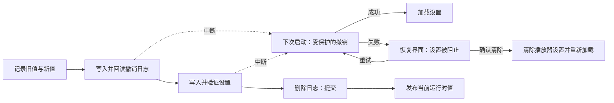

# 可恢复的多键设置

<!-- language-navigation:start -->

<a href="settings-recovery.md" lang="en" dir="ltr">English</a> · <a href="settings-recovery.ar.md" lang="ar" dir="rtl">العربية</a> · <a href="settings-recovery.bn.md" lang="bn" dir="ltr">বাংলা</a> · <a href="settings-recovery.cs.md" lang="cs" dir="ltr">Čeština</a> · <a href="settings-recovery.de.md" lang="de" dir="ltr">Deutsch</a> · <a href="settings-recovery.es.md" lang="es" dir="ltr">Español</a> · <a href="settings-recovery.fa.md" lang="fa" dir="rtl">فارسی</a> · <a href="settings-recovery.fr.md" lang="fr" dir="ltr">Français</a>
 
<a href="settings-recovery.he.md" lang="he" dir="rtl">עברית</a> · <a href="settings-recovery.hi.md" lang="hi" dir="ltr">हिन्दी</a> · <a href="settings-recovery.id.md" lang="id" dir="ltr">Bahasa Indonesia</a> · <a href="settings-recovery.it.md" lang="it" dir="ltr">Italiano</a> · <a href="settings-recovery.ja.md" lang="ja" dir="ltr">日本語</a> · <a href="settings-recovery.ko.md" lang="ko" dir="ltr">한국어</a> · <a href="settings-recovery.nl.md" lang="nl" dir="ltr">Nederlands</a> · <a href="settings-recovery.pl.md" lang="pl" dir="ltr">Polski</a>
 
<a href="settings-recovery.pt.md" lang="pt" dir="ltr">Português</a> · <a href="settings-recovery.ru.md" lang="ru" dir="ltr">Русский</a> · <a href="settings-recovery.th.md" lang="th" dir="ltr">ไทย</a> · <a href="settings-recovery.tr.md" lang="tr" dir="ltr">Türkçe</a> · <a href="settings-recovery.uk.md" lang="uk" dir="ltr">Українська</a> · <a href="settings-recovery.vi.md" lang="vi" dir="ltr">Tiếng Việt</a> · <a href="settings-recovery.zh-Hans.md" lang="zh-Hans" dir="ltr">简体中文</a> · <a href="settings-recovery.zh-Hant.md" lang="zh-Hant" dir="ltr">繁體中文</a>

<!-- language-navigation:end -->

[改进](roadmap-delivery.zh-Hans.md)

受支持的 localStorage 批处理使用 `ottplaySettingsJournalV1`。这是内部撤销日志，不包含在导出、云端载荷或常规设置枚举中。修改设置之前，写入方会记录每个键的回滚／新字符串（或 null），回读日志，写入并验证批处理，最后删除日志，以此作为提交点。只有之前记录的设置所有者仍是当前所有者时，才会发布运行时更改。导入不会清除无关的键。

家长控制 PIN 迁移会在内存中保留完全一致的原始值以检查冲突，但作为回滚值写入的只有受保护的替代值。导入失败或恢复中断都不得还原可读的旧 PIN。日志格式仍为版本 1。更新或恢复旧设置之前，请阅读 [PIN 迁移与限制](parental-pin-storage.md)。

启动过程会先恢复，再加载设置。只有存储值仍等于该批处理的新值时，才恢复旧值，从而保留后来其他写入方的修改。整个恢复过程中都会验证日志和所有权。日志失败或损坏会在播放器启动前打开恢复界面。不加载不完整的账户设置或过时的 cookie 回退值，常规设置写入也继续被阻止。**Retry** 会重复受保护的恢复过程，仅在成功后重新加载。**Clear settings** 需要第二次明确确认；Cancel/Back 会保留数据不变。它会清除该 origin 的 localStorage，并在各自的根路径删除已记录的播放器 cookie。其他 cookie 不受影响。持久的重置标记与空的回退允许列表，会防止未记录的旧 cookie 使设置复活，即使 localStorage 变得不可用也一样；新的回退写入会加入允许列表。只有验证重置策略和删除操作后，才会移除日志屏障。失败时保留恢复界面和屏障。键盘 Tab／方向键／Enter 及设备遥控器按键在常规界面初始化前即可使用。不会自动重置，界面也绝不显示日志内容。如有需要，请在选择 Clear settings 前私下保存原始存储以供诊断。日志上限：16 000 个条目和 2 MiB 序列化文本。

**保证边界：** 一个写入方、一个受支持的原生 localStorage 后端存储。浏览器不提供跨标签页的原子 compare-and-swap。不要在多个窗口中并发导入；这不是跨标签页事务或数据库。断电持久性受浏览器／操作系统存储本身的限制。cookie／会话／自定义设备适配器仍只提供受保护的尽力回滚，不会获得持久日志。与远程控制器或其他播放器之间不存在分布式事务。

日志会在原本就存放设置的同源存储中，临时保存旧／新设置值，可能包括提供商凭据。它不是遥测数据，不得复制到公开的问题报告中。准备日志时发生配额错误，会在写入前停止。不要仅为隐藏失败的导入而删除待处理日志；这样会丢弃恢复信息。

运行 `node tests/test_settings_journal.cjs`、`node tests/test_settings_store.cjs`、`node tests/test_local_settings_backup.cjs` 和 `node tests/test_cloud_settings_session.cjs`。测试从中断写入的快照重新启动，也会中断恢复本身，保留其他写入方的值，并覆盖配额／损坏／重入失败。恢复测试还覆盖隔离的读写、实际的早期启动保护、临时存储故障后的重试、明确重置确认、键盘／遥控器输入、中断的重置、被拒绝的 cookie 删除、其他写入方的路径限定 cookie，以及重置后的原生／cookie 回退。早期 HTML 语言加载器遵循同一重置允许列表。
