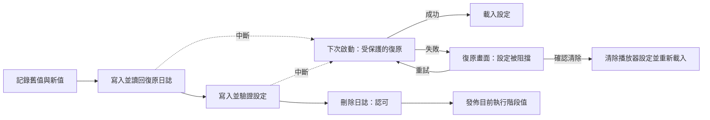

# 可復原的多鍵設定

<!-- language-navigation:start -->

<a href="settings-recovery.md" lang="en" dir="ltr">English</a> · <a href="settings-recovery.ar.md" lang="ar" dir="rtl">العربية</a> · <a href="settings-recovery.bn.md" lang="bn" dir="ltr">বাংলা</a> · <a href="settings-recovery.cs.md" lang="cs" dir="ltr">Čeština</a> · <a href="settings-recovery.de.md" lang="de" dir="ltr">Deutsch</a> · <a href="settings-recovery.es.md" lang="es" dir="ltr">Español</a> · <a href="settings-recovery.fa.md" lang="fa" dir="rtl">فارسی</a> · <a href="settings-recovery.fr.md" lang="fr" dir="ltr">Français</a>
 
<a href="settings-recovery.he.md" lang="he" dir="rtl">עברית</a> · <a href="settings-recovery.hi.md" lang="hi" dir="ltr">हिन्दी</a> · <a href="settings-recovery.id.md" lang="id" dir="ltr">Bahasa Indonesia</a> · <a href="settings-recovery.it.md" lang="it" dir="ltr">Italiano</a> · <a href="settings-recovery.ja.md" lang="ja" dir="ltr">日本語</a> · <a href="settings-recovery.ko.md" lang="ko" dir="ltr">한국어</a> · <a href="settings-recovery.nl.md" lang="nl" dir="ltr">Nederlands</a> · <a href="settings-recovery.pl.md" lang="pl" dir="ltr">Polski</a>
 
<a href="settings-recovery.pt.md" lang="pt" dir="ltr">Português</a> · <a href="settings-recovery.ru.md" lang="ru" dir="ltr">Русский</a> · <a href="settings-recovery.th.md" lang="th" dir="ltr">ไทย</a> · <a href="settings-recovery.tr.md" lang="tr" dir="ltr">Türkçe</a> · <a href="settings-recovery.uk.md" lang="uk" dir="ltr">Українська</a> · <a href="settings-recovery.vi.md" lang="vi" dir="ltr">Tiếng Việt</a> · <a href="settings-recovery.zh-Hans.md" lang="zh-Hans" dir="ltr">简体中文</a> · <a href="settings-recovery.zh-Hant.md" lang="zh-Hant" dir="ltr">繁體中文</a>

<!-- language-navigation:end -->

[改進](roadmap-delivery.zh-Hant.md)

支援的 localStorage 批次處理使用 `ottplaySettingsJournalV1`。這是內部復原日誌，不包含在匯出、雲端承載資料或一般設定列舉中。修改設定前，寫入端會記錄每個鍵的回復／新字串（或 null），讀回日誌，寫入並驗證批次，最後刪除日誌，以此作為認可點。只有先前記錄的設定擁有者仍是目前擁有者時，才會發佈執行階段變更。匯入不會清除無關的鍵。

家長控制 PIN 移轉會在記憶體中保留完全相同的原始值以檢查衝突，但作為回復值寫入的只有受保護的替代值。匯入失敗或復原中斷都不得還原可讀的舊 PIN。日誌格式仍為版本 1。更新或還原舊設定之前，請閱讀 [PIN 移轉與限制](parental-pin-storage.md)。

啟動程序會先復原，再載入設定。只有儲存值仍等於該批次的新值時，才還原舊值，藉此保留之後其他寫入端的修改。整個復原過程都會驗證日誌與擁有權。日誌失敗或損毀會在播放器啟動前開啟復原畫面。不載入不完整的帳戶設定或過時的 cookie 後援值，一般設定寫入也持續被阻擋。**Retry** 會重複受保護的復原程序，僅在成功後重新載入。**Clear settings** 需要第二次明確確認；Cancel/Back 會保留資料不變。它會清除該 origin 的 localStorage，並在各自根路徑刪除已記錄的播放器 cookie。其他 cookie 不受影響。持續保存的重設標記及空白後援允許清單，會防止未記錄的舊 cookie 讓設定復活，即使 localStorage 變得無法使用也一樣；新的後援寫入會加入允許清單。只有驗證重設原則和刪除作業後，才移除日誌屏障。失敗時保留復原畫面與屏障。鍵盤 Tab／方向鍵／Enter 及裝置遙控器按鍵，在一般介面初始化前即可使用。不會自動重設，畫面也絕不顯示日誌內容。如有需要，請在選擇 Clear settings 前私下保留原始儲存內容以供診斷。日誌上限：16 000 個項目及 2 MiB 序列化文字。

**保證範圍：** 一個寫入端、一個支援的原生 localStorage 後端儲存區。瀏覽器不提供跨分頁的不可分割 compare-and-swap。不要在多個視窗中同時匯入；這不是跨分頁交易或資料庫。斷電時的持久性受瀏覽器／作業系統儲存本身限制。cookie／工作階段／自訂裝置配接器仍只提供受保護且盡力而為的回復，不會取得持續保存的日誌。與遠端控制器或其他播放器之間不存在分散式交易。

日誌會在原本就存放設定的同源儲存區中，暫時保存舊／新設定值，可能包括供應商憑證。它不是遙測資料，不得複製到公開的錯誤回報中。準備日誌時發生配額錯誤，會在寫入前停止。不要只為了隱藏失敗的匯入而刪除待處理日誌；這樣會遺失復原資訊。

執行 `node tests/test_settings_journal.cjs`、`node tests/test_settings_store.cjs`、`node tests/test_local_settings_backup.cjs` 和 `node tests/test_cloud_settings_session.cjs`。測試會從中斷寫入的快照重新啟動，也會中斷復原本身，保留其他寫入端的值，並涵蓋配額／損毀／重入失敗。復原測試也涵蓋隔離的讀寫、實際的早期啟動保護、暫時儲存故障後的重試、明確重設確認、鍵盤／遙控器輸入、中斷的重設、遭拒的 cookie 刪除、其他寫入端限定路徑的 cookie，以及重設後的原生／cookie 後援。早期 HTML 語言載入器遵循同一重設允許清單。
