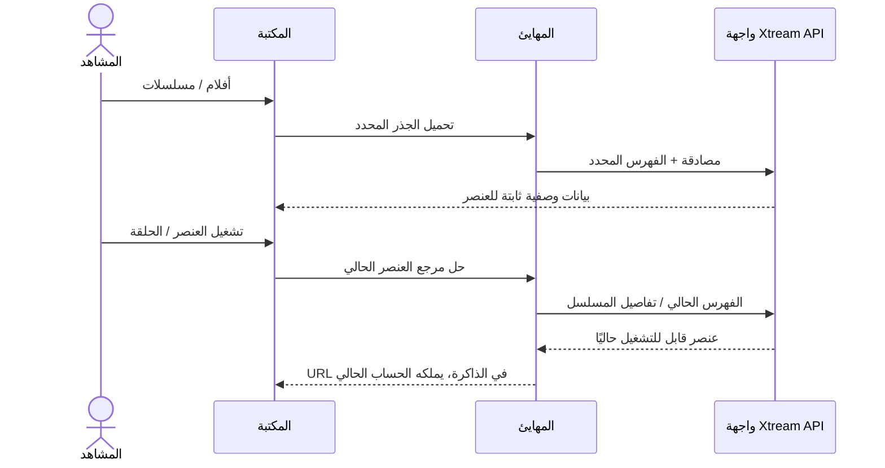

# أفلام ومسلسلات Xtream

<!-- language-navigation:start -->

<a href="xtream-media.md" lang="en" dir="ltr">English</a> · <a href="xtream-media.ar.md" lang="ar" dir="rtl">العربية</a> · <a href="xtream-media.bn.md" lang="bn" dir="ltr">বাংলা</a> · <a href="xtream-media.cs.md" lang="cs" dir="ltr">Čeština</a> · <a href="xtream-media.de.md" lang="de" dir="ltr">Deutsch</a> · <a href="xtream-media.es.md" lang="es" dir="ltr">Español</a> · <a href="xtream-media.fa.md" lang="fa" dir="rtl">فارسی</a> · <a href="xtream-media.fr.md" lang="fr" dir="ltr">Français</a>
 
<a href="xtream-media.he.md" lang="he" dir="rtl">עברית</a> · <a href="xtream-media.hi.md" lang="hi" dir="ltr">हिन्दी</a> · <a href="xtream-media.id.md" lang="id" dir="ltr">Bahasa Indonesia</a> · <a href="xtream-media.it.md" lang="it" dir="ltr">Italiano</a> · <a href="xtream-media.ja.md" lang="ja" dir="ltr">日本語</a> · <a href="xtream-media.ko.md" lang="ko" dir="ltr">한국어</a> · <a href="xtream-media.nl.md" lang="nl" dir="ltr">Nederlands</a> · <a href="xtream-media.pl.md" lang="pl" dir="ltr">Polski</a>
 
<a href="xtream-media.pt.md" lang="pt" dir="ltr">Português</a> · <a href="xtream-media.ru.md" lang="ru" dir="ltr">Русский</a> · <a href="xtream-media.th.md" lang="th" dir="ltr">ไทย</a> · <a href="xtream-media.tr.md" lang="tr" dir="ltr">Türkçe</a> · <a href="xtream-media.uk.md" lang="uk" dir="ltr">Українська</a> · <a href="xtream-media.vi.md" lang="vi" dir="ltr">Tiếng Việt</a> · <a href="xtream-media.zh-Hans.md" lang="zh-Hans" dir="ltr">简体中文</a> · <a href="xtream-media.zh-Hant.md" lang="zh-Hant" dir="ltr">繁體中文</a>

<!-- language-navigation:end -->

[التحسينات](roadmap-delivery.ar.md)

اضبط مزوّد Xtream وحمّل فهرس البث المباشر، ثم افتح مكتبة الوسائط. يمثل **Movies** و**Series** جذرين منفصلين يُحمَّلان عند الحاجة: فتح المكتبة لا ينزّل الفهرسين معًا. يؤدي فتح مسلسل إلى تحميل تفاصيل حلقاته. ينشئ محلّل Xtream الموجود في النواة المشتركة الهويات وعناوين URL للبث؛ أما المهايئ التقليدي فيدير العرض وعمر الطلب فقط.

يعيد كل اختيار حل طلبه الثابت بالنسبة إلى الحساب الحالي. لا تتضمن العناصر المحفوظة عنوان URL للبث الموثّق. لا يمكن إحياء عنصر محذوف من صف سبق أن حلّه المهايئ. يؤدي تغيير بيانات الاعتماد/المزوّد أو إغلاق السياق المالك إلى إلغاء العمل المعلّق؛ ولا يمكن للردود القديمة ملء شاشة الحساب التالي. تظل الأسماء والصور المقدّمة من المزوّد بيانات خاصة بالمزوّد.

يجب أن يسمح المزوّد بطلبات العميل (CORS أو النقل الأصلي المضبوط)، وأن يدعم الجهاز الوسائط المعادة. هذه ليست آلية فهرس دون اتصال أو ترحيل بين الحسابات أو تجاوز DRM أو محوّل ترميز جديد. الحفاظ على حداثة الفهرس يتطلب طلبًا عند الاختيار. تُبلَّغ الأخطاء عبر رسالة خطأ المكتبة المترجمة الموجودة؛ ولا تبدأ النتائج غير المتاحة التشغيل.

شغّل `node tests/test_xtream_media.cjs` لاختبار الجذور المحمّلة عند الحاجة وبيانات الاعتماد المرمّزة والطلبات المحفوظة الخالية من الأسرار والعناصر المحذوفة وإلغاء المصدر، وشغّل `node tests/test_provider_drivers.cjs` لدورة حياة المزوّد الفعلية.

