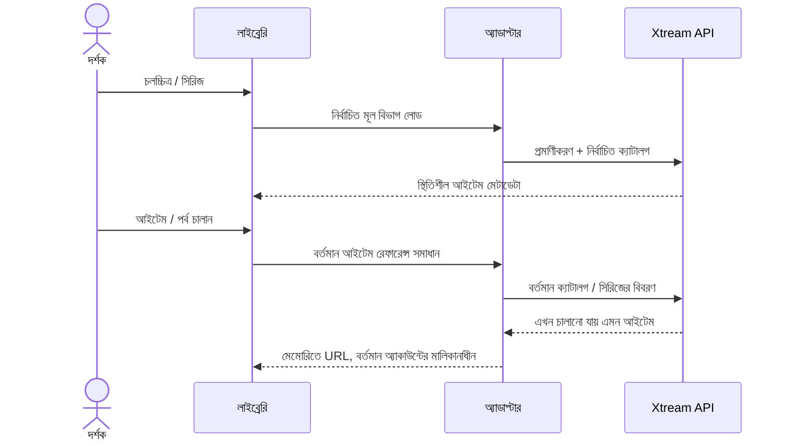

# Xtream চলচ্চিত্র ও সিরিজ

<!-- language-navigation:start -->

<a href="xtream-media.md" lang="en" dir="ltr">English</a> · <a href="xtream-media.ar.md" lang="ar" dir="rtl">العربية</a> · <a href="xtream-media.bn.md" lang="bn" dir="ltr">বাংলা</a> · <a href="xtream-media.cs.md" lang="cs" dir="ltr">Čeština</a> · <a href="xtream-media.de.md" lang="de" dir="ltr">Deutsch</a> · <a href="xtream-media.es.md" lang="es" dir="ltr">Español</a> · <a href="xtream-media.fa.md" lang="fa" dir="rtl">فارسی</a> · <a href="xtream-media.fr.md" lang="fr" dir="ltr">Français</a>
 
<a href="xtream-media.he.md" lang="he" dir="rtl">עברית</a> · <a href="xtream-media.hi.md" lang="hi" dir="ltr">हिन्दी</a> · <a href="xtream-media.id.md" lang="id" dir="ltr">Bahasa Indonesia</a> · <a href="xtream-media.it.md" lang="it" dir="ltr">Italiano</a> · <a href="xtream-media.ja.md" lang="ja" dir="ltr">日本語</a> · <a href="xtream-media.ko.md" lang="ko" dir="ltr">한국어</a> · <a href="xtream-media.nl.md" lang="nl" dir="ltr">Nederlands</a> · <a href="xtream-media.pl.md" lang="pl" dir="ltr">Polski</a>
 
<a href="xtream-media.pt.md" lang="pt" dir="ltr">Português</a> · <a href="xtream-media.ru.md" lang="ru" dir="ltr">Русский</a> · <a href="xtream-media.th.md" lang="th" dir="ltr">ไทย</a> · <a href="xtream-media.tr.md" lang="tr" dir="ltr">Türkçe</a> · <a href="xtream-media.uk.md" lang="uk" dir="ltr">Українська</a> · <a href="xtream-media.vi.md" lang="vi" dir="ltr">Tiếng Việt</a> · <a href="xtream-media.zh-Hans.md" lang="zh-Hans" dir="ltr">简体中文</a> · <a href="xtream-media.zh-Hant.md" lang="zh-Hant" dir="ltr">繁體中文</a>

<!-- language-navigation:end -->

[উন্নতি](roadmap-delivery.bn.md)

Xtream প্রদানকারী কনফিগার করে তার লাইভ ক্যাটালগ লোড করুন, তারপর মিডিয়া লাইব্রেরি খুলুন। **Movies** ও **Series** আলাদা মূল বিভাগ, যা প্রয়োজনমতো লোড হয়: লাইব্রেরি খুললেই দুটি ক্যাটালগ ডাউনলোড হয় না। সিরিজ খুললে তার পর্বের বিবরণ লোড হয়। শেয়ার করা কোরের বিদ্যমান Xtream পার্সার পরিচয় ও স্ট্রিম URL তৈরি করে; ক্লাসিক অ্যাডাপ্টার শুধু উপস্থাপনা ও অনুরোধের জীবনকাল পরিচালনা করে।

প্রতিটি নির্বাচন বর্তমান অ্যাকাউন্টের ভিত্তিতে তার স্থিতিশীল অনুরোধ আবার সমাধান করে। সংরক্ষিত আইটেমে প্রমাণীকৃত স্ট্রিম URL থাকে না। অ্যাডাপ্টারের আগে সমাধান করা সারি থেকে সরানো আইটেম ফিরিয়ে আনা যায় না। শংসাপত্র/প্রদানকারী বদলানো বা মালিক প্রসঙ্গ বন্ধ করা অসমাপ্ত কাজ বাতিল করে; পুরোনো উত্তর পরবর্তী অ্যাকাউন্টের স্ক্রিন পূরণ করতে পারে না। প্রদানকারীর দেওয়া নাম ও ছবি প্রদানকারীর তথ্যই থাকে।

প্রদানকারীকে ক্লায়েন্টের অনুরোধ অনুমোদন করতে হবে (CORS বা কনফিগার করা নেটিভ ট্রান্সপোর্ট), এবং ডিভাইসকে ফেরত আসা মিডিয়া সমর্থন করতে হবে। এটি অফলাইন ক্যাটালগ, অ্যাকাউন্টের মধ্যে মাইগ্রেশন, DRM এড়ানোর উপায় বা নতুন ট্রান্সকোডার নয়। ক্যাটালগ হালনাগাদ রাখতে নির্বাচনের সময় একটি অনুরোধ লাগে। বিদ্যমান স্থানীয়কৃত লাইব্রেরি ত্রুটির মাধ্যমে সমস্যা জানানো হয়; অনুপলব্ধ ফলাফল প্লেব্যাক শুরু করে না।

প্রয়োজনমতো মূল বিভাগ লোড, এনকোড করা শংসাপত্র, গোপন তথ্যবিহীন সংরক্ষিত অনুরোধ, সরানো আইটেম ও উৎস বাতিলের জন্য `node tests/test_xtream_media.cjs` চালান; প্রদানকারীর প্রকৃত জীবনচক্রের জন্য `node tests/test_provider_drivers.cjs` চালান।
