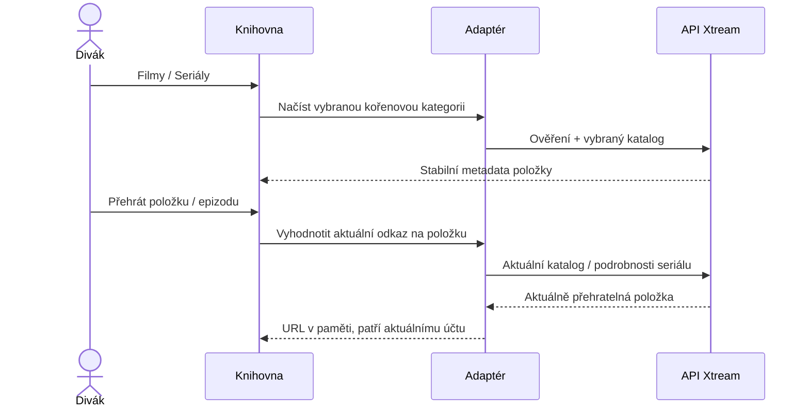

# Filmy a seriály Xtream

<!-- language-navigation:start -->

<a href="xtream-media.md" lang="en" dir="ltr">English</a> · <a href="xtream-media.ar.md" lang="ar" dir="rtl">العربية</a> · <a href="xtream-media.bn.md" lang="bn" dir="ltr">বাংলা</a> · <a href="xtream-media.cs.md" lang="cs" dir="ltr">Čeština</a> · <a href="xtream-media.de.md" lang="de" dir="ltr">Deutsch</a> · <a href="xtream-media.es.md" lang="es" dir="ltr">Español</a> · <a href="xtream-media.fa.md" lang="fa" dir="rtl">فارسی</a> · <a href="xtream-media.fr.md" lang="fr" dir="ltr">Français</a>
 
<a href="xtream-media.he.md" lang="he" dir="rtl">עברית</a> · <a href="xtream-media.hi.md" lang="hi" dir="ltr">हिन्दी</a> · <a href="xtream-media.id.md" lang="id" dir="ltr">Bahasa Indonesia</a> · <a href="xtream-media.it.md" lang="it" dir="ltr">Italiano</a> · <a href="xtream-media.ja.md" lang="ja" dir="ltr">日本語</a> · <a href="xtream-media.ko.md" lang="ko" dir="ltr">한국어</a> · <a href="xtream-media.nl.md" lang="nl" dir="ltr">Nederlands</a> · <a href="xtream-media.pl.md" lang="pl" dir="ltr">Polski</a>
 
<a href="xtream-media.pt.md" lang="pt" dir="ltr">Português</a> · <a href="xtream-media.ru.md" lang="ru" dir="ltr">Русский</a> · <a href="xtream-media.th.md" lang="th" dir="ltr">ไทย</a> · <a href="xtream-media.tr.md" lang="tr" dir="ltr">Türkçe</a> · <a href="xtream-media.uk.md" lang="uk" dir="ltr">Українська</a> · <a href="xtream-media.vi.md" lang="vi" dir="ltr">Tiếng Việt</a> · <a href="xtream-media.zh-Hans.md" lang="zh-Hans" dir="ltr">简体中文</a> · <a href="xtream-media.zh-Hant.md" lang="zh-Hant" dir="ltr">繁體中文</a>

<!-- language-navigation:end -->

[Vylepšení](roadmap-delivery.cs.md)

Nastavte poskytovatele Xtream, načtěte jeho katalog živého vysílání a otevřete knihovnu médií. **Movies** a **Series** jsou samostatné kořenové kategorie načítané až na vyžádání: otevřením knihovny se nestáhnou oba katalogy. Otevření seriálu načte podrobnosti epizod. Stávající parser Xtream ve sdíleném jádře vytváří identity a URL streamů; klasický adaptér řeší pouze zobrazení a životnost požadavků.

Každý výběr znovu vyhodnotí svůj stabilní požadavek vůči aktuálnímu účtu. Uložené položky neobsahují autentizovanou URL streamu. Odstraněnou položku nelze obnovit z dříve vyhodnoceného řádku adaptéru. Změna přihlašovacích údajů/poskytovatele nebo zavření vlastnícího kontextu zruší probíhající práci; zastaralé odpovědi nemohou naplnit obrazovku dalšího účtu. Názvy a obrázky dodané poskytovatelem zůstávají jeho daty.

Poskytovatel musí povolit požadavky klienta (CORS nebo nastavený nativní přenos) a zařízení musí podporovat vrácená média. Nejde o offline katalog, migraci mezi účty, obcházení DRM ani nový překódovač. Aktuálnost katalogu vyžaduje při výběru požadavek. Chyby se hlásí existující lokalizovanou chybou knihovny; nedostupné výsledky nespustí přehrávání.

Spusťte `node tests/test_xtream_media.cjs` pro kořenové kategorie načítané na vyžádání, kódované přihlašovací údaje, uložené požadavky bez tajných údajů, odstraněné položky a zrušení zdroje; `node tests/test_provider_drivers.cjs` ověřuje skutečný životní cyklus poskytovatele.
