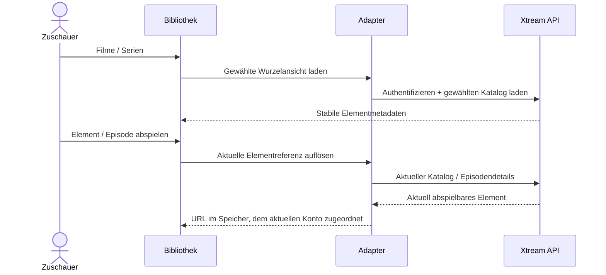

# Xtream-Filme und -Serien

<!-- language-navigation:start -->

<a href="xtream-media.md" lang="en" dir="ltr">English</a> · <a href="xtream-media.ar.md" lang="ar" dir="rtl">العربية</a> · <a href="xtream-media.bn.md" lang="bn" dir="ltr">বাংলা</a> · <a href="xtream-media.cs.md" lang="cs" dir="ltr">Čeština</a> · <a href="xtream-media.de.md" lang="de" dir="ltr">Deutsch</a> · <a href="xtream-media.es.md" lang="es" dir="ltr">Español</a> · <a href="xtream-media.fa.md" lang="fa" dir="rtl">فارسی</a> · <a href="xtream-media.fr.md" lang="fr" dir="ltr">Français</a>
 
<a href="xtream-media.he.md" lang="he" dir="rtl">עברית</a> · <a href="xtream-media.hi.md" lang="hi" dir="ltr">हिन्दी</a> · <a href="xtream-media.id.md" lang="id" dir="ltr">Bahasa Indonesia</a> · <a href="xtream-media.it.md" lang="it" dir="ltr">Italiano</a> · <a href="xtream-media.ja.md" lang="ja" dir="ltr">日本語</a> · <a href="xtream-media.ko.md" lang="ko" dir="ltr">한국어</a> · <a href="xtream-media.nl.md" lang="nl" dir="ltr">Nederlands</a> · <a href="xtream-media.pl.md" lang="pl" dir="ltr">Polski</a>
 
<a href="xtream-media.pt.md" lang="pt" dir="ltr">Português</a> · <a href="xtream-media.ru.md" lang="ru" dir="ltr">Русский</a> · <a href="xtream-media.th.md" lang="th" dir="ltr">ไทย</a> · <a href="xtream-media.tr.md" lang="tr" dir="ltr">Türkçe</a> · <a href="xtream-media.uk.md" lang="uk" dir="ltr">Українська</a> · <a href="xtream-media.vi.md" lang="vi" dir="ltr">Tiếng Việt</a> · <a href="xtream-media.zh-Hans.md" lang="zh-Hans" dir="ltr">简体中文</a> · <a href="xtream-media.zh-Hant.md" lang="zh-Hant" dir="ltr">繁體中文</a>

<!-- language-navigation:end -->

[Verbesserungen](roadmap-delivery.de.md)

Konfigurieren Sie den Xtream-Anbieter und laden Sie seinen Live-Katalog. Öffnen Sie anschließend die Medienbibliothek. **Movies** und **Series** sind getrennte, erst bei Bedarf geladene Wurzelansichten: Beim Öffnen der Bibliothek werden nicht beide Kataloge heruntergeladen. Beim Öffnen einer Serie werden deren Episodendetails geladen. Der bestehende Xtream-Parser im gemeinsamen Kern erzeugt Identitäten und Stream-URLs; der klassische Adapter übernimmt nur Darstellung und Anfragelaufzeit.

Bei jeder Auswahl wird die stabile Anfrage erneut gegen das aktuelle Konto aufgelöst. Gespeicherte Einträge enthalten keine authentifizierte Stream-URL. Ein entfernter Eintrag lässt sich nicht aus einer zuvor aufgelösten Adapterzeile wiederherstellen. Das Ersetzen von Zugangsdaten/Anbieter oder das Schließen des zuständigen Kontexts bricht ausstehende Arbeit ab; veraltete Antworten können den Bildschirm des nächsten Kontos nicht füllen. Vom Anbieter gelieferte Namen und Bilder bleiben Anbieterdaten.

Der Anbieter muss Clientanfragen zulassen (CORS oder der konfigurierte native Transport), und das Gerät muss die zurückgegebenen Medien unterstützen. Dies ist weder ein Offline-Katalog noch eine kontenübergreifende Migration, DRM-Umgehung oder ein neuer Transcoder. Für einen aktuellen Katalog ist bei jeder Auswahl eine Anfrage nötig. Fehler werden über die vorhandene lokalisierte Bibliotheksfehlermeldung gemeldet; nicht verfügbare Ergebnisse starten keine Wiedergabe.

Führen Sie `node tests/test_xtream_media.cjs` aus, um bedarfsgeladene Wurzelansichten, kodierte Zugangsdaten, gespeicherte Anfragen ohne Geheimnisse, entfernte Einträge und den Abbruch bei Quellenwechsel zu prüfen, sowie `node tests/test_provider_drivers.cjs` für den tatsächlichen Anbieterlebenszyklus.
