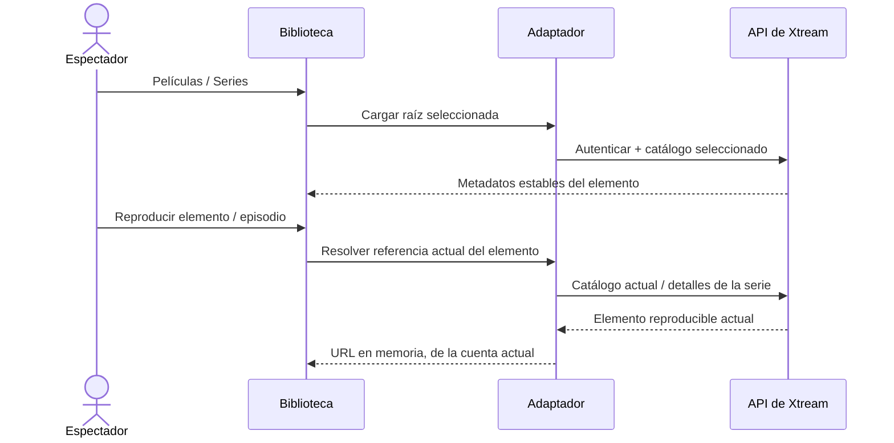

# Películas y series de Xtream

<!-- language-navigation:start -->

<a href="xtream-media.md" lang="en" dir="ltr">English</a> · <a href="xtream-media.ar.md" lang="ar" dir="rtl">العربية</a> · <a href="xtream-media.bn.md" lang="bn" dir="ltr">বাংলা</a> · <a href="xtream-media.cs.md" lang="cs" dir="ltr">Čeština</a> · <a href="xtream-media.de.md" lang="de" dir="ltr">Deutsch</a> · <a href="xtream-media.es.md" lang="es" dir="ltr">Español</a> · <a href="xtream-media.fa.md" lang="fa" dir="rtl">فارسی</a> · <a href="xtream-media.fr.md" lang="fr" dir="ltr">Français</a>
 
<a href="xtream-media.he.md" lang="he" dir="rtl">עברית</a> · <a href="xtream-media.hi.md" lang="hi" dir="ltr">हिन्दी</a> · <a href="xtream-media.id.md" lang="id" dir="ltr">Bahasa Indonesia</a> · <a href="xtream-media.it.md" lang="it" dir="ltr">Italiano</a> · <a href="xtream-media.ja.md" lang="ja" dir="ltr">日本語</a> · <a href="xtream-media.ko.md" lang="ko" dir="ltr">한국어</a> · <a href="xtream-media.nl.md" lang="nl" dir="ltr">Nederlands</a> · <a href="xtream-media.pl.md" lang="pl" dir="ltr">Polski</a>
 
<a href="xtream-media.pt.md" lang="pt" dir="ltr">Português</a> · <a href="xtream-media.ru.md" lang="ru" dir="ltr">Русский</a> · <a href="xtream-media.th.md" lang="th" dir="ltr">ไทย</a> · <a href="xtream-media.tr.md" lang="tr" dir="ltr">Türkçe</a> · <a href="xtream-media.uk.md" lang="uk" dir="ltr">Українська</a> · <a href="xtream-media.vi.md" lang="vi" dir="ltr">Tiếng Việt</a> · <a href="xtream-media.zh-Hans.md" lang="zh-Hans" dir="ltr">简体中文</a> · <a href="xtream-media.zh-Hant.md" lang="zh-Hant" dir="ltr">繁體中文</a>

<!-- language-navigation:end -->

[Mejoras](roadmap-delivery.es.md)

Configure el proveedor Xtream y cargue su catálogo en directo; después abra la Biblioteca multimedia. **Movies** y **Series** son raíces separadas que se cargan bajo demanda: abrir la biblioteca no descarga ambos catálogos. Al abrir una serie se cargan los detalles de sus episodios. El analizador Xtream existente del núcleo compartido crea identidades y URL de flujo; el adaptador clásico solo gestiona la presentación y la duración de las solicitudes.

Cada selección vuelve a resolver su solicitud estable contra la cuenta actual. Los elementos guardados omiten la URL autenticada del flujo. Un elemento eliminado no puede recuperarse de la fila que el adaptador resolvió anteriormente. Cambiar credenciales/proveedor o cerrar el contexto propietario cancela el trabajo pendiente; las respuestas obsoletas no pueden llenar la pantalla de la siguiente cuenta. Los nombres e imágenes suministrados por el proveedor siguen siendo datos del proveedor.

El proveedor debe permitir las solicitudes del cliente (CORS o el transporte nativo configurado), y el dispositivo debe admitir los medios devueltos. Esto no es un catálogo sin conexión, una migración entre cuentas, una forma de eludir DRM ni un nuevo transcodificador. Mantener actualizado el catálogo requiere una solicitud al seleccionar. Los errores se notifican mediante el error localizado existente de la biblioteca; los resultados no disponibles no inician la reproducción.

Ejecute `node tests/test_xtream_media.cjs` para comprobar raíces bajo demanda, credenciales codificadas, solicitudes guardadas sin secretos, elementos eliminados y cancelación de la fuente, y `node tests/test_provider_drivers.cjs` para el ciclo de vida real del proveedor.
