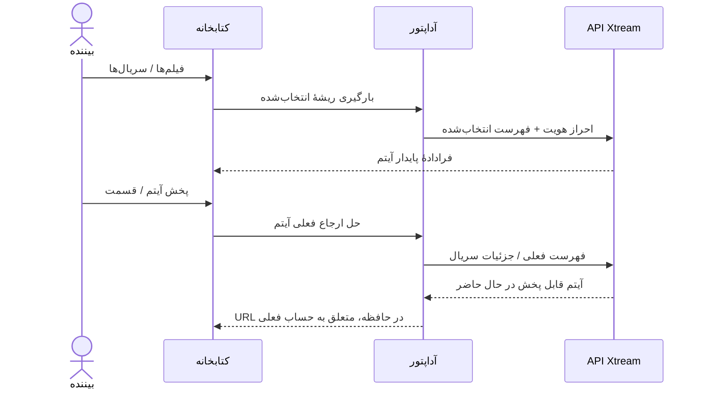

# فیلم‌ها و سریال‌های Xtream

<!-- language-navigation:start -->

<a href="xtream-media.md" lang="en" dir="ltr">English</a> · <a href="xtream-media.ar.md" lang="ar" dir="rtl">العربية</a> · <a href="xtream-media.bn.md" lang="bn" dir="ltr">বাংলা</a> · <a href="xtream-media.cs.md" lang="cs" dir="ltr">Čeština</a> · <a href="xtream-media.de.md" lang="de" dir="ltr">Deutsch</a> · <a href="xtream-media.es.md" lang="es" dir="ltr">Español</a> · <a href="xtream-media.fa.md" lang="fa" dir="rtl">فارسی</a> · <a href="xtream-media.fr.md" lang="fr" dir="ltr">Français</a>
 
<a href="xtream-media.he.md" lang="he" dir="rtl">עברית</a> · <a href="xtream-media.hi.md" lang="hi" dir="ltr">हिन्दी</a> · <a href="xtream-media.id.md" lang="id" dir="ltr">Bahasa Indonesia</a> · <a href="xtream-media.it.md" lang="it" dir="ltr">Italiano</a> · <a href="xtream-media.ja.md" lang="ja" dir="ltr">日本語</a> · <a href="xtream-media.ko.md" lang="ko" dir="ltr">한국어</a> · <a href="xtream-media.nl.md" lang="nl" dir="ltr">Nederlands</a> · <a href="xtream-media.pl.md" lang="pl" dir="ltr">Polski</a>
 
<a href="xtream-media.pt.md" lang="pt" dir="ltr">Português</a> · <a href="xtream-media.ru.md" lang="ru" dir="ltr">Русский</a> · <a href="xtream-media.th.md" lang="th" dir="ltr">ไทย</a> · <a href="xtream-media.tr.md" lang="tr" dir="ltr">Türkçe</a> · <a href="xtream-media.uk.md" lang="uk" dir="ltr">Українська</a> · <a href="xtream-media.vi.md" lang="vi" dir="ltr">Tiếng Việt</a> · <a href="xtream-media.zh-Hans.md" lang="zh-Hans" dir="ltr">简体中文</a> · <a href="xtream-media.zh-Hant.md" lang="zh-Hant" dir="ltr">繁體中文</a>

<!-- language-navigation:end -->

[بهبودها](roadmap-delivery.fa.md)

ارائه‌دهندهٔ Xtream را پیکربندی و فهرست پخش زندهٔ آن را بارگیری کنید، سپس کتابخانهٔ رسانه را باز کنید. **Movies** و **Series** ریشه‌های جداگانه‌اند که هنگام نیاز بارگیری می‌شوند: بازکردن کتابخانه هر دو فهرست را دانلود نمی‌کند. بازکردن یک سریال جزئیات قسمت‌هایش را بارگیری می‌کند. تجزیه‌گر فعلی Xtream در هستهٔ مشترک، هویت‌ها و URLهای جریان را می‌سازد؛ آداپتور کلاسیک فقط نمایش و طول عمر درخواست را مدیریت می‌کند.

هر انتخاب، درخواست پایدارش را دوباره بر پایهٔ حساب فعلی حل می‌کند. آیتم‌های ذخیره‌شده URL احراز هویت‌شدهٔ جریان را ندارند. آیتم حذف‌شده را نمی‌توان از ردیفی که آداپتور قبلاً حل کرده احیا کرد. جایگزینی اطلاعات ورود/ارائه‌دهنده یا بستن زمینهٔ مالک، کارهای در انتظار را لغو می‌کند؛ پاسخ‌های قدیمی نمی‌توانند صفحهٔ حساب بعدی را پر کنند. نام‌ها و تصاویر ارائه‌شده همچنان دادهٔ ارائه‌دهنده هستند.

ارائه‌دهنده باید درخواست‌های کلاینت را مجاز کند (CORS یا انتقال بومی پیکربندی‌شده) و دستگاه باید از رسانهٔ برگشتی پشتیبانی کند. این قابلیت فهرست آفلاین، مهاجرت میان حساب‌ها، دورزدن DRM یا مبدل کدک تازه نیست. به‌روز نگه‌داشتن فهرست به یک درخواست هنگام انتخاب نیاز دارد. خطاها با پیام خطای بومی‌سازی‌شدهٔ فعلی کتابخانه گزارش می‌شوند؛ نتیجهٔ ناموجود پخش را آغاز نمی‌کند.

برای ریشه‌های بارگیری‌شونده هنگام نیاز، اطلاعات ورود کدگذاری‌شده، درخواست‌های ذخیره‌شدهٔ بدون راز، آیتم‌های حذف‌شده و لغو منبع، `node tests/test_xtream_media.cjs` را اجرا کنید؛ برای چرخهٔ عمر واقعی ارائه‌دهنده نیز `node tests/test_provider_drivers.cjs` را اجرا کنید.

