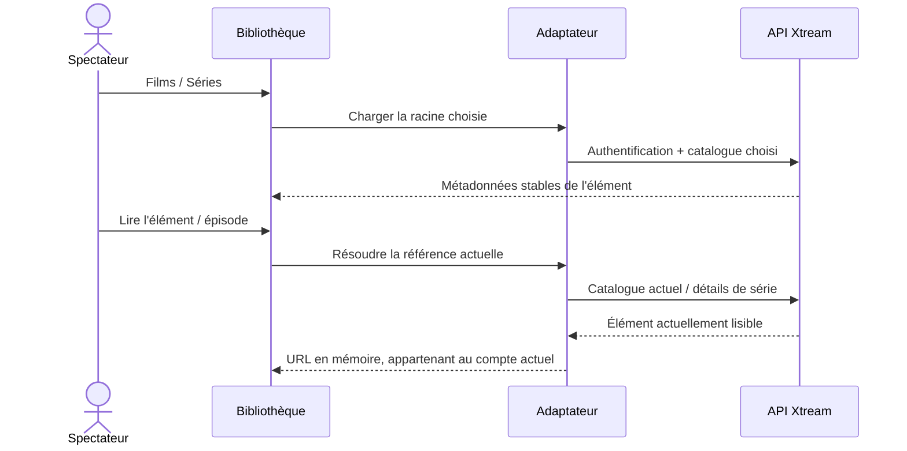

# Films et séries Xtream

<!-- language-navigation:start -->

<a href="xtream-media.md" lang="en" dir="ltr">English</a> · <a href="xtream-media.ar.md" lang="ar" dir="rtl">العربية</a> · <a href="xtream-media.bn.md" lang="bn" dir="ltr">বাংলা</a> · <a href="xtream-media.cs.md" lang="cs" dir="ltr">Čeština</a> · <a href="xtream-media.de.md" lang="de" dir="ltr">Deutsch</a> · <a href="xtream-media.es.md" lang="es" dir="ltr">Español</a> · <a href="xtream-media.fa.md" lang="fa" dir="rtl">فارسی</a> · <a href="xtream-media.fr.md" lang="fr" dir="ltr">Français</a>
 
<a href="xtream-media.he.md" lang="he" dir="rtl">עברית</a> · <a href="xtream-media.hi.md" lang="hi" dir="ltr">हिन्दी</a> · <a href="xtream-media.id.md" lang="id" dir="ltr">Bahasa Indonesia</a> · <a href="xtream-media.it.md" lang="it" dir="ltr">Italiano</a> · <a href="xtream-media.ja.md" lang="ja" dir="ltr">日本語</a> · <a href="xtream-media.ko.md" lang="ko" dir="ltr">한국어</a> · <a href="xtream-media.nl.md" lang="nl" dir="ltr">Nederlands</a> · <a href="xtream-media.pl.md" lang="pl" dir="ltr">Polski</a>
 
<a href="xtream-media.pt.md" lang="pt" dir="ltr">Português</a> · <a href="xtream-media.ru.md" lang="ru" dir="ltr">Русский</a> · <a href="xtream-media.th.md" lang="th" dir="ltr">ไทย</a> · <a href="xtream-media.tr.md" lang="tr" dir="ltr">Türkçe</a> · <a href="xtream-media.uk.md" lang="uk" dir="ltr">Українська</a> · <a href="xtream-media.vi.md" lang="vi" dir="ltr">Tiếng Việt</a> · <a href="xtream-media.zh-Hans.md" lang="zh-Hans" dir="ltr">简体中文</a> · <a href="xtream-media.zh-Hant.md" lang="zh-Hant" dir="ltr">繁體中文</a>

<!-- language-navigation:end -->

[Améliorations](roadmap-delivery.fr.md)

Configurez le fournisseur Xtream et chargez son catalogue en direct, puis ouvrez la médiathèque. **Movies** et **Series** sont deux racines distinctes chargées à la demande : ouvrir la bibliothèque ne télécharge pas les deux catalogues. Ouvrir une série charge les détails de ses épisodes. L'analyseur Xtream existant du noyau partagé crée les identités et les URL de flux ; l'adaptateur classique ne gère que la présentation et la durée de vie des requêtes.

Chaque sélection résout à nouveau sa requête stable dans le compte actuel. Les éléments enregistrés ne contiennent pas l'URL authentifiée du flux. Un élément supprimé ne peut pas être ressuscité depuis une ancienne ligne résolue par l'adaptateur. Remplacer les identifiants/le fournisseur ou fermer le contexte propriétaire annule les opérations en cours ; des réponses périmées ne peuvent pas remplir l'écran du compte suivant. Les noms et illustrations fournis restent des données du fournisseur.

Le fournisseur doit autoriser les requêtes du client (CORS ou transport natif configuré), et l'appareil doit prendre en charge les médias retournés. Ce n'est ni un catalogue hors ligne, ni une migration entre comptes, ni un contournement DRM, ni un nouveau transcodeur. La fraîcheur du catalogue exige une requête à chaque sélection. Les erreurs utilisent le message localisé existant de la bibliothèque ; les résultats indisponibles ne déclenchent pas la lecture.

Exécutez `node tests/test_xtream_media.cjs` pour les racines à la demande, les identifiants encodés, les requêtes enregistrées sans secrets, les éléments supprimés et l'annulation de source, puis `node tests/test_provider_drivers.cjs` pour le cycle de vie réel du fournisseur.
