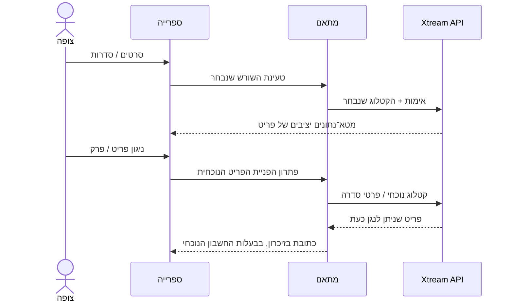

# סרטים וסדרות ב־Xtream

<!-- language-navigation:start -->

<a href="xtream-media.md" lang="en" dir="ltr">English</a> · <a href="xtream-media.ar.md" lang="ar" dir="rtl">العربية</a> · <a href="xtream-media.bn.md" lang="bn" dir="ltr">বাংলা</a> · <a href="xtream-media.cs.md" lang="cs" dir="ltr">Čeština</a> · <a href="xtream-media.de.md" lang="de" dir="ltr">Deutsch</a> · <a href="xtream-media.es.md" lang="es" dir="ltr">Español</a> · <a href="xtream-media.fa.md" lang="fa" dir="rtl">فارسی</a> · <a href="xtream-media.fr.md" lang="fr" dir="ltr">Français</a>
 
<a href="xtream-media.he.md" lang="he" dir="rtl">עברית</a> · <a href="xtream-media.hi.md" lang="hi" dir="ltr">हिन्दी</a> · <a href="xtream-media.id.md" lang="id" dir="ltr">Bahasa Indonesia</a> · <a href="xtream-media.it.md" lang="it" dir="ltr">Italiano</a> · <a href="xtream-media.ja.md" lang="ja" dir="ltr">日本語</a> · <a href="xtream-media.ko.md" lang="ko" dir="ltr">한국어</a> · <a href="xtream-media.nl.md" lang="nl" dir="ltr">Nederlands</a> · <a href="xtream-media.pl.md" lang="pl" dir="ltr">Polski</a>
 
<a href="xtream-media.pt.md" lang="pt" dir="ltr">Português</a> · <a href="xtream-media.ru.md" lang="ru" dir="ltr">Русский</a> · <a href="xtream-media.th.md" lang="th" dir="ltr">ไทย</a> · <a href="xtream-media.tr.md" lang="tr" dir="ltr">Türkçe</a> · <a href="xtream-media.uk.md" lang="uk" dir="ltr">Українська</a> · <a href="xtream-media.vi.md" lang="vi" dir="ltr">Tiếng Việt</a> · <a href="xtream-media.zh-Hans.md" lang="zh-Hans" dir="ltr">简体中文</a> · <a href="xtream-media.zh-Hant.md" lang="zh-Hant" dir="ltr">繁體中文</a>

<!-- language-navigation:end -->

[שיפורים](roadmap-delivery.he.md)

הגדירו את ספק Xtream וטענו את קטלוג השידורים החיים שלו, ואז פתחו את ספריית המדיה. **Movies** ו־**Series** הם שורשים נפרדים הנטענים לפי הצורך: פתיחת הספרייה אינה מורידה את שני הקטלוגים. פתיחת סדרה טוענת את פרטי הפרקים שלה. מנתח Xtream הקיים בליבה המשותפת יוצר זהויות וכתובות זרם; המתאם הקלאסי מטפל רק בתצוגה ובמשך חיי הבקשה.

כל בחירה פותרת מחדש את הבקשה היציבה שלה מול החשבון הנוכחי. פריטים שמורים אינם כוללים את כתובת הזרם המאומתת. אי אפשר להחיות פריט שהוסר מתוך שורה שהמתאם פתר בעבר. החלפת פרטי הזדהות/ספק או סגירת הקשר הבעלים מבטלת עבודה ממתינה; תשובות מיושנות אינן יכולות למלא את מסך החשבון הבא. שמות ותמונות שסופקו נשארים נתונים של הספק.

הספק חייב לאפשר את בקשות הלקוח (CORS או התעבורה הילידית שהוגדרה), והמכשיר חייב לתמוך במדיה שהוחזרה. אין כאן קטלוג לא מקוון, העברה בין חשבונות, עקיפת DRM או מקודד־מחדש חדש. שמירת עדכניות הקטלוג דורשת בקשה בעת בחירה. שגיאות מדווחות באמצעות שגיאת הספרייה המקומית הקיימת; תוצאות לא זמינות אינן מתחילות ניגון.

הריצו `node tests/test_xtream_media.cjs` לבדיקת שורשים הנטענים לפי הצורך, פרטי הזדהות מקודדים, בקשות שמורות ללא סודות, פריטים שהוסרו וביטול מקור, ו־`node tests/test_provider_drivers.cjs` לבדיקת מחזור החיים האמיתי של הספק.

