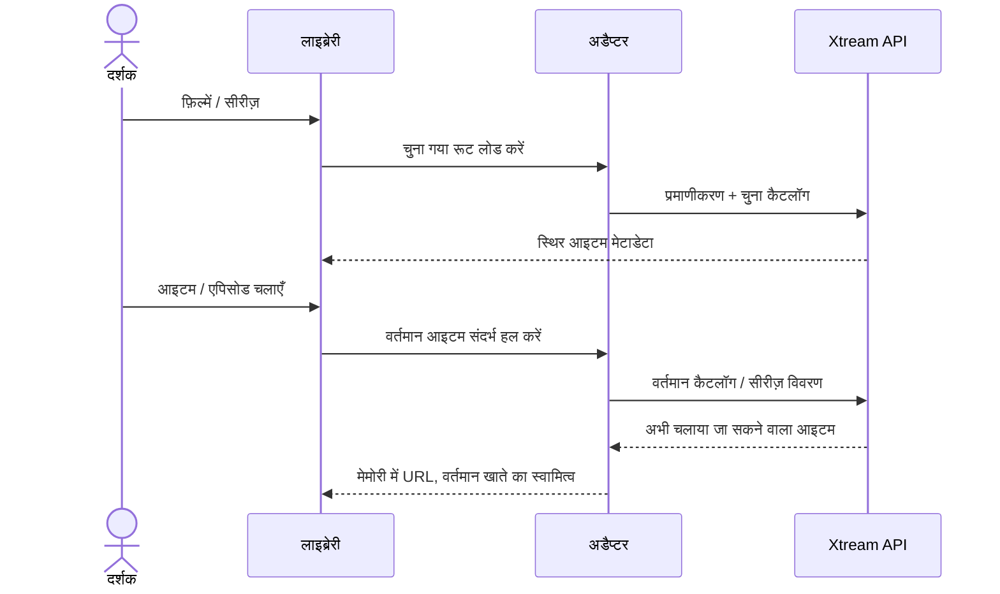

# Xtream फ़िल्में और सीरीज़

<!-- language-navigation:start -->

<a href="xtream-media.md" lang="en" dir="ltr">English</a> · <a href="xtream-media.ar.md" lang="ar" dir="rtl">العربية</a> · <a href="xtream-media.bn.md" lang="bn" dir="ltr">বাংলা</a> · <a href="xtream-media.cs.md" lang="cs" dir="ltr">Čeština</a> · <a href="xtream-media.de.md" lang="de" dir="ltr">Deutsch</a> · <a href="xtream-media.es.md" lang="es" dir="ltr">Español</a> · <a href="xtream-media.fa.md" lang="fa" dir="rtl">فارسی</a> · <a href="xtream-media.fr.md" lang="fr" dir="ltr">Français</a>
 
<a href="xtream-media.he.md" lang="he" dir="rtl">עברית</a> · <a href="xtream-media.hi.md" lang="hi" dir="ltr">हिन्दी</a> · <a href="xtream-media.id.md" lang="id" dir="ltr">Bahasa Indonesia</a> · <a href="xtream-media.it.md" lang="it" dir="ltr">Italiano</a> · <a href="xtream-media.ja.md" lang="ja" dir="ltr">日本語</a> · <a href="xtream-media.ko.md" lang="ko" dir="ltr">한국어</a> · <a href="xtream-media.nl.md" lang="nl" dir="ltr">Nederlands</a> · <a href="xtream-media.pl.md" lang="pl" dir="ltr">Polski</a>
 
<a href="xtream-media.pt.md" lang="pt" dir="ltr">Português</a> · <a href="xtream-media.ru.md" lang="ru" dir="ltr">Русский</a> · <a href="xtream-media.th.md" lang="th" dir="ltr">ไทย</a> · <a href="xtream-media.tr.md" lang="tr" dir="ltr">Türkçe</a> · <a href="xtream-media.uk.md" lang="uk" dir="ltr">Українська</a> · <a href="xtream-media.vi.md" lang="vi" dir="ltr">Tiếng Việt</a> · <a href="xtream-media.zh-Hans.md" lang="zh-Hans" dir="ltr">简体中文</a> · <a href="xtream-media.zh-Hant.md" lang="zh-Hant" dir="ltr">繁體中文</a>

<!-- language-navigation:end -->

[सुधार](roadmap-delivery.hi.md)

Xtream प्रदाता कॉन्फ़िगर करें और उसका लाइव कैटलॉग लोड करें, फिर मीडिया लाइब्रेरी खोलें। **Movies** और **Series** अलग-अलग रूट हैं जो ज़रूरत पर लोड होते हैं: लाइब्रेरी खोलने से दोनों कैटलॉग डाउनलोड नहीं होते। कोई सीरीज़ खोलने पर उसके एपिसोड का विवरण लोड होता है। साझा कोर का मौजूदा Xtream पार्सर पहचान और स्ट्रीम URL बनाता है; क्लासिक अडैप्टर केवल प्रस्तुति और अनुरोध के जीवनकाल को संभालता है।

हर चयन अपना स्थिर अनुरोध वर्तमान खाते के संदर्भ में फिर से हल करता है। सहेजे गए आइटम में प्रमाणीकृत स्ट्रीम URL नहीं होता। हटाया गया आइटम अडैप्टर की पहले हल की गई पंक्ति से वापस नहीं लाया जा सकता। क्रेडेंशियल/प्रदाता बदलने या स्वामी संदर्भ बंद करने से लंबित काम रद्द होता है; पुराने उत्तर अगले खाते की स्क्रीन नहीं भर सकते। प्रदाता के दिए नाम और चित्र प्रदाता का ही डेटा रहते हैं।

प्रदाता को क्लाइंट के अनुरोधों की अनुमति देनी चाहिए (CORS या कॉन्फ़िगर किया गया नेटिव ट्रांसपोर्ट), और डिवाइस को लौटाए गए मीडिया का समर्थन करना चाहिए। यह ऑफ़लाइन कैटलॉग, खातों के बीच माइग्रेशन, DRM को दरकिनार करने का तरीका या नया ट्रांसकोडर नहीं है। कैटलॉग को ताज़ा रखने के लिए चयन पर एक अनुरोध करना पड़ता है। त्रुटियाँ लाइब्रेरी के मौजूदा स्थानीयकृत त्रुटि संदेश से बताई जाती हैं; अनुपलब्ध परिणाम प्लेबैक शुरू नहीं करते।

ज़रूरत पर लोड होने वाले रूट, एनकोड किए गए क्रेडेंशियल, रहस्यों से मुक्त सहेजे गए अनुरोध, हटाए गए आइटम और स्रोत रद्द करने के लिए `node tests/test_xtream_media.cjs` चलाएँ; प्रदाता के वास्तविक जीवनचक्र के लिए `node tests/test_provider_drivers.cjs` चलाएँ।
