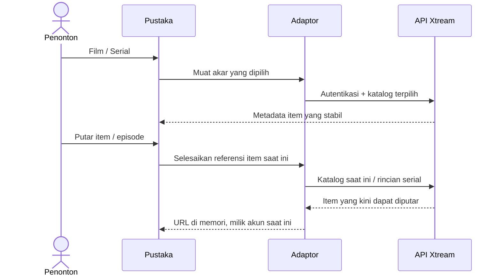

# Film dan serial Xtream

<!-- language-navigation:start -->

<a href="xtream-media.md" lang="en" dir="ltr">English</a> · <a href="xtream-media.ar.md" lang="ar" dir="rtl">العربية</a> · <a href="xtream-media.bn.md" lang="bn" dir="ltr">বাংলা</a> · <a href="xtream-media.cs.md" lang="cs" dir="ltr">Čeština</a> · <a href="xtream-media.de.md" lang="de" dir="ltr">Deutsch</a> · <a href="xtream-media.es.md" lang="es" dir="ltr">Español</a> · <a href="xtream-media.fa.md" lang="fa" dir="rtl">فارسی</a> · <a href="xtream-media.fr.md" lang="fr" dir="ltr">Français</a>
 
<a href="xtream-media.he.md" lang="he" dir="rtl">עברית</a> · <a href="xtream-media.hi.md" lang="hi" dir="ltr">हिन्दी</a> · <a href="xtream-media.id.md" lang="id" dir="ltr">Bahasa Indonesia</a> · <a href="xtream-media.it.md" lang="it" dir="ltr">Italiano</a> · <a href="xtream-media.ja.md" lang="ja" dir="ltr">日本語</a> · <a href="xtream-media.ko.md" lang="ko" dir="ltr">한국어</a> · <a href="xtream-media.nl.md" lang="nl" dir="ltr">Nederlands</a> · <a href="xtream-media.pl.md" lang="pl" dir="ltr">Polski</a>
 
<a href="xtream-media.pt.md" lang="pt" dir="ltr">Português</a> · <a href="xtream-media.ru.md" lang="ru" dir="ltr">Русский</a> · <a href="xtream-media.th.md" lang="th" dir="ltr">ไทย</a> · <a href="xtream-media.tr.md" lang="tr" dir="ltr">Türkçe</a> · <a href="xtream-media.uk.md" lang="uk" dir="ltr">Українська</a> · <a href="xtream-media.vi.md" lang="vi" dir="ltr">Tiếng Việt</a> · <a href="xtream-media.zh-Hans.md" lang="zh-Hans" dir="ltr">简体中文</a> · <a href="xtream-media.zh-Hant.md" lang="zh-Hant" dir="ltr">繁體中文</a>

<!-- language-navigation:end -->

[Peningkatan](roadmap-delivery.id.md)

Konfigurasikan penyedia Xtream dan muat katalog siaran langsungnya, lalu buka Pustaka Media. **Movies** dan **Series** adalah akar terpisah yang dimuat sesuai kebutuhan: membuka pustaka tidak mengunduh kedua katalog. Membuka sebuah serial memuat rincian episodenya. Parser Xtream yang sudah ada di inti bersama membuat identitas dan URL aliran; adaptor klasik hanya mengelola tampilan dan masa hidup permintaan.

Setiap pilihan menyelesaikan ulang permintaan stabilnya terhadap akun saat ini. Item tersimpan tidak menyertakan URL aliran terautentikasi. Item yang telah dihapus tidak dapat dipulihkan dari baris yang pernah diselesaikan adaptor. Mengganti kredensial/penyedia atau menutup konteks pemilik membatalkan pekerjaan yang masih berlangsung; respons usang tidak dapat mengisi layar akun berikutnya. Nama dan gambar dari penyedia tetap merupakan data penyedia.

Penyedia harus mengizinkan permintaan klien (CORS atau transportasi native yang dikonfigurasi), dan perangkat harus mendukung media yang dikembalikan. Ini bukan katalog luring, migrasi antar-akun, pengelakan DRM, atau transcoder baru. Menjaga katalog tetap mutakhir memerlukan permintaan saat pemilihan. Kesalahan dilaporkan melalui pesan kesalahan pustaka terlokalisasi yang sudah ada; hasil yang tidak tersedia tidak memulai pemutaran.

Jalankan `node tests/test_xtream_media.cjs` untuk akar sesuai kebutuhan, kredensial terenkode, permintaan tersimpan tanpa rahasia, item yang dihapus, dan pembatalan sumber, serta `node tests/test_provider_drivers.cjs` untuk siklus hidup penyedia yang sebenarnya.
