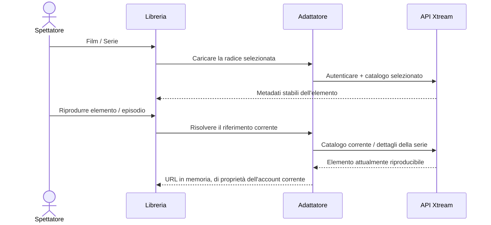

# Film e serie Xtream

<!-- language-navigation:start -->

<a href="xtream-media.md" lang="en" dir="ltr">English</a> · <a href="xtream-media.ar.md" lang="ar" dir="rtl">العربية</a> · <a href="xtream-media.bn.md" lang="bn" dir="ltr">বাংলা</a> · <a href="xtream-media.cs.md" lang="cs" dir="ltr">Čeština</a> · <a href="xtream-media.de.md" lang="de" dir="ltr">Deutsch</a> · <a href="xtream-media.es.md" lang="es" dir="ltr">Español</a> · <a href="xtream-media.fa.md" lang="fa" dir="rtl">فارسی</a> · <a href="xtream-media.fr.md" lang="fr" dir="ltr">Français</a>
 
<a href="xtream-media.he.md" lang="he" dir="rtl">עברית</a> · <a href="xtream-media.hi.md" lang="hi" dir="ltr">हिन्दी</a> · <a href="xtream-media.id.md" lang="id" dir="ltr">Bahasa Indonesia</a> · <a href="xtream-media.it.md" lang="it" dir="ltr">Italiano</a> · <a href="xtream-media.ja.md" lang="ja" dir="ltr">日本語</a> · <a href="xtream-media.ko.md" lang="ko" dir="ltr">한국어</a> · <a href="xtream-media.nl.md" lang="nl" dir="ltr">Nederlands</a> · <a href="xtream-media.pl.md" lang="pl" dir="ltr">Polski</a>
 
<a href="xtream-media.pt.md" lang="pt" dir="ltr">Português</a> · <a href="xtream-media.ru.md" lang="ru" dir="ltr">Русский</a> · <a href="xtream-media.th.md" lang="th" dir="ltr">ไทย</a> · <a href="xtream-media.tr.md" lang="tr" dir="ltr">Türkçe</a> · <a href="xtream-media.uk.md" lang="uk" dir="ltr">Українська</a> · <a href="xtream-media.vi.md" lang="vi" dir="ltr">Tiếng Việt</a> · <a href="xtream-media.zh-Hans.md" lang="zh-Hans" dir="ltr">简体中文</a> · <a href="xtream-media.zh-Hant.md" lang="zh-Hant" dir="ltr">繁體中文</a>

<!-- language-navigation:end -->

[Miglioramenti](roadmap-delivery.it.md)

Configurare il fornitore Xtream e caricare il suo catalogo in diretta, quindi aprire la libreria multimediale. **Movies** e **Series** sono radici separate caricate su richiesta: aprire la libreria non scarica entrambi i cataloghi. Aprire una serie carica i dettagli degli episodi. Il parser Xtream esistente nel nucleo condiviso crea identità e URL dei flussi; l'adattatore classico gestisce solo presentazione e durata delle richieste.

Ogni selezione risolve nuovamente la propria richiesta stabile rispetto all'account corrente. Gli elementi salvati omettono l'URL autenticato del flusso. Un elemento rimosso non può essere ripristinato dalla riga risolta in precedenza dall'adattatore. Sostituire credenziali/fornitore o chiudere il contesto proprietario annulla il lavoro in sospeso; le risposte obsolete non possono riempire la schermata dell'account successivo. Nomi e immagini forniti restano dati del fornitore.

Il fornitore deve consentire le richieste del client (CORS o trasporto nativo configurato) e il dispositivo deve supportare i contenuti restituiti. Non si tratta di un catalogo offline, una migrazione tra account, un aggiramento DRM o un nuovo transcodificatore. Mantenere il catalogo aggiornato richiede una richiesta alla selezione. Gli errori sono segnalati tramite il messaggio localizzato esistente della libreria; risultati non disponibili non avviano la riproduzione.

Eseguire `node tests/test_xtream_media.cjs` per radici su richiesta, credenziali codificate, richieste salvate senza segreti, elementi rimossi e annullamento della sorgente, e `node tests/test_provider_drivers.cjs` per l'effettivo ciclo di vita del fornitore.
