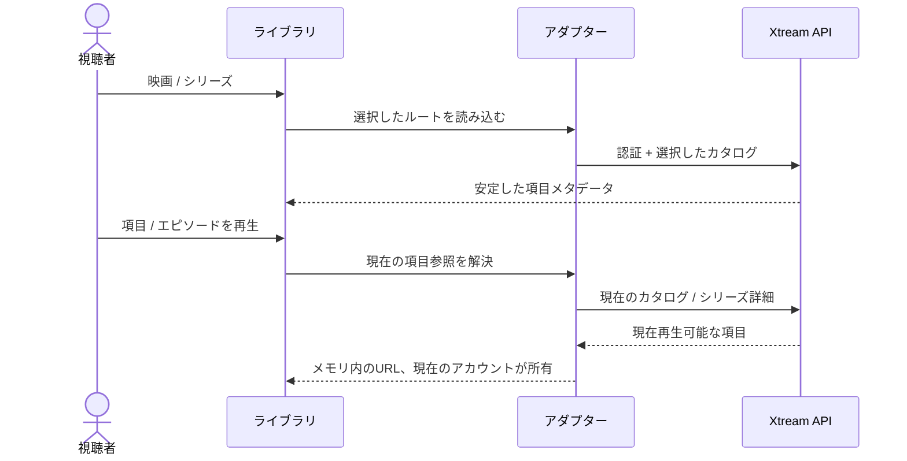

# Xtreamの映画とシリーズ

<!-- language-navigation:start -->

<a href="xtream-media.md" lang="en" dir="ltr">English</a> · <a href="xtream-media.ar.md" lang="ar" dir="rtl">العربية</a> · <a href="xtream-media.bn.md" lang="bn" dir="ltr">বাংলা</a> · <a href="xtream-media.cs.md" lang="cs" dir="ltr">Čeština</a> · <a href="xtream-media.de.md" lang="de" dir="ltr">Deutsch</a> · <a href="xtream-media.es.md" lang="es" dir="ltr">Español</a> · <a href="xtream-media.fa.md" lang="fa" dir="rtl">فارسی</a> · <a href="xtream-media.fr.md" lang="fr" dir="ltr">Français</a>
 
<a href="xtream-media.he.md" lang="he" dir="rtl">עברית</a> · <a href="xtream-media.hi.md" lang="hi" dir="ltr">हिन्दी</a> · <a href="xtream-media.id.md" lang="id" dir="ltr">Bahasa Indonesia</a> · <a href="xtream-media.it.md" lang="it" dir="ltr">Italiano</a> · <a href="xtream-media.ja.md" lang="ja" dir="ltr">日本語</a> · <a href="xtream-media.ko.md" lang="ko" dir="ltr">한국어</a> · <a href="xtream-media.nl.md" lang="nl" dir="ltr">Nederlands</a> · <a href="xtream-media.pl.md" lang="pl" dir="ltr">Polski</a>
 
<a href="xtream-media.pt.md" lang="pt" dir="ltr">Português</a> · <a href="xtream-media.ru.md" lang="ru" dir="ltr">Русский</a> · <a href="xtream-media.th.md" lang="th" dir="ltr">ไทย</a> · <a href="xtream-media.tr.md" lang="tr" dir="ltr">Türkçe</a> · <a href="xtream-media.uk.md" lang="uk" dir="ltr">Українська</a> · <a href="xtream-media.vi.md" lang="vi" dir="ltr">Tiếng Việt</a> · <a href="xtream-media.zh-Hans.md" lang="zh-Hans" dir="ltr">简体中文</a> · <a href="xtream-media.zh-Hant.md" lang="zh-Hant" dir="ltr">繁體中文</a>

<!-- language-navigation:end -->

[改善点](roadmap-delivery.ja.md)

Xtreamプロバイダーを設定してライブカタログを読み込み、メディアライブラリを開きます。**Movies** と **Series** は、それぞれ必要になるまで読み込まれない独立したルートです。ライブラリを開いただけでは両方のカタログをダウンロードしません。シリーズを開くとエピソードの詳細を読み込みます。共有コアにある既存のXtreamパーサーが識別子とストリームURLを作成し、従来のアダプターは表示とリクエストのライフサイクルだけを扱います。

選択するたびに、安定したリクエストを現在のアカウントに対して再解決します。保存する項目には認証済みストリームURLを含めません。削除済みの項目を、アダプターが以前に解決した行から復活させることはできません。認証情報／プロバイダーを置き換えるか、所有コンテキストを閉じると、未完了の処理を取り消します。古い応答が次のアカウントの画面を埋めることはありません。プロバイダーが提供する名前や画像は、引き続きプロバイダーのデータです。

プロバイダーがクライアントのリクエストを許可していること（CORSまたは設定済みのネイティブ転送方式）、およびデバイスが返されたメディアを扱えることが必要です。これはオフラインカタログ、アカウント間の移行、DRM回避、新しいトランスコーダーではありません。カタログを最新に保つため、選択時にリクエストを1回行います。エラーは既存のローカライズ済みライブラリエラーで通知し、利用できない結果では再生を開始しません。

必要時に読み込むルート、エンコードされた認証情報、秘密情報のない保存リクエスト、削除済み項目、ソースの取り消しは `node tests/test_xtream_media.cjs` で、実際のプロバイダーライフサイクルは `node tests/test_provider_drivers.cjs` で確認します。
