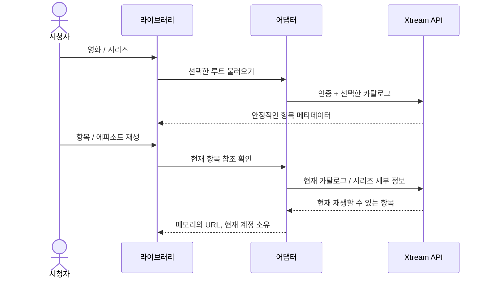

# Xtream 영화와 시리즈

<!-- language-navigation:start -->

<a href="xtream-media.md" lang="en" dir="ltr">English</a> · <a href="xtream-media.ar.md" lang="ar" dir="rtl">العربية</a> · <a href="xtream-media.bn.md" lang="bn" dir="ltr">বাংলা</a> · <a href="xtream-media.cs.md" lang="cs" dir="ltr">Čeština</a> · <a href="xtream-media.de.md" lang="de" dir="ltr">Deutsch</a> · <a href="xtream-media.es.md" lang="es" dir="ltr">Español</a> · <a href="xtream-media.fa.md" lang="fa" dir="rtl">فارسی</a> · <a href="xtream-media.fr.md" lang="fr" dir="ltr">Français</a>
 
<a href="xtream-media.he.md" lang="he" dir="rtl">עברית</a> · <a href="xtream-media.hi.md" lang="hi" dir="ltr">हिन्दी</a> · <a href="xtream-media.id.md" lang="id" dir="ltr">Bahasa Indonesia</a> · <a href="xtream-media.it.md" lang="it" dir="ltr">Italiano</a> · <a href="xtream-media.ja.md" lang="ja" dir="ltr">日本語</a> · <a href="xtream-media.ko.md" lang="ko" dir="ltr">한국어</a> · <a href="xtream-media.nl.md" lang="nl" dir="ltr">Nederlands</a> · <a href="xtream-media.pl.md" lang="pl" dir="ltr">Polski</a>
 
<a href="xtream-media.pt.md" lang="pt" dir="ltr">Português</a> · <a href="xtream-media.ru.md" lang="ru" dir="ltr">Русский</a> · <a href="xtream-media.th.md" lang="th" dir="ltr">ไทย</a> · <a href="xtream-media.tr.md" lang="tr" dir="ltr">Türkçe</a> · <a href="xtream-media.uk.md" lang="uk" dir="ltr">Українська</a> · <a href="xtream-media.vi.md" lang="vi" dir="ltr">Tiếng Việt</a> · <a href="xtream-media.zh-Hans.md" lang="zh-Hans" dir="ltr">简体中文</a> · <a href="xtream-media.zh-Hant.md" lang="zh-Hant" dir="ltr">繁體中文</a>

<!-- language-navigation:end -->

[개선 사항](roadmap-delivery.ko.md)

Xtream 공급자를 구성하고 실시간 카탈로그를 불러온 다음 미디어 라이브러리를 엽니다. **Movies** 와 **Series** 는 필요할 때 불러오는 별도의 루트입니다. 라이브러리를 여는 것만으로 두 카탈로그를 모두 다운로드하지는 않습니다. 시리즈를 열면 에피소드 세부 정보를 불러옵니다. 공유 코어의 기존 Xtream 파서가 식별 정보와 스트림 URL을 만들며, 클래식 어댑터는 표시와 요청 수명만 처리합니다.

선택할 때마다 안정적인 요청을 현재 계정에 대해 다시 확인합니다. 저장된 항목에는 인증된 스트림 URL이 포함되지 않습니다. 제거된 항목은 어댑터가 이전에 확인한 행에서 되살릴 수 없습니다. 자격 증명/공급자를 교체하거나 소유 컨텍스트를 닫으면 진행 중인 작업이 취소됩니다. 오래된 응답이 다음 계정의 화면을 채울 수는 없습니다. 공급자가 제공한 이름과 이미지는 계속 공급자 데이터입니다.

공급자는 클라이언트 요청을 허용해야 하며(CORS 또는 구성된 네이티브 전송 방식), 기기는 반환된 미디어를 지원해야 합니다. 이는 오프라인 카탈로그, 계정 간 이전, DRM 우회 또는 새로운 트랜스코더가 아닙니다. 카탈로그를 최신으로 유지하려면 선택 시 요청이 필요합니다. 오류는 기존의 지역화된 라이브러리 오류로 보고되며, 사용할 수 없는 결과는 재생을 시작하지 않습니다.

필요 시 루트 로딩, 인코딩된 자격 증명, 비밀 정보 없는 저장 요청, 제거된 항목 및 소스 취소는 `node tests/test_xtream_media.cjs` 로, 실제 공급자 수명 주기는 `node tests/test_provider_drivers.cjs` 로 확인합니다.
