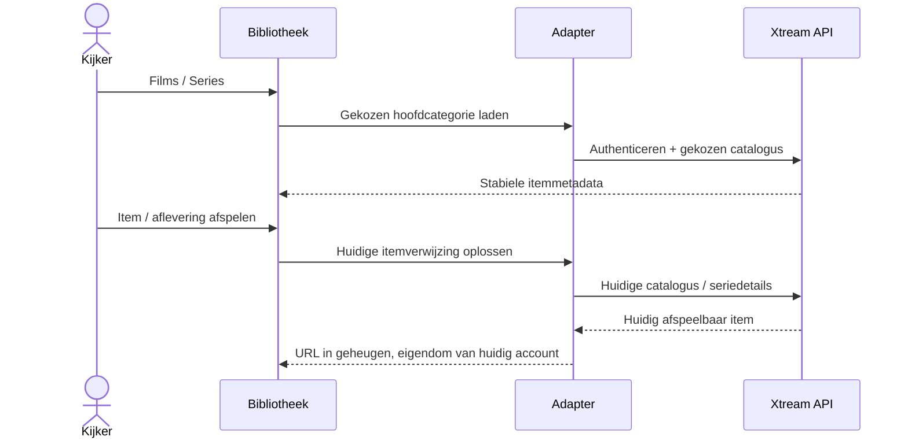

# Xtream-films en -series

<!-- language-navigation:start -->

<a href="xtream-media.md" lang="en" dir="ltr">English</a> · <a href="xtream-media.ar.md" lang="ar" dir="rtl">العربية</a> · <a href="xtream-media.bn.md" lang="bn" dir="ltr">বাংলা</a> · <a href="xtream-media.cs.md" lang="cs" dir="ltr">Čeština</a> · <a href="xtream-media.de.md" lang="de" dir="ltr">Deutsch</a> · <a href="xtream-media.es.md" lang="es" dir="ltr">Español</a> · <a href="xtream-media.fa.md" lang="fa" dir="rtl">فارسی</a> · <a href="xtream-media.fr.md" lang="fr" dir="ltr">Français</a>
 
<a href="xtream-media.he.md" lang="he" dir="rtl">עברית</a> · <a href="xtream-media.hi.md" lang="hi" dir="ltr">हिन्दी</a> · <a href="xtream-media.id.md" lang="id" dir="ltr">Bahasa Indonesia</a> · <a href="xtream-media.it.md" lang="it" dir="ltr">Italiano</a> · <a href="xtream-media.ja.md" lang="ja" dir="ltr">日本語</a> · <a href="xtream-media.ko.md" lang="ko" dir="ltr">한국어</a> · <a href="xtream-media.nl.md" lang="nl" dir="ltr">Nederlands</a> · <a href="xtream-media.pl.md" lang="pl" dir="ltr">Polski</a>
 
<a href="xtream-media.pt.md" lang="pt" dir="ltr">Português</a> · <a href="xtream-media.ru.md" lang="ru" dir="ltr">Русский</a> · <a href="xtream-media.th.md" lang="th" dir="ltr">ไทย</a> · <a href="xtream-media.tr.md" lang="tr" dir="ltr">Türkçe</a> · <a href="xtream-media.uk.md" lang="uk" dir="ltr">Українська</a> · <a href="xtream-media.vi.md" lang="vi" dir="ltr">Tiếng Việt</a> · <a href="xtream-media.zh-Hans.md" lang="zh-Hans" dir="ltr">简体中文</a> · <a href="xtream-media.zh-Hant.md" lang="zh-Hant" dir="ltr">繁體中文</a>

<!-- language-navigation:end -->

[Verbeteringen](roadmap-delivery.nl.md)

Stel de Xtream-provider in en laad de livecatalogus. Open vervolgens de mediabibliotheek. **Movies** en **Series** zijn aparte hoofdcategorieën die pas op aanvraag laden: bij het openen van de bibliotheek worden niet beide catalogi gedownload. Het openen van een serie laadt de afleveringsdetails. De bestaande Xtream-parser in de gedeelde kern maakt identiteiten en stream-URL's; de klassieke adapter regelt alleen de presentatie en de levensduur van aanvragen.

Elke selectie zoekt haar stabiele aanvraag opnieuw op binnen het huidige account. Opgeslagen items bevatten geen geauthenticeerde stream-URL. Een verwijderd item kan niet worden hersteld uit een eerder opgeloste adapterrij. Het vervangen van inloggegevens/provider of het sluiten van de eigenaarcontext annuleert openstaand werk; verouderde antwoorden kunnen het scherm van het volgende account niet vullen. Namen en afbeeldingen van de provider blijven providergegevens.

De provider moet clientaanvragen toestaan (CORS of het ingestelde native transport), en het apparaat moet de geretourneerde media ondersteunen. Dit is geen offlinecatalogus, migratie tussen accounts, DRM-omzeiling of nieuwe transcoder. Een actuele catalogus kost bij elke selectie een aanvraag. Fouten worden gemeld via de bestaande vertaalde bibliotheekfout; niet-beschikbare resultaten starten geen weergave.

Voer `node tests/test_xtream_media.cjs` uit voor laden op aanvraag, gecodeerde inloggegevens, opgeslagen aanvragen zonder geheimen, verwijderde items en bronannulering, en `node tests/test_provider_drivers.cjs` voor de daadwerkelijke levenscyclus van de provider.
