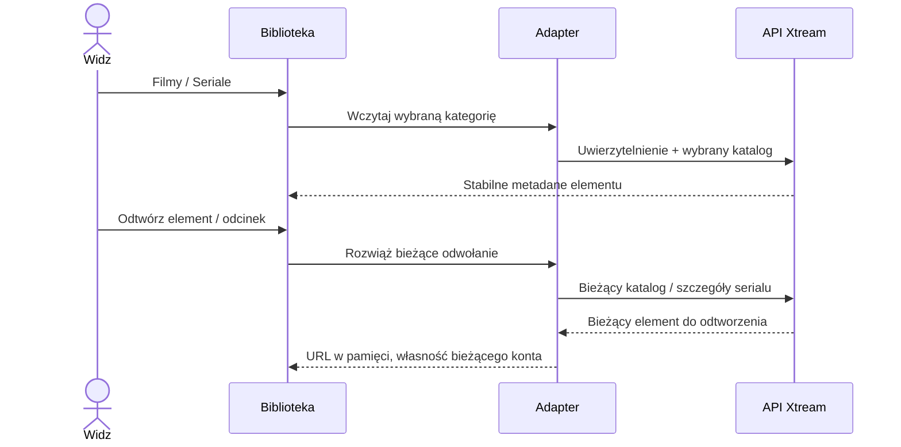

# Filmy i seriale Xtream

<!-- language-navigation:start -->

<a href="xtream-media.md" lang="en" dir="ltr">English</a> · <a href="xtream-media.ar.md" lang="ar" dir="rtl">العربية</a> · <a href="xtream-media.bn.md" lang="bn" dir="ltr">বাংলা</a> · <a href="xtream-media.cs.md" lang="cs" dir="ltr">Čeština</a> · <a href="xtream-media.de.md" lang="de" dir="ltr">Deutsch</a> · <a href="xtream-media.es.md" lang="es" dir="ltr">Español</a> · <a href="xtream-media.fa.md" lang="fa" dir="rtl">فارسی</a> · <a href="xtream-media.fr.md" lang="fr" dir="ltr">Français</a>
 
<a href="xtream-media.he.md" lang="he" dir="rtl">עברית</a> · <a href="xtream-media.hi.md" lang="hi" dir="ltr">हिन्दी</a> · <a href="xtream-media.id.md" lang="id" dir="ltr">Bahasa Indonesia</a> · <a href="xtream-media.it.md" lang="it" dir="ltr">Italiano</a> · <a href="xtream-media.ja.md" lang="ja" dir="ltr">日本語</a> · <a href="xtream-media.ko.md" lang="ko" dir="ltr">한국어</a> · <a href="xtream-media.nl.md" lang="nl" dir="ltr">Nederlands</a> · <a href="xtream-media.pl.md" lang="pl" dir="ltr">Polski</a>
 
<a href="xtream-media.pt.md" lang="pt" dir="ltr">Português</a> · <a href="xtream-media.ru.md" lang="ru" dir="ltr">Русский</a> · <a href="xtream-media.th.md" lang="th" dir="ltr">ไทย</a> · <a href="xtream-media.tr.md" lang="tr" dir="ltr">Türkçe</a> · <a href="xtream-media.uk.md" lang="uk" dir="ltr">Українська</a> · <a href="xtream-media.vi.md" lang="vi" dir="ltr">Tiếng Việt</a> · <a href="xtream-media.zh-Hans.md" lang="zh-Hans" dir="ltr">简体中文</a> · <a href="xtream-media.zh-Hant.md" lang="zh-Hant" dir="ltr">繁體中文</a>

<!-- language-navigation:end -->

[Ulepszenia](roadmap-delivery.pl.md)

Skonfiguruj dostawcę Xtream i wczytaj jego katalog transmisji na żywo, a następnie otwórz bibliotekę multimediów. **Movies** i **Series** to oddzielne kategorie główne wczytywane na żądanie: otwarcie biblioteki nie pobiera obu katalogów. Otwarcie serialu wczytuje szczegóły odcinków. Istniejący parser Xtream we wspólnym rdzeniu tworzy tożsamości i URL strumieni; klasyczny adapter odpowiada wyłącznie za prezentację i czas życia żądań.

Każdy wybór ponownie rozwiązuje swoje stabilne żądanie względem bieżącego konta. Zapisane elementy nie zawierają uwierzytelnionego URL strumienia. Usuniętego elementu nie można przywrócić z wcześniej rozwiązanej pozycji adaptera. Zmiana danych logowania/dostawcy lub zamknięcie kontekstu właściciela anuluje oczekującą pracę; nieaktualne odpowiedzi nie mogą zapełnić ekranu następnego konta. Nazwy i grafiki dostarczone przez dostawcę pozostają jego danymi.

Dostawca musi zezwalać na żądania klienta (CORS lub skonfigurowany transport natywny), a urządzenie musi obsługiwać zwrócone media. Nie jest to katalog offline, migracja między kontami, obejście DRM ani nowy transkoder. Aktualność katalogu wymaga żądania przy wyborze. Błędy są zgłaszane przez istniejący zlokalizowany błąd biblioteki; niedostępne wyniki nie uruchamiają odtwarzania.

Uruchom `node tests/test_xtream_media.cjs` dla kategorii na żądanie, kodowanych danych logowania, zapisanych żądań bez sekretów, usuniętych elementów i anulowania źródła, a `node tests/test_provider_drivers.cjs` dla rzeczywistego cyklu życia dostawcy.
