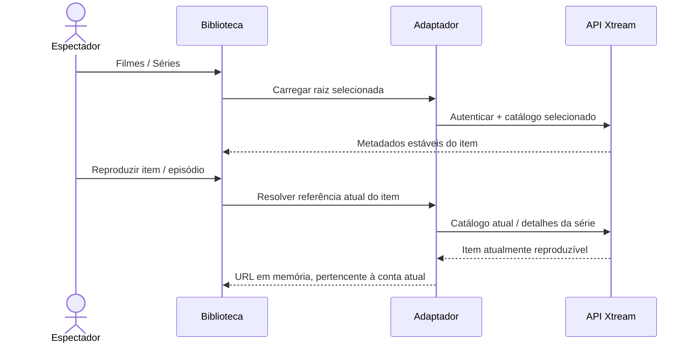

# Filmes e séries Xtream

<!-- language-navigation:start -->

<a href="xtream-media.md" lang="en" dir="ltr">English</a> · <a href="xtream-media.ar.md" lang="ar" dir="rtl">العربية</a> · <a href="xtream-media.bn.md" lang="bn" dir="ltr">বাংলা</a> · <a href="xtream-media.cs.md" lang="cs" dir="ltr">Čeština</a> · <a href="xtream-media.de.md" lang="de" dir="ltr">Deutsch</a> · <a href="xtream-media.es.md" lang="es" dir="ltr">Español</a> · <a href="xtream-media.fa.md" lang="fa" dir="rtl">فارسی</a> · <a href="xtream-media.fr.md" lang="fr" dir="ltr">Français</a>
 
<a href="xtream-media.he.md" lang="he" dir="rtl">עברית</a> · <a href="xtream-media.hi.md" lang="hi" dir="ltr">हिन्दी</a> · <a href="xtream-media.id.md" lang="id" dir="ltr">Bahasa Indonesia</a> · <a href="xtream-media.it.md" lang="it" dir="ltr">Italiano</a> · <a href="xtream-media.ja.md" lang="ja" dir="ltr">日本語</a> · <a href="xtream-media.ko.md" lang="ko" dir="ltr">한국어</a> · <a href="xtream-media.nl.md" lang="nl" dir="ltr">Nederlands</a> · <a href="xtream-media.pl.md" lang="pl" dir="ltr">Polski</a>
 
<a href="xtream-media.pt.md" lang="pt" dir="ltr">Português</a> · <a href="xtream-media.ru.md" lang="ru" dir="ltr">Русский</a> · <a href="xtream-media.th.md" lang="th" dir="ltr">ไทย</a> · <a href="xtream-media.tr.md" lang="tr" dir="ltr">Türkçe</a> · <a href="xtream-media.uk.md" lang="uk" dir="ltr">Українська</a> · <a href="xtream-media.vi.md" lang="vi" dir="ltr">Tiếng Việt</a> · <a href="xtream-media.zh-Hans.md" lang="zh-Hans" dir="ltr">简体中文</a> · <a href="xtream-media.zh-Hant.md" lang="zh-Hant" dir="ltr">繁體中文</a>

<!-- language-navigation:end -->

[Melhorias](roadmap-delivery.pt.md)

Configure o fornecedor Xtream e carregue o seu catálogo em direto; depois abra a biblioteca multimédia. **Movies** e **Series** são raízes separadas carregadas a pedido: abrir a biblioteca não descarrega ambos os catálogos. Abrir uma série carrega os detalhes dos episódios. O analisador Xtream existente no núcleo partilhado cria identidades e URLs de fluxos; o adaptador clássico apenas gere a apresentação e a duração dos pedidos.

Cada seleção volta a resolver o seu pedido estável na conta atual. Os itens guardados omitem o URL autenticado do fluxo. Um item removido não pode ser recuperado da linha anteriormente resolvida pelo adaptador. Substituir credenciais/fornecedor ou fechar o contexto proprietário cancela o trabalho pendente; respostas desatualizadas não podem preencher o ecrã da conta seguinte. Os nomes e imagens fornecidos continuam a ser dados do fornecedor.

O fornecedor deve permitir os pedidos do cliente (CORS ou transporte nativo configurado), e o dispositivo deve suportar os conteúdos devolvidos. Isto não é um catálogo offline, uma migração entre contas, uma forma de contornar DRM nem um novo transcodificador. Manter o catálogo atualizado exige um pedido na seleção. Os erros são comunicados através do erro localizado existente da biblioteca; resultados indisponíveis não iniciam a reprodução.

Execute `node tests/test_xtream_media.cjs` para raízes a pedido, credenciais codificadas, pedidos guardados sem segredos, itens removidos e cancelamento da fonte, e `node tests/test_provider_drivers.cjs` para o ciclo de vida real do fornecedor.
