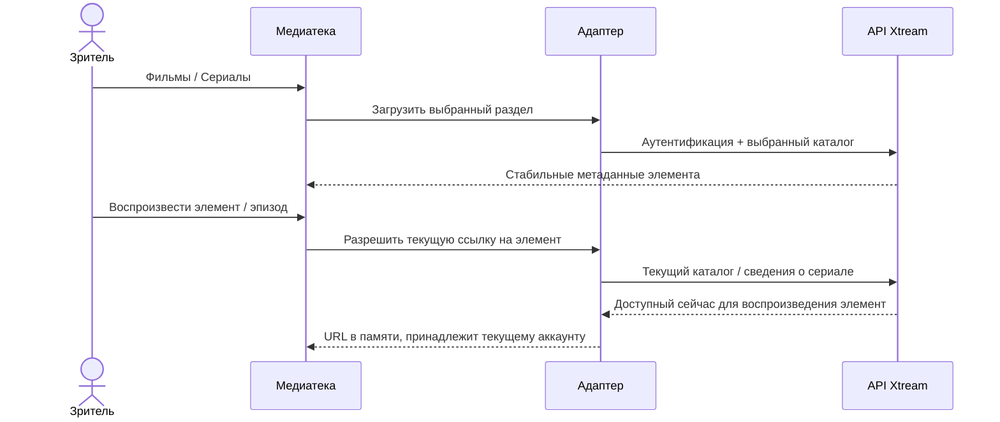

# Фильмы и сериалы Xtream

<!-- language-navigation:start -->

<a href="xtream-media.md" lang="en" dir="ltr">English</a> · <a href="xtream-media.ar.md" lang="ar" dir="rtl">العربية</a> · <a href="xtream-media.bn.md" lang="bn" dir="ltr">বাংলা</a> · <a href="xtream-media.cs.md" lang="cs" dir="ltr">Čeština</a> · <a href="xtream-media.de.md" lang="de" dir="ltr">Deutsch</a> · <a href="xtream-media.es.md" lang="es" dir="ltr">Español</a> · <a href="xtream-media.fa.md" lang="fa" dir="rtl">فارسی</a> · <a href="xtream-media.fr.md" lang="fr" dir="ltr">Français</a>
 
<a href="xtream-media.he.md" lang="he" dir="rtl">עברית</a> · <a href="xtream-media.hi.md" lang="hi" dir="ltr">हिन्दी</a> · <a href="xtream-media.id.md" lang="id" dir="ltr">Bahasa Indonesia</a> · <a href="xtream-media.it.md" lang="it" dir="ltr">Italiano</a> · <a href="xtream-media.ja.md" lang="ja" dir="ltr">日本語</a> · <a href="xtream-media.ko.md" lang="ko" dir="ltr">한국어</a> · <a href="xtream-media.nl.md" lang="nl" dir="ltr">Nederlands</a> · <a href="xtream-media.pl.md" lang="pl" dir="ltr">Polski</a>
 
<a href="xtream-media.pt.md" lang="pt" dir="ltr">Português</a> · <a href="xtream-media.ru.md" lang="ru" dir="ltr">Русский</a> · <a href="xtream-media.th.md" lang="th" dir="ltr">ไทย</a> · <a href="xtream-media.tr.md" lang="tr" dir="ltr">Türkçe</a> · <a href="xtream-media.uk.md" lang="uk" dir="ltr">Українська</a> · <a href="xtream-media.vi.md" lang="vi" dir="ltr">Tiếng Việt</a> · <a href="xtream-media.zh-Hans.md" lang="zh-Hans" dir="ltr">简体中文</a> · <a href="xtream-media.zh-Hant.md" lang="zh-Hant" dir="ltr">繁體中文</a>

<!-- language-navigation:end -->

[Улучшения](roadmap-delivery.ru.md)

Настройте провайдера Xtream и загрузите его каталог эфира, затем откройте медиатеку. **Movies** и **Series** — отдельные корневые разделы с загрузкой по требованию: открытие медиатеки не скачивает оба каталога. При открытии сериала загружаются сведения об эпизодах. Существующий парсер Xtream в общем ядре создаёт идентичности и URL потоков; классический адаптер отвечает только за представление и время жизни запросов.

При каждом выборе стабильный запрос заново разрешается для текущего аккаунта. В сохранённых элементах нет аутентифицированного URL потока. Удалённый элемент нельзя восстановить из ранее разрешённой строки адаптера. Замена учётных данных/провайдера или закрытие контекста-владельца отменяет незавершённые операции; устаревшие ответы не могут заполнить экран следующего аккаунта. Предоставленные провайдером названия и изображения остаются данными провайдера.

Провайдер должен разрешать запросы клиента (CORS или настроенный нативный транспорт), а устройство — поддерживать возвращаемые медиа. Это не офлайн-каталог, миграция между аккаунтами, обход DRM или новый транскодер. Актуальность каталога требует запроса при выборе. Ошибки сообщаются через существующую локализованную ошибку медиатеки; недоступные результаты не запускают воспроизведение.

Выполните `node tests/test_xtream_media.cjs` для проверки разделов по требованию, закодированных учётных данных, сохранённых запросов без секретов, удалённых элементов и отмены источника, а `node tests/test_provider_drivers.cjs` — для реального жизненного цикла провайдера.
