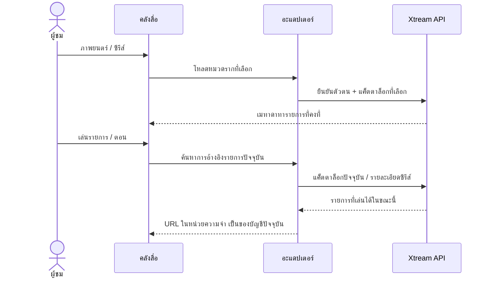

# ภาพยนตร์และซีรีส์ Xtream

<!-- language-navigation:start -->

<a href="xtream-media.md" lang="en" dir="ltr">English</a> · <a href="xtream-media.ar.md" lang="ar" dir="rtl">العربية</a> · <a href="xtream-media.bn.md" lang="bn" dir="ltr">বাংলা</a> · <a href="xtream-media.cs.md" lang="cs" dir="ltr">Čeština</a> · <a href="xtream-media.de.md" lang="de" dir="ltr">Deutsch</a> · <a href="xtream-media.es.md" lang="es" dir="ltr">Español</a> · <a href="xtream-media.fa.md" lang="fa" dir="rtl">فارسی</a> · <a href="xtream-media.fr.md" lang="fr" dir="ltr">Français</a>
 
<a href="xtream-media.he.md" lang="he" dir="rtl">עברית</a> · <a href="xtream-media.hi.md" lang="hi" dir="ltr">हिन्दी</a> · <a href="xtream-media.id.md" lang="id" dir="ltr">Bahasa Indonesia</a> · <a href="xtream-media.it.md" lang="it" dir="ltr">Italiano</a> · <a href="xtream-media.ja.md" lang="ja" dir="ltr">日本語</a> · <a href="xtream-media.ko.md" lang="ko" dir="ltr">한국어</a> · <a href="xtream-media.nl.md" lang="nl" dir="ltr">Nederlands</a> · <a href="xtream-media.pl.md" lang="pl" dir="ltr">Polski</a>
 
<a href="xtream-media.pt.md" lang="pt" dir="ltr">Português</a> · <a href="xtream-media.ru.md" lang="ru" dir="ltr">Русский</a> · <a href="xtream-media.th.md" lang="th" dir="ltr">ไทย</a> · <a href="xtream-media.tr.md" lang="tr" dir="ltr">Türkçe</a> · <a href="xtream-media.uk.md" lang="uk" dir="ltr">Українська</a> · <a href="xtream-media.vi.md" lang="vi" dir="ltr">Tiếng Việt</a> · <a href="xtream-media.zh-Hans.md" lang="zh-Hans" dir="ltr">简体中文</a> · <a href="xtream-media.zh-Hant.md" lang="zh-Hant" dir="ltr">繁體中文</a>

<!-- language-navigation:end -->

[การปรับปรุง](roadmap-delivery.th.md)

กำหนดค่าผู้ให้บริการ Xtream และโหลดแค็ตตาล็อกรายการสด แล้วเปิดคลังสื่อ **Movies** และ **Series** เป็นหมวดรากแยกกันซึ่งโหลดเมื่อจำเป็น การเปิดคลังไม่ได้ดาวน์โหลดทั้งสองแค็ตตาล็อก การเปิดซีรีส์จะโหลดรายละเอียดของแต่ละตอน ตัวแยกวิเคราะห์ Xtream ที่มีอยู่ในแกนกลางร่วมสร้างข้อมูลระบุตัวตนและ URL สตรีม ส่วนอะแดปเตอร์แบบคลาสสิกจัดการเพียงการแสดงผลและอายุของคำขอ

ทุกครั้งที่เลือก ระบบจะค้นหาคำขอที่คงที่นั้นใหม่โดยอ้างอิงบัญชีปัจจุบัน รายการที่บันทึกไม่เก็บ URL สตรีมที่มีข้อมูลยืนยันตัวตน รายการที่ถูกลบแล้วไม่สามารถคืนมาจากแถวที่อะแดปเตอร์เคยประมวลผลไว้ การเปลี่ยนข้อมูลรับรอง/ผู้ให้บริการหรือปิดบริบทเจ้าของจะยกเลิกงานที่ค้างอยู่ การตอบกลับเก่าไม่สามารถเติมข้อมูลลงในหน้าจอของบัญชีถัดไป ชื่อและภาพจากผู้ให้บริการยังคงเป็นข้อมูลของผู้ให้บริการ

ผู้ให้บริการต้องอนุญาตคำขอของไคลเอนต์ (CORS หรือการรับส่งแบบเนทีฟที่กำหนดไว้) และอุปกรณ์ต้องรองรับสื่อที่ส่งกลับ นี่ไม่ใช่แค็ตตาล็อกออฟไลน์ การย้ายข้ามบัญชี การข้าม DRM หรือตัวแปลงรหัสใหม่ การรักษาแค็ตตาล็อกให้เป็นปัจจุบันต้องใช้คำขอเมื่อเลือก ข้อผิดพลาดจะแจ้งผ่านข้อความผิดพลาดของคลังที่แปลไว้แล้ว ผลลัพธ์ที่ไม่พร้อมใช้งานจะไม่เริ่มเล่น

เรียกใช้ `node tests/test_xtream_media.cjs` เพื่อตรวจหมวดรากที่โหลดตามต้องการ ข้อมูลรับรองที่เข้ารหัสรูปแบบ คำขอที่บันทึกโดยไม่มีความลับ รายการที่ถูกลบ และการยกเลิกแหล่งที่มา ส่วน `node tests/test_provider_drivers.cjs` ใช้ตรวจวงจรชีวิตจริงของผู้ให้บริการ
