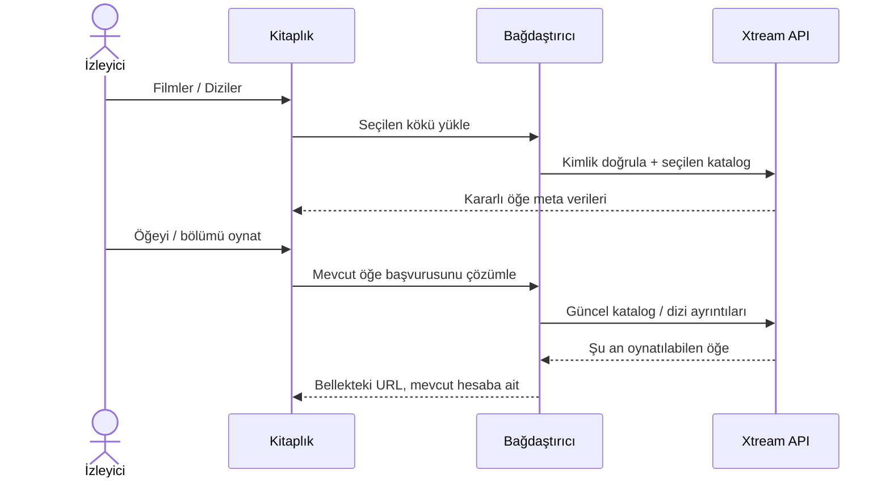

# Xtream filmleri ve dizileri

<!-- language-navigation:start -->

<a href="xtream-media.md" lang="en" dir="ltr">English</a> · <a href="xtream-media.ar.md" lang="ar" dir="rtl">العربية</a> · <a href="xtream-media.bn.md" lang="bn" dir="ltr">বাংলা</a> · <a href="xtream-media.cs.md" lang="cs" dir="ltr">Čeština</a> · <a href="xtream-media.de.md" lang="de" dir="ltr">Deutsch</a> · <a href="xtream-media.es.md" lang="es" dir="ltr">Español</a> · <a href="xtream-media.fa.md" lang="fa" dir="rtl">فارسی</a> · <a href="xtream-media.fr.md" lang="fr" dir="ltr">Français</a>
 
<a href="xtream-media.he.md" lang="he" dir="rtl">עברית</a> · <a href="xtream-media.hi.md" lang="hi" dir="ltr">हिन्दी</a> · <a href="xtream-media.id.md" lang="id" dir="ltr">Bahasa Indonesia</a> · <a href="xtream-media.it.md" lang="it" dir="ltr">Italiano</a> · <a href="xtream-media.ja.md" lang="ja" dir="ltr">日本語</a> · <a href="xtream-media.ko.md" lang="ko" dir="ltr">한국어</a> · <a href="xtream-media.nl.md" lang="nl" dir="ltr">Nederlands</a> · <a href="xtream-media.pl.md" lang="pl" dir="ltr">Polski</a>
 
<a href="xtream-media.pt.md" lang="pt" dir="ltr">Português</a> · <a href="xtream-media.ru.md" lang="ru" dir="ltr">Русский</a> · <a href="xtream-media.th.md" lang="th" dir="ltr">ไทย</a> · <a href="xtream-media.tr.md" lang="tr" dir="ltr">Türkçe</a> · <a href="xtream-media.uk.md" lang="uk" dir="ltr">Українська</a> · <a href="xtream-media.vi.md" lang="vi" dir="ltr">Tiếng Việt</a> · <a href="xtream-media.zh-Hans.md" lang="zh-Hans" dir="ltr">简体中文</a> · <a href="xtream-media.zh-Hant.md" lang="zh-Hant" dir="ltr">繁體中文</a>

<!-- language-navigation:end -->

[İyileştirmeler](roadmap-delivery.tr.md)

Xtream sağlayıcısını yapılandırıp canlı kataloğunu yükleyin, ardından Medya Kitaplığı'nı açın. **Movies** ve **Series**, gerektiğinde yüklenen ayrı köklerdir: kitaplığı açmak iki kataloğu birden indirmez. Bir diziyi açmak bölüm ayrıntılarını yükler. Paylaşılan çekirdekteki mevcut Xtream ayrıştırıcısı kimlikleri ve akış URL'lerini oluşturur; klasik bağdaştırıcı yalnızca sunumu ve istek ömrünü yönetir.

Her seçim, kararlı isteğini mevcut hesaba göre yeniden çözümler. Kaydedilen öğeler kimlik doğrulamalı akış URL'sini içermez. Kaldırılmış bir öğe, bağdaştırıcının daha önce çözümlediği satırdan geri getirilemez. Kimlik bilgilerinin/sağlayıcının değiştirilmesi veya sahip bağlamın kapatılması bekleyen işleri iptal eder; eski yanıtlar sonraki hesabın ekranını dolduramaz. Sağlayıcının verdiği adlar ve görseller sağlayıcı verisi olarak kalır.

Sağlayıcı istemci isteklerine izin vermelidir (CORS veya yapılandırılmış yerel taşıma); cihaz da döndürülen medyayı desteklemelidir. Bu, çevrimdışı katalog, hesaplar arası geçiş, DRM atlatma veya yeni bir kod dönüştürücü değildir. Kataloğun güncel tutulması seçim sırasında bir istek gerektirir. Hatalar mevcut yerelleştirilmiş kitaplık hatasıyla bildirilir; kullanılamayan sonuçlar oynatmayı başlatmaz.

İsteğe bağlı kökler, kodlanmış kimlik bilgileri, sır içermeyen kayıtlı istekler, kaldırılmış öğeler ve kaynak iptali için `node tests/test_xtream_media.cjs`; gerçek sağlayıcı yaşam döngüsü için `node tests/test_provider_drivers.cjs` çalıştırın.
