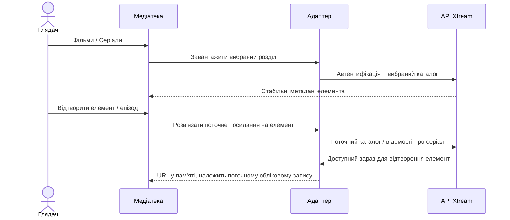

# Фільми та серіали Xtream

<!-- language-navigation:start -->

<a href="xtream-media.md" lang="en" dir="ltr">English</a> · <a href="xtream-media.ar.md" lang="ar" dir="rtl">العربية</a> · <a href="xtream-media.bn.md" lang="bn" dir="ltr">বাংলা</a> · <a href="xtream-media.cs.md" lang="cs" dir="ltr">Čeština</a> · <a href="xtream-media.de.md" lang="de" dir="ltr">Deutsch</a> · <a href="xtream-media.es.md" lang="es" dir="ltr">Español</a> · <a href="xtream-media.fa.md" lang="fa" dir="rtl">فارسی</a> · <a href="xtream-media.fr.md" lang="fr" dir="ltr">Français</a>
 
<a href="xtream-media.he.md" lang="he" dir="rtl">עברית</a> · <a href="xtream-media.hi.md" lang="hi" dir="ltr">हिन्दी</a> · <a href="xtream-media.id.md" lang="id" dir="ltr">Bahasa Indonesia</a> · <a href="xtream-media.it.md" lang="it" dir="ltr">Italiano</a> · <a href="xtream-media.ja.md" lang="ja" dir="ltr">日本語</a> · <a href="xtream-media.ko.md" lang="ko" dir="ltr">한국어</a> · <a href="xtream-media.nl.md" lang="nl" dir="ltr">Nederlands</a> · <a href="xtream-media.pl.md" lang="pl" dir="ltr">Polski</a>
 
<a href="xtream-media.pt.md" lang="pt" dir="ltr">Português</a> · <a href="xtream-media.ru.md" lang="ru" dir="ltr">Русский</a> · <a href="xtream-media.th.md" lang="th" dir="ltr">ไทย</a> · <a href="xtream-media.tr.md" lang="tr" dir="ltr">Türkçe</a> · <a href="xtream-media.uk.md" lang="uk" dir="ltr">Українська</a> · <a href="xtream-media.vi.md" lang="vi" dir="ltr">Tiếng Việt</a> · <a href="xtream-media.zh-Hans.md" lang="zh-Hans" dir="ltr">简体中文</a> · <a href="xtream-media.zh-Hant.md" lang="zh-Hant" dir="ltr">繁體中文</a>

<!-- language-navigation:end -->

[Поліпшення](roadmap-delivery.uk.md)

Налаштуйте провайдера Xtream і завантажте його каталог ефіру, а потім відкрийте медіатеку. **Movies** і **Series** — окремі кореневі розділи, що завантажуються на вимогу: відкриття медіатеки не завантажує обидва каталоги. Відкриття серіалу завантажує відомості про епізоди. Наявний парсер Xtream у спільному ядрі створює ідентичності й URL потоків; класичний адаптер відповідає лише за подання та час життя запитів.

Кожен вибір знову розв'язує свій стабільний запит щодо поточного облікового запису. Збережені елементи не містять автентифікованого URL потоку. Видалений елемент не можна відновити з раніше розв'язаного рядка адаптера. Заміна облікових даних/провайдера або закриття контексту-власника скасовує незавершені операції; застарілі відповіді не можуть заповнити екран наступного облікового запису. Назви й зображення від провайдера залишаються даними провайдера.

Провайдер має дозволяти запити клієнта (CORS або налаштований нативний транспорт), а пристрій — підтримувати повернуті медіа. Це не офлайн-каталог, міграція між обліковими записами, обхід DRM чи новий транскодер. Актуальність каталогу потребує запиту під час вибору. Помилки повідомляються через наявну локалізовану помилку медіатеки; недоступні результати не запускають відтворення.

Виконайте `node tests/test_xtream_media.cjs` для перевірки розділів на вимогу, закодованих облікових даних, збережених запитів без секретів, видалених елементів і скасування джерела; `node tests/test_provider_drivers.cjs` перевіряє справжній життєвий цикл провайдера.
