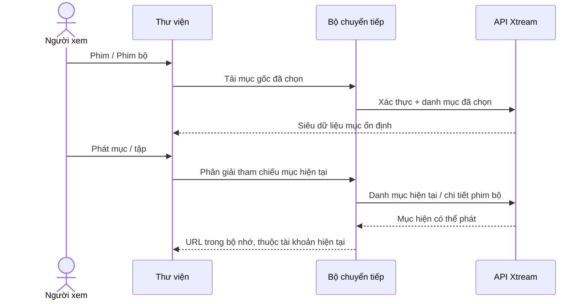

# Phim và phim bộ Xtream

<!-- language-navigation:start -->

<a href="xtream-media.md" lang="en" dir="ltr">English</a> · <a href="xtream-media.ar.md" lang="ar" dir="rtl">العربية</a> · <a href="xtream-media.bn.md" lang="bn" dir="ltr">বাংলা</a> · <a href="xtream-media.cs.md" lang="cs" dir="ltr">Čeština</a> · <a href="xtream-media.de.md" lang="de" dir="ltr">Deutsch</a> · <a href="xtream-media.es.md" lang="es" dir="ltr">Español</a> · <a href="xtream-media.fa.md" lang="fa" dir="rtl">فارسی</a> · <a href="xtream-media.fr.md" lang="fr" dir="ltr">Français</a>
 
<a href="xtream-media.he.md" lang="he" dir="rtl">עברית</a> · <a href="xtream-media.hi.md" lang="hi" dir="ltr">हिन्दी</a> · <a href="xtream-media.id.md" lang="id" dir="ltr">Bahasa Indonesia</a> · <a href="xtream-media.it.md" lang="it" dir="ltr">Italiano</a> · <a href="xtream-media.ja.md" lang="ja" dir="ltr">日本語</a> · <a href="xtream-media.ko.md" lang="ko" dir="ltr">한국어</a> · <a href="xtream-media.nl.md" lang="nl" dir="ltr">Nederlands</a> · <a href="xtream-media.pl.md" lang="pl" dir="ltr">Polski</a>
 
<a href="xtream-media.pt.md" lang="pt" dir="ltr">Português</a> · <a href="xtream-media.ru.md" lang="ru" dir="ltr">Русский</a> · <a href="xtream-media.th.md" lang="th" dir="ltr">ไทย</a> · <a href="xtream-media.tr.md" lang="tr" dir="ltr">Türkçe</a> · <a href="xtream-media.uk.md" lang="uk" dir="ltr">Українська</a> · <a href="xtream-media.vi.md" lang="vi" dir="ltr">Tiếng Việt</a> · <a href="xtream-media.zh-Hans.md" lang="zh-Hans" dir="ltr">简体中文</a> · <a href="xtream-media.zh-Hant.md" lang="zh-Hant" dir="ltr">繁體中文</a>

<!-- language-navigation:end -->

[Cải tiến](roadmap-delivery.vi.md)

Cấu hình nhà cung cấp Xtream và tải danh mục truyền hình trực tiếp, sau đó mở Thư viện đa phương tiện. **Movies** và **Series** là các mục gốc riêng biệt được tải khi cần: mở thư viện không tải xuống cả hai danh mục. Mở một phim bộ sẽ tải chi tiết các tập. Bộ phân tích Xtream hiện có trong lõi dùng chung tạo danh tính và URL luồng; bộ chuyển tiếp cổ điển chỉ xử lý cách trình bày và vòng đời yêu cầu.

Mỗi lần chọn đều phân giải lại yêu cầu ổn định của nó theo tài khoản hiện tại. Mục đã lưu không chứa URL luồng có xác thực. Không thể khôi phục mục đã bị xóa từ hàng mà bộ chuyển tiếp từng phân giải. Thay thông tin đăng nhập/nhà cung cấp hoặc đóng ngữ cảnh sở hữu sẽ hủy công việc đang chờ; phản hồi cũ không thể điền vào màn hình tài khoản tiếp theo. Tên và hình ảnh do nhà cung cấp đưa ra vẫn là dữ liệu của họ.

Nhà cung cấp phải cho phép yêu cầu của máy khách (CORS hoặc cơ chế truyền tải gốc đã cấu hình), và thiết bị phải hỗ trợ nội dung trả về. Đây không phải danh mục ngoại tuyến, chuyển đổi giữa các tài khoản, cách vượt DRM hay bộ chuyển mã mới. Để giữ danh mục cập nhật, mỗi lần chọn cần một yêu cầu. Lỗi được báo qua thông báo lỗi thư viện đã bản địa hóa hiện có; kết quả không khả dụng sẽ không bắt đầu phát.

Chạy `node tests/test_xtream_media.cjs` để kiểm tra mục gốc tải khi cần, thông tin đăng nhập được mã hóa biểu diễn, yêu cầu lưu không chứa bí mật, mục đã xóa và hủy nguồn; chạy `node tests/test_provider_drivers.cjs` để kiểm tra vòng đời thực tế của nhà cung cấp.
