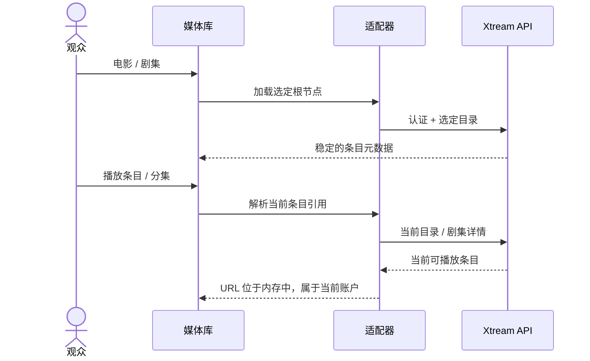

# Xtream 电影与剧集

<!-- language-navigation:start -->

<a href="xtream-media.md" lang="en" dir="ltr">English</a> · <a href="xtream-media.ar.md" lang="ar" dir="rtl">العربية</a> · <a href="xtream-media.bn.md" lang="bn" dir="ltr">বাংলা</a> · <a href="xtream-media.cs.md" lang="cs" dir="ltr">Čeština</a> · <a href="xtream-media.de.md" lang="de" dir="ltr">Deutsch</a> · <a href="xtream-media.es.md" lang="es" dir="ltr">Español</a> · <a href="xtream-media.fa.md" lang="fa" dir="rtl">فارسی</a> · <a href="xtream-media.fr.md" lang="fr" dir="ltr">Français</a>
 
<a href="xtream-media.he.md" lang="he" dir="rtl">עברית</a> · <a href="xtream-media.hi.md" lang="hi" dir="ltr">हिन्दी</a> · <a href="xtream-media.id.md" lang="id" dir="ltr">Bahasa Indonesia</a> · <a href="xtream-media.it.md" lang="it" dir="ltr">Italiano</a> · <a href="xtream-media.ja.md" lang="ja" dir="ltr">日本語</a> · <a href="xtream-media.ko.md" lang="ko" dir="ltr">한국어</a> · <a href="xtream-media.nl.md" lang="nl" dir="ltr">Nederlands</a> · <a href="xtream-media.pl.md" lang="pl" dir="ltr">Polski</a>
 
<a href="xtream-media.pt.md" lang="pt" dir="ltr">Português</a> · <a href="xtream-media.ru.md" lang="ru" dir="ltr">Русский</a> · <a href="xtream-media.th.md" lang="th" dir="ltr">ไทย</a> · <a href="xtream-media.tr.md" lang="tr" dir="ltr">Türkçe</a> · <a href="xtream-media.uk.md" lang="uk" dir="ltr">Українська</a> · <a href="xtream-media.vi.md" lang="vi" dir="ltr">Tiếng Việt</a> · <a href="xtream-media.zh-Hans.md" lang="zh-Hans" dir="ltr">简体中文</a> · <a href="xtream-media.zh-Hant.md" lang="zh-Hant" dir="ltr">繁體中文</a>

<!-- language-navigation:end -->

[改进](roadmap-delivery.zh-Hans.md)

配置 Xtream 提供商并加载其直播目录，然后打开媒体库。**Movies** 和 **Series** 是两个按需加载的独立根节点：打开媒体库不会同时下载两个目录。打开剧集时才会加载分集详情。共享核心中现有的 Xtream 解析器负责生成身份标识和流 URL；经典适配器只负责呈现与请求生命周期。

每次选择都会针对当前账户重新解析其稳定的请求。保存的条目不包含已认证的流 URL。已删除的条目不能从适配器之前解析过的行中恢复。替换凭据／提供商或关闭所属上下文会取消未完成的工作；过时响应不能填入下一个账户的界面。提供商给出的名称和图片仍属于提供商数据。

提供商必须允许客户端请求（通过 CORS 或已配置的原生传输），设备也必须支持返回的媒体。这不是离线目录、跨账户迁移、DRM 绕过方案或新的转码器。为保持目录新鲜度，选择时需要发出一次请求。错误通过现有的本地化媒体库错误消息报告；不可用的结果不会开始播放。

运行 `node tests/test_xtream_media.cjs` 检查按需根节点、编码后的凭据、不含秘密信息的已保存请求、已删除条目和来源取消；运行 `node tests/test_provider_drivers.cjs` 检查实际的提供商生命周期。
