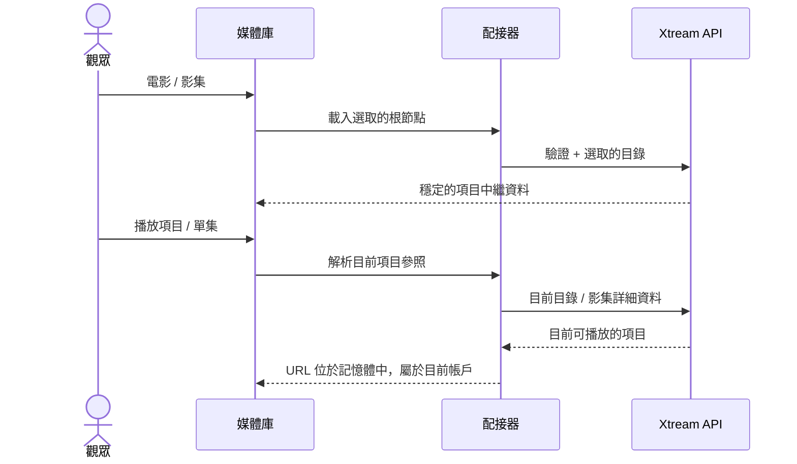

# Xtream 電影與影集

<!-- language-navigation:start -->

<a href="xtream-media.md" lang="en" dir="ltr">English</a> · <a href="xtream-media.ar.md" lang="ar" dir="rtl">العربية</a> · <a href="xtream-media.bn.md" lang="bn" dir="ltr">বাংলা</a> · <a href="xtream-media.cs.md" lang="cs" dir="ltr">Čeština</a> · <a href="xtream-media.de.md" lang="de" dir="ltr">Deutsch</a> · <a href="xtream-media.es.md" lang="es" dir="ltr">Español</a> · <a href="xtream-media.fa.md" lang="fa" dir="rtl">فارسی</a> · <a href="xtream-media.fr.md" lang="fr" dir="ltr">Français</a>
 
<a href="xtream-media.he.md" lang="he" dir="rtl">עברית</a> · <a href="xtream-media.hi.md" lang="hi" dir="ltr">हिन्दी</a> · <a href="xtream-media.id.md" lang="id" dir="ltr">Bahasa Indonesia</a> · <a href="xtream-media.it.md" lang="it" dir="ltr">Italiano</a> · <a href="xtream-media.ja.md" lang="ja" dir="ltr">日本語</a> · <a href="xtream-media.ko.md" lang="ko" dir="ltr">한국어</a> · <a href="xtream-media.nl.md" lang="nl" dir="ltr">Nederlands</a> · <a href="xtream-media.pl.md" lang="pl" dir="ltr">Polski</a>
 
<a href="xtream-media.pt.md" lang="pt" dir="ltr">Português</a> · <a href="xtream-media.ru.md" lang="ru" dir="ltr">Русский</a> · <a href="xtream-media.th.md" lang="th" dir="ltr">ไทย</a> · <a href="xtream-media.tr.md" lang="tr" dir="ltr">Türkçe</a> · <a href="xtream-media.uk.md" lang="uk" dir="ltr">Українська</a> · <a href="xtream-media.vi.md" lang="vi" dir="ltr">Tiếng Việt</a> · <a href="xtream-media.zh-Hans.md" lang="zh-Hans" dir="ltr">简体中文</a> · <a href="xtream-media.zh-Hant.md" lang="zh-Hant" dir="ltr">繁體中文</a>

<!-- language-navigation:end -->

[改進](roadmap-delivery.zh-Hant.md)

設定 Xtream 供應商並載入其直播目錄，然後開啟媒體庫。**Movies** 和 **Series** 是兩個按需載入的獨立根節點：開啟媒體庫不會同時下載兩個目錄。開啟影集時才會載入各集詳細資料。共用核心中現有的 Xtream 剖析器負責產生身分識別與串流 URL；傳統配接器只負責呈現及請求生命週期。

每次選取都會針對目前帳戶重新解析其穩定的請求。儲存的項目不包含已驗證的串流 URL。已刪除的項目無法從配接器之前解析過的列中還原。更換憑證／供應商或關閉所屬內容環境，會取消尚未完成的工作；過時回應無法填入下一個帳戶的畫面。供應商提供的名稱與圖片仍屬於供應商資料。

供應商必須允許用戶端請求（透過 CORS 或已設定的原生傳輸），裝置也必須支援傳回的媒體。這不是離線目錄、跨帳戶移轉、DRM 繞過方式或新的轉碼器。為維持目錄的即時性，選取時需要發出一次請求。錯誤透過現有的本地化媒體庫錯誤訊息回報；無法使用的結果不會開始播放。

執行 `node tests/test_xtream_media.cjs`，檢查按需根節點、編碼後的憑證、不含秘密資訊的已儲存請求、已刪除項目及來源取消；執行 `node tests/test_provider_drivers.cjs`，檢查實際的供應商生命週期。
